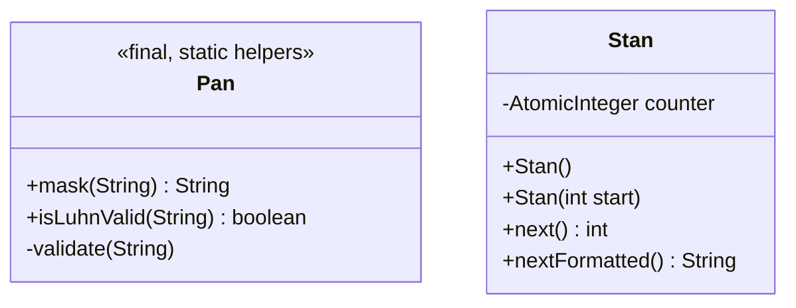

# Phase 1, step 0: card numbers (PAN), masking, Luhn, and trace numbers (STAN)

Two small classes in the `common` module. They look trivial, and they carry two of the most important rules in card payments: never leak a card number, and never confuse one transaction with another.

## 1. Where this sits

```
 Terminal ──> Acquirer ──> Switch ──> Issuer          services (Phases 2-6)
                 \            |          /
                  \           |         /      every service uses the libraries below
   +----------------------------------------------------------------+
   |  iso8583-link   sign-on, echo, keep-alive      (step 9)         |
   |  iso8583-core   spec, codecs, bitmap, packer   (steps 1-7)      |
   |  transport      TCP framing, Netty             (Phase 0, step 8)|
   |  common         Hex, Pan, Stan                                  |
   |     [*** step 0 ***]  Pan.java and Stan.java live here          |
   +----------------------------------------------------------------+
```

Who uses these two classes later:

| Later work | Uses | For what |
| --- | --- | --- |
| Phase 1 step 7 (message model, pretty-printer) | `Pan.mask` | The printer shows field 2 and field 35 masked, so a dumped message is safe to log. |
| Phase 1 step 9 (`iso8583-link`) | `Stan` | Every request gets a fresh field 11; the response is matched to the request by it. |
| Phase 2 (issuer) | `Pan`, `Stan` | Looks up cards by PAN, checks Luhn before touching the database, echoes field 11 in every response. |
| Phase 3 (switch, acquirer) | `Stan`, `Pan` | The acquirer generates STANs for the switch link; the switch generates its own for the issuer link, so one transaction carries a different STAN on each hop. Both mask PANs in logs. |
| Phase 4 (terminal simulator) | `Pan`, `Stan` | Generates Luhn-valid test card numbers and numbers its requests. |
| Phase 5 (clearing) | `Pan.mask` | Settlement files and reconciliation reports show masked PANs only. |
| Phases 6-7 (HSM, risk) | `Pan.mask` | Audit events and risk rules refer to cards by masked PAN or a token, never the clear number. |

## 2. The domain concept

### 2.1 What a PAN is

The Primary Account Number is the long number on the front of a card. It is defined by ISO/IEC 7812 and has three parts:

```
   4 1 1 1 1 1 1 1 1 1 1 1 1 1 1 1
   \_____/ \___________________/ ^
     IIN       account number    check digit (Luhn)
```

- **Issuer Identification Number (IIN), usually called the BIN** (Bank Identification Number). The leading digits identify who issued the card. The very first digit is the Major Industry Identifier: 4 is Visa, 5 (and 2, in newer ranges) is Mastercard, 3 includes American Express, and so on. A switch reads the BIN to decide where a transaction should go. This is called BIN routing and it is the core of the switch in Phase 3.
- **Individual account number.** Chosen by the issuer. It is not the bank account number; it identifies the card account at the issuer.
- **Check digit.** The last digit, computed from all the others with the Luhn algorithm (section 2.3).

A PAN is 12 to 19 digits long. Most credit and debit cards are 16. The code enforces 12-19 and nothing else.

**6-digit versus 8-digit BINs.** For decades the BIN was the first 6 digits. ISO/IEC 7812 was revised to make the IIN 8 digits, because the 6-digit space was running out as issuers, programs and products multiplied. The card brands moved to 8-digit BINs in a transition that completed around 2022. Two consequences:

- A BIN table keyed on 6 digits is no longer enough: two issuers can now share their first 6 digits. The BIN table in Phase 3 should look up the longest matching prefix.
- The classic masking rule was written when 6 was the BIN length. This project keeps the conventional "first 6, last 4".

### 2.2 The masking rule, and why logs are the classic leak

PCI DSS (the Payment Card Industry Data Security Standard) limits what may be shown when a PAN is displayed: at most the first six and the last four digits (current versions of the standard allow the first eight for longer PANs, matching the 8-digit BIN). A stored PAN must be rendered unreadable. Sensitive authentication data, meaning full track data, the card verification code and the PIN, must not be stored after authorization at all.

The rule exists because the middle digits plus expiry and name are enough to commit card-not-present fraud. A masked number such as `411111******1111` is still useful for support staff ("which card do you mean?") and for matching, but worth nothing to a thief.

**Where it goes wrong: logs.** Databases and files get encryption reviews. Logs do not, because nobody thinks of them as a data store. A typical scenario (an industry pattern, not a specific incident): a developer adds `log.debug("request: {}", message)` to diagnose a timeout. `message.toString()` prints every field. Months later a PCI assessment finds clear PANs, and sometimes track 2 data, in application logs, in a log aggregator, in backups of that aggregator, and in support tickets where someone pasted an excerpt. The clean-up is expensive: purge every copy, prove it, and in the meantime treat every system that held card data as "in scope" for the audit.

The defence has to be structural, not a code-review habit. This project uses three layers:

1. `Pan.mask` is the one way to show a PAN.
2. Exceptions from `Pan` never contain digits. A rejected input is described by its length or by the index of the bad character. This matters because exception messages go to logs automatically. If `mask("41111X1111111111")` said "invalid PAN 41111X1111111111", the leak would happen exactly when something goes wrong.
3. From step 2 on, `FieldValue.toString()` prints only a size, and codec errors name a field and an offset, never content.

### 2.3 Luhn: catches typos, not fraud

The Luhn algorithm (Hans Peter Luhn, IBM) adds a check digit so that the most common human errors are detectable by arithmetic:

1. Start from the right. Leave the check digit alone, then double every second digit going left.
2. If doubling gives more than 9, subtract 9.
3. Add everything. The PAN is valid if the sum is a multiple of 10.

It catches every single-digit error and most swaps of adjacent digits. It does not protect against anything deliberate: anyone can compute a valid check digit. Luhn says "this number was probably not mistyped", never "this card exists" or "this card is genuine". The uses are:

- **At the terminal or acquirer:** reject a mistyped manual entry before spending a network round trip.
- **At the issuer:** refuse obviously bad numbers before a database lookup.
- **In test data:** generate numbers that pass validation. `4111111111111111` is a widely used Visa test number: Luhn-valid, not a real account.

The issuer's real checks are whether the card exists, is active, has funds, and presents the right PIN or cryptogram. Luhn is only the first filter.

### 2.4 STAN: how a response finds its request

ISO 8583 runs over long-lived connections where many requests are in flight at once, and responses may return in a different order. A response must be paired with the request that caused it. Field 11, the **System Trace Audit Number (STAN)**, is the tag for that:

- It is 6 digits, assigned by the **sender** of each request. The responder copies it unchanged into the response (a 0110 echoes the 0100's field 11).
- It is meaningful only **per sender**. Two terminals can both send STAN 000123 at the same moment, and that is legal because they are not the same sender.
- It **wraps**. Six digits give under a million values; a busy sender uses them up within a day or much less, then starts again at 000001. So a STAN is never a globally unique ID. It only has to be unique among messages still in flight, and unambiguous when combined with other fields.

Because it is not unique on its own, real systems identify a transaction by a combination. A typical matching key:

| Field | Role in the key |
| --- | --- |
| 11 STAN | The sender's sequence number |
| 7 Transmission date and time | Separates today's 000123 from yesterday's |
| 32 Acquiring institution ID | Says whose counter this STAN came from |
| 41 Terminal ID (and 42 merchant ID) | Distinguishes terminals, when the STAN is kept per terminal |

The same combination appears in **reversals**. A 0400 reversal says "undo that earlier transaction", and field 90 (Original data elements) carries the original MTI, original STAN, original field 7 date/time, and the original acquiring and forwarding institution IDs. The issuer finds the original authorization by those, not by a database key, because the sender does not know the issuer's internal IDs. (That is why field 90 is 42 digits wide in the spec: 4 + 6 + 10 + 11 + 11.)

`Stan` counts 000001 to 999999 and never issues 000000 (some hosts treat all zeros as "not set"). It is lock-free (`AtomicInteger.getAndUpdate`) because one counter is shared by every connection thread of a service.

**A failure story (typical industry scenario).** A gateway generates STANs from an in-memory counter that starts at 1 when the process starts. The gateway restarts during the day. Requests sent before the restart may still be outstanding at a downstream host with a long timeout. After the restart the counter hands out 000001, 000002, ... again, so the same STAN, date and acquirer can appear twice within minutes. A late response to an old request arrives and is matched to a new request with the same STAN, and a customer is told "approved" for someone else's transaction. Remedies used in practice: seed the counter from a persisted value or from the time of day; include more fields in the match key; compare the amount (field 4) and terminal ID of the response with the stored request and treat a mismatch as an error. The simulator's matching in step 9 should do the last of these.

## 3. A concrete message, byte by byte

Step 0 handles two values inside a 0100 authorization request, not the whole message (field encoding comes in step 2, the bitmap in step 3). The output below comes from running the compiled classes in jshell.

| Field | Value in the 0100 | What step 0 does with it |
| --- | --- | --- |
| 2 PAN | `4111111111111111` | `Pan.mask` gives `411111******1111`; Luhn is valid |
| 11 STAN | `000123` | `Stan.nextFormatted()` yields values in this shape |

Masking and Luhn:

```
Pan.mask("4111111111111111")           -> 411111******1111
Pan.isLuhnValid("4111111111111111")    -> true
Pan.isLuhnValid("4111111111111112")    -> false      (last digit changed)
Pan.mask("41111X1111111111")           -> IllegalArgumentException:
                                          PAN contains a non-digit at index 5
```

The error names an index, not a character, and no digits of the input appear in it.

The Luhn sum for `4111111111111111`, reading from the right (the check digit is position 1 and is not doubled; even positions are doubled):

```
position   16  15 14 13 12 11 10  9  8  7  6  5  4  3  2  1
digit       4   1  1  1  1  1  1  1  1  1  1  1  1  1  1  1
doubled?   yes  -  yes -  yes - yes -  yes - yes -  yes - yes -
value       8   1  2  1  2  1  2  1  2  1  2  1  2  1  2  1

sum = 8 + (7 x 2) + (8 x 1) = 30      30 mod 10 = 0, so valid
```

Change the last digit to 2 and the sum becomes 31, which fails. That is all Luhn is.

STAN wrap-around, from a counter started at 999998 (four calls to `nextFormatted()`):

```
999998 999999 000001 000002
```

After 999999 the next value is 000001; 000000 is skipped.

How the STAN is laid out on the wire is the topic of step 2. As a preview, field 11 = `000123` in the simulator's ASCII dialect is six bytes (output of the step 2 code):

```
0000  30 30 30 31 32 33          000123
```

## 4. Design and flow



`Pan` has no state. `Stan` holds one atomic counter.

Decisions and reasons:

- **`Pan` takes a `String`, not a wrapper class.** At this stage the PAN is a validated string passing through. A wrapper type with a hiding `toString` would be a reasonable later upgrade, and step 2 already applies the idea with `FieldValue`. Static helpers are the smallest thing that works.
- **`validate` runs before both `mask` and `isLuhnValid`.** A mask function that accepted garbage could return the garbage unmasked. Validating first means the output is always a well-formed masked PAN.
- **Errors carry length and index, never digits.** See section 2.2.
- **`Stan.next()` uses `getAndUpdate`.** The read, the wrap decision and the write happen as one atomic step. A `synchronized` method would also be correct but makes every connection thread queue on a lock in the hot path.
- **`Stan(int start)` exists for tests.** A test can begin at 999998 and check the wrap without issuing a million values.
- **STANs are not persisted.** The restart scenario in section 2.4 is real. The simulator accepts the risk now; the linking layer (step 9) must be defensive about mismatched responses.
- **PANs are text, never numbers.** A PAN can start with zero, has no arithmetic meaning, and 19 digits overflow `int` and can exceed `long`. The same discipline applies to money, but for the opposite reason: money is a number, held as `long` minor units.

## 5. Try it yourself

On Windows, if Maven fails with PKIX or certificate errors, set this first (antivirus HTTPS scanning):

```bash
export MAVEN_OPTS="-Djavax.net.ssl.trustStoreType=Windows-ROOT"
```

Run the tests for these two classes:

```bash
./mvnw -q -pl common test -Dtest=PanTest,StanTest -Dsurefire.failIfNoSpecifiedTests=false
```

No output with `-q` means they passed. Build, then open jshell on the compiled classes:

```bash
./mvnw -q -pl common -am install -DskipTests
jshell --class-path "common/target/classes"
```

Paste:

```java
import dev.paysim.common.*;
Pan.mask("4111111111111111")
Pan.isLuhnValid("4111111111111111")
Pan.isLuhnValid("4111111111111112")
try { Pan.mask("41111X1111111111"); } catch (IllegalArgumentException e) { System.out.println(e.getMessage()); }
var stan = new Stan(999998);
stan.nextFormatted() + " " + stan.nextFormatted() + " " + stan.nextFormatted() + " " + stan.nextFormatted()
```

Quick experiments. Predict the result first, then run it:

1. Is `4111111111111121` Luhn-valid? What about `4111111111111112`? Using the table in section 3, work out which positions the changed digit falls in and why the answer differs.
2. Call `Pan.mask` on a 19-digit string, then a 12-digit string, then an 11-digit string. How many `*` characters in each, and what happens to the last one?
3. Call `next()` three times on `new Stan(999999)`, then three times on `new Stan(1)`. What does `new Stan(0)` do, and why is that the right behaviour?

## Key terms

- **PAN:** Primary Account Number, the card number, 12-19 digits.
- **IIN / BIN:** the leading digits that identify the issuer; 6 digits historically, 8 in the current standard.
- **Check digit / Luhn:** the last digit of a PAN, computed so the weighted digit sum passes a mod-10 test. Detects typos.
- **PCI DSS:** the industry security standard governing storage and display of card data.
- **Masking:** showing only the first 6 (or 8) and last 4 digits of a PAN.
- **Sensitive authentication data:** full track data, card verification code, PIN. Must not be stored after authorization.
- **STAN:** System Trace Audit Number, field 11, six digits, assigned by the sender per request and echoed in the response.
- **In flight:** a request that has been sent but has not yet received its response.
- **Reversal:** a 0400 message that undoes an earlier transaction, identifying it by original STAN, date/time and institution IDs (field 90).

## Next step

[Phase 1, step 1: message specs, why ISO 8583 is a framework and not a format](phase-1-step-1.md)
