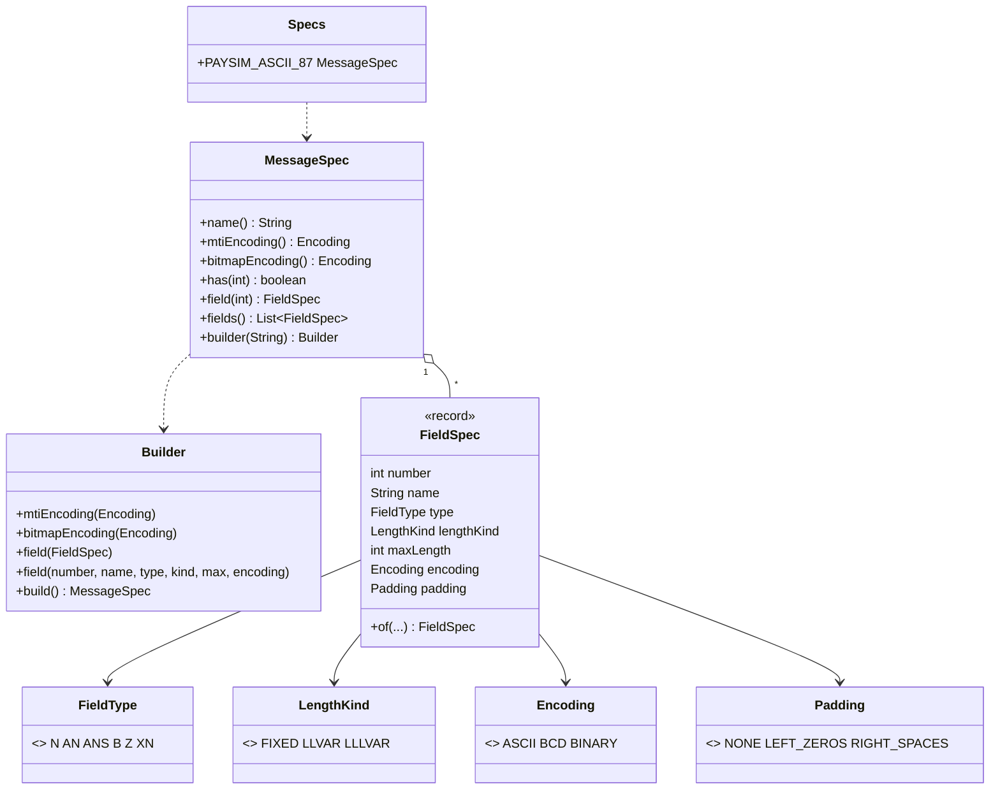

# Phase 1, step 1: message specs, why ISO 8583 is a framework and not a format

This step adds no code that touches bytes. It builds the vocabulary for describing a message format as data: what each field is called, which characters it may hold, how long it is, and how it is encoded. Every later step reads this description instead of hard-coding it.

## 1. Where this sits

```
 Terminal ──> Acquirer ──> Switch ──> Issuer          services (Phases 2-6)
                 \            |          /
                  \           |         /      every service uses the libraries below
   +----------------------------------------------------------------+
   |  iso8583-link   sign-on, echo, keep-alive      (step 9)         |
   |  iso8583-core   spec, codecs, bitmap, packer   (steps 1-7)      |
   |     [*** step 1 ***]  package dev.paysim.iso8583.spec           |
   |  transport      TCP framing, Netty             (Phase 0, step 8)|
   |  common         Hex, Pan, Stan                 (step 0)         |
   +----------------------------------------------------------------+
```

Who depends on the spec model:

| Later work | Uses | For what |
| --- | --- | --- |
| Phase 1 step 2 (field codecs) | `FieldSpec` | Each codec is driven by one spec: type, length kind, encoding, padding. |
| Phase 1 step 3 (bitmaps) | `MessageSpec` | Encoding of the bitmap, and which field numbers exist (1-128). |
| Phase 1 steps 4-5 (packer, unpacker) | `MessageSpec.fields()`, `field(n)` | Walks fields in number order, packs or unpacks each with its spec. |
| Phase 1 step 7 (message model, printer) | `MessageSpec` | Field names for the pretty-printer. |
| Phase 2 (issuer) | `Specs.PAYSIM_ASCII_87` | The issuer host speaks the default dialect. |
| Phase 3 (switch, acquirer) | `MessageSpec` (more than one) | The switch can speak one dialect to the acquirer side and another to the issuer side, with the same code. |
| Phase 4 (terminal simulator) | the spec | Builds messages that match the dialect of its acquirer. |
| Phase 5 (clearing) | the field list | Advice messages (0220 and similar) use the same field definitions. |
| Phase 6 (HSM) | field types B, 52 and 64 | PIN data and MAC fields are binary, which the spec marks explicitly. |
| Phase 7 (risk) | field names and types | Rules refer to fields by number and read typed values. |

## 2. The domain concept

### 2.1 ISO 8583 is a framework

People say "the ISO 8583 message" as if there were one. There is not. ISO 8583 (editions 1987, 1993 and 2003) defines:

- the idea of a message type indicator (MTI) followed by a bitmap and numbered data elements;
- a catalogue of data elements, numbered 1 to 128 (the 1993 and 2003 editions add more), each with a meaning, such as "field 4 is the transaction amount";
- the field types: how to describe what characters a field may hold.

It deliberately leaves open how those are laid out in bytes. Each network, processor or bank host publishes its own **interface specification** that fixes the open choices. Two systems that both say "we speak ISO 8583" will usually not understand each other until those choices match.

Choices that vary from one interface to another:

| Choice | Typical variants |
| --- | --- |
| Character set of text fields | ASCII, or EBCDIC on mainframe-hosted interfaces |
| Encoding of numeric fields | One ASCII character per digit, or BCD (two digits per byte) |
| MTI encoding | 4 ASCII characters, or 2 bytes of BCD |
| Bitmap encoding | 8 raw bytes, or 16 hex characters |
| Length prefix of variable fields | ASCII digits, BCD, or binary |
| Which fields are used at all | Different subsets; many networks give fields 48, 55, 60-63 and 120-127 private structure |
| What the private fields contain | Entirely network-defined, often with sub-fields |
| Length of a field with the same number | Field 41 might be 8 characters on one network and 16 on another |

The big card networks and processors each have their own dialect (Visa's authorization interface and Mastercard's are well known to differ in field usage and in how the private fields are structured), and many banks run host-specific variants. You will meet this the first day of a real integration: you receive an interface spec PDF and a test hex dump, and must make your software agree with them.

Worked example of "same field number, different encoding". Field 4 (amount, 12 digits) for 15.00:

```
ASCII dialect:  30 30 30 30 30 30 30 30 31 35 30 30    12 bytes, readable text
BCD dialect:    00 00 00 00 15 00                       6 bytes
```

Both are "field 4, 12 digits, value 000000001500". Both are correct for their network. Step 2 shows these two byte strings produced by the code.

### 2.2 How libraries cope: packagers

The most widely used open-source Java ISO 8583 library, jPOS, gives each field its own small class (a "field packager", with names such as `IFA_NUMERIC` for ASCII numbers, `IFB_LLNUM` for BCD numbers with a length prefix, `IFB_BINARY` for raw bytes), and collects them in a "packager" for the whole message. A packager is a message dialect expressed as objects, typically loaded from an XML file. Changing network means loading a different packager. The message-handling code does not change.

This project follows the same idea in a simpler form: a **spec** (a `MessageSpec` holding a `FieldSpec` per field) that the one packer reads. The spec is **data**, so adding a network means writing another spec, not editing the packer. In Phase 3 this will matter directly: the switch sits between two parties and may speak a different dialect to each.

### 2.3 Field types, with real fields

The type says which characters are allowed. A receiver uses it to reject a corrupt field before business logic sees it.

| Type | Meaning | Allowed characters | Example field |
| --- | --- | --- | --- |
| `n` | Numeric | digits 0-9 | 4 Amount, 11 STAN, 49 Currency code |
| `an` | Alphanumeric | letters and digits | 37 Retrieval reference number, 39 Response code |
| `ans` | Alphanumeric and special | any printable character | 41 Terminal ID, 43 Name/location |
| `b` | Binary | any byte | 52 PIN data, 64 MAC |
| `z` | Track data | digits, `=` separator, `D` | 35 Track 2 |
| `x+n` | Signed amount | `C` or `D`, then digits | 28 Transaction fee |

Details that trip people up:

- Field 39, the response code, is `an`: `00` is approved, `51` is insufficient funds, `05` is do not honour. It is not a number, because networks also use letters.
- Field 52 is binary, 8 bytes: the encrypted PIN block. It is not text and must never be treated as such; the HSM (Phase 6) is the only party that can open it.
- Field 35 is track 2: the data from the magnetic stripe (or its chip equivalent), `PAN=YYMM` then service code and discretionary data. It contains the full PAN and is sensitive authentication data.
- In `x+n`, the `C` or `D` means credit or debit. Field 28 is `x+n 8`: a sign plus 8 digits, which is 9 characters. The spec model counts the sign, so the max length is 9.

### 2.4 Fixed, LLVAR, LLLVAR

Some fields always have the same length (field 3 is exactly 6 digits); others vary (a PAN is 12-19 digits). A variable field travels with a **length prefix**:

| Kind | Prefix | Max length | Example |
| --- | --- | --- | --- |
| Fixed | none; the length is in the spec | the spec length | 3 Processing code, n 6 |
| LLVAR | two digits | 99 | 2 PAN, 35 Track 2, 32 Acquirer ID |
| LLLVAR | three digits | 999 | 54 Additional amounts, 55 EMV chip data |

The prefix says how long the data that follows is. A PAN of 16 digits in ASCII LLVAR is `16` followed by the 16 digits, 18 bytes in all.

## 3. A concrete message, byte by byte

There are no bytes yet, so the concrete object this step produces is the default spec for the 0100 authorization request. The 0100 uses these fields (from the spec as built, in field-number order). The output comes from `Specs.PAYSIM_ASCII_87`:

| # | Name | Type | Length | Value in our 0100 |
| --- | --- | --- | --- | --- |
| 2 | Primary account number | n | LLVAR, max 19 | `4111111111111111` |
| 3 | Processing code | n | fixed 6 | `000000` (purchase, default accounts) |
| 4 | Amount, transaction | n | fixed 12 | `000000001500` (15.00) |
| 7 | Transmission date and time | n | fixed 10 | `1031143015` (MMDDhhmmss, 31 Oct 14:30:15) |
| 11 | System trace audit number | n | fixed 6 | `000123` |
| 22 | POS entry mode | n | fixed 3 | `051` (chip read, PIN-capable) |
| 35 | Track 2 data | z | LLVAR, max 37 | `4111111111111111=2512101` |
| 41 | Card acceptor terminal ID | ans | fixed 8 | `TERM0001` |
| 49 | Currency code, transaction | n | fixed 3 | `840` (USD) |
| 52 | PIN data | b | fixed 8 bytes | `0123456789ABCDEF` |

A few readings of those values: `000000` in field 3 is "purchase, from the default account"; the track 2 value decodes as PAN `4111111111111111`, expiry `2512` (December 2025), service code `101`, then no discretionary data. Field 7 is in GMT by convention.

What the code says about three of them (real `toString` output of the records, spacing adjusted for reading):

```
FieldSpec[number=2,  name=Primary account number, type=N,   lengthKind=LLVAR, maxLength=19, encoding=ASCII, padding=NONE]
FieldSpec[number=4,  name=Amount, transaction,    type=N,   lengthKind=FIXED, maxLength=12, encoding=ASCII, padding=LEFT_ZEROS]
FieldSpec[number=41, name=Card acceptor terminal ID, type=ANS, lengthKind=FIXED, maxLength=8, encoding=ASCII, padding=RIGHT_SPACES]
FieldSpec[number=52, name=PIN data,               type=B,   lengthKind=FIXED, maxLength=8, encoding=ASCII, padding=NONE]
```

Reading those lines:

- Field 4 is padded with zeros on the **left**, the convention for numbers. `1500` becomes `000000001500`.
- Field 41 is padded with spaces on the **right**, the convention for names. `T1` becomes `T1      `.
- Field 52 has `maxLength=8` and `encoding=ASCII`. For binary fields `maxLength` counts **bytes**, so 8 is the 64-bit PIN block. `ASCII` here means "send the bytes as hex text", which makes the field 16 bytes on the wire (step 2 shows it). `BINARY` would send the 8 raw bytes.
- The spec as a whole: `paysim-ascii-87 (31 fields)`, ASCII MTI, ASCII (hex text) bitmap.

## 4. Design and flow



Key classes:

- `FieldType`: the six character sets, and `isValid(String)` to check a value against one.
- `LengthKind`: `FIXED`, `LLVAR`, `LLLVAR`, with the prefix width (0, 2, 3) and the largest length that the prefix can express (99 or 999).
- `Encoding`: `ASCII`, `BCD`, `BINARY`: how a value is turned into bytes.
- `Padding`: `NONE`, `LEFT_ZEROS`, `RIGHT_SPACES`: how a short fixed value is filled out.
- `FieldSpec`: a record that describes one field, and checks itself when created.
- `MessageSpec`: the whole dialect: MTI encoding, bitmap encoding and the fields. Built with a builder, then immutable.
- `Specs`: ready-made dialects; currently `PAYSIM_ASCII_87`.

Decisions and reasons:

- **The spec is Java code, not YAML.** The project owner chose this, recorded in the progress notes. The reasons that hold up: the compiler checks it, `-Werror` and tests run on it, there is no parser to write or to get wrong, and the IDE can navigate to a field. The cost is that changing a dialect means a recompile, which is acceptable for a simulator. The spec is still *data* in the sense that matters: the packer only reads it, and nothing in the packer knows a field number.
- **`FieldSpec` validates itself in its constructor.** An invalid spec cannot exist. The rules, with the real messages:
  - field numbers are 2 to 128; `field 1 must be in 2..128 (field 1 is the secondary bitmap)`;
  - `field 2: maxLength 100 exceeds the LLVAR limit of 99` (a two-digit prefix cannot say 100);
  - `field 2: BCD encoding is only valid for type N or Z, not AN` (letters have no BCD form);
  - BINARY only for type B; padding only for fixed fields, and never for type B.
  A bad dialect is caught at start-up, where the author is looking, not when a rare field first arrives in production.
- **`MessageSpec` rejects duplicates and unknown lookups.** `field 3 is defined twice in spec x`, `field 5 is not defined in spec paysim-ascii-87`. Both are programmer errors and are reported as such.
- **Length means characters for text and bytes for type B.** For `n`, `an`, `ans`, `z` a length of 12 is twelve characters or digits. For `b` it is the number of bytes, because the binary content is what the field defines (a PIN block is 8 bytes) no matter whether it later travels as 8 raw bytes or 16 hex characters. Counting characters for B would make the same field "8" in one dialect and "16" in another.
- **XN counts the sign.** `x+n 8` is 9 characters, so `maxLength` is 9.
- **`FieldSpec.of(...)` picks the conventional padding.** Fixed numeric fields get left zeros, fixed text fields get right spaces, everything else none. Writing the 31 fields would otherwise need a padding argument on each, and getting it wrong on one would be easy. `of` for field 4 gives `LEFT_ZEROS`, for 41 `RIGHT_SPACES`, for the LLVAR field 2 `NONE`.
- **`MessageSpec` is immutable and sorted.** Fields are stored in an array indexed by number and exposed as an unmodifiable list in field order, which is exactly the order a packer needs and the bitmap uses.
- **Bitmap and MTI encodings belong to the spec, not the field.** They are properties of the dialect as a whole. Allowed values are checked: MTI is ASCII or BCD; the bitmap is ASCII (hex text) or BINARY.
- **31 fields, not 128.** `PAYSIM_ASCII_87` covers the data elements card flows in this project use. Add more when a flow needs them.

## 5. Try it yourself

On Windows, if Maven fails with PKIX or certificate errors:

```bash
export MAVEN_OPTS="-Djavax.net.ssl.trustStoreType=Windows-ROOT"
```

Run the tests of the spec package:

```bash
./mvnw -q -pl iso8583-core -am test -Dtest='FieldSpecTest,FieldTypeTest,LengthKindTest,MessageSpecTest,SpecsTest' -Dsurefire.failIfNoSpecifiedTests=false
```

Build, then jshell on the compiled classes (`;` is the Windows class path separator; use `:` elsewhere):

```bash
./mvnw -q -pl iso8583-core -am install -DskipTests
jshell --class-path "common/target/classes;iso8583-core/target/classes"
```

Paste:

```java
import dev.paysim.iso8583.spec.*;
var spec = Specs.PAYSIM_ASCII_87;
spec.toString()
spec.field(4)
spec.field(41)
spec.has(5)
FieldType.N.isValid("0123")
FieldType.N.isValid("12A")
FieldType.Z.isValid("4111=2512D1")
FieldType.XN.isValid("C00000100")
FieldType.XN.isValid("100")
try { spec.field(5); } catch (IllegalArgumentException e) { System.out.println(e.getMessage()); }
try { new FieldSpec(2, "PAN", FieldType.N, LengthKind.LLVAR, 100, Encoding.ASCII, Padding.NONE); } catch (IllegalArgumentException e) { System.out.println(e.getMessage()); }
var mine = MessageSpec.builder("my-dialect").field(3, "Processing code", FieldType.N, LengthKind.FIXED, 6, Encoding.BCD).build();
mine.field(3)
```

Quick experiments. Predict the result first, then run it:

1. Change `Encoding.BCD` in the last line to `Encoding.BINARY`. What does the constructor say, and which rule produced it?
2. Build a spec with field 41 as `FieldType.ANS`, `LengthKind.FIXED`, 8, `Encoding.ASCII` through `FieldSpec.of`, then through the full constructor with `Padding.LEFT_ZEROS`. What padding does each get, and is the second one accepted?
3. Try `FieldType.XN.isValid("C0")`, `FieldType.XN.isValid("C")` and `FieldType.AN.isValid("ab 1")`. Which are true, and which rule decides each?

## Key terms

- **MTI:** Message Type Indicator, the four digits at the start of a message (0100 authorization request, 0110 response).
- **Data element / field:** one numbered item in a message (field 4 is the amount).
- **Interface specification:** the document in which a network or host fixes its ISO 8583 choices: encodings, lengths, which fields, what the private fields contain.
- **Dialect / spec:** this project's data description of such an interface.
- **Packager:** jPOS's name for a dialect expressed as objects.
- **n, an, ans, b, z, x+n:** field types; numeric, alphanumeric, alphanumeric with specials, binary, track data, signed amount.
- **LLVAR / LLLVAR:** variable-length fields with a two-digit or three-digit length prefix.
- **BCD:** binary-coded decimal, two decimal digits per byte.
- **Padding:** the fill used when a fixed-length value is shorter than the field (zeros on the left for numbers, spaces on the right for text).

## Next step

[Phase 1, step 2: field encodings, ASCII, BCD, binary and length prefixes](phase-1-step-2.md)
