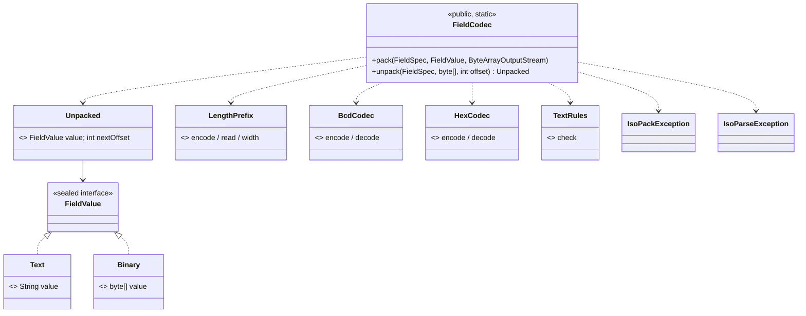
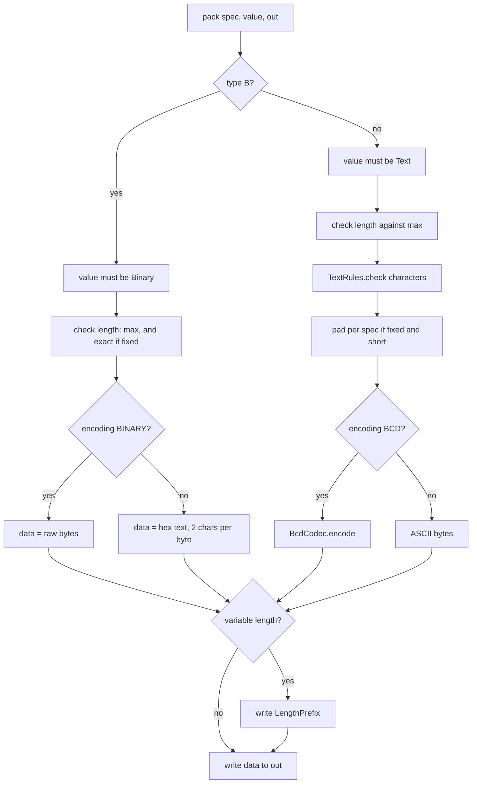
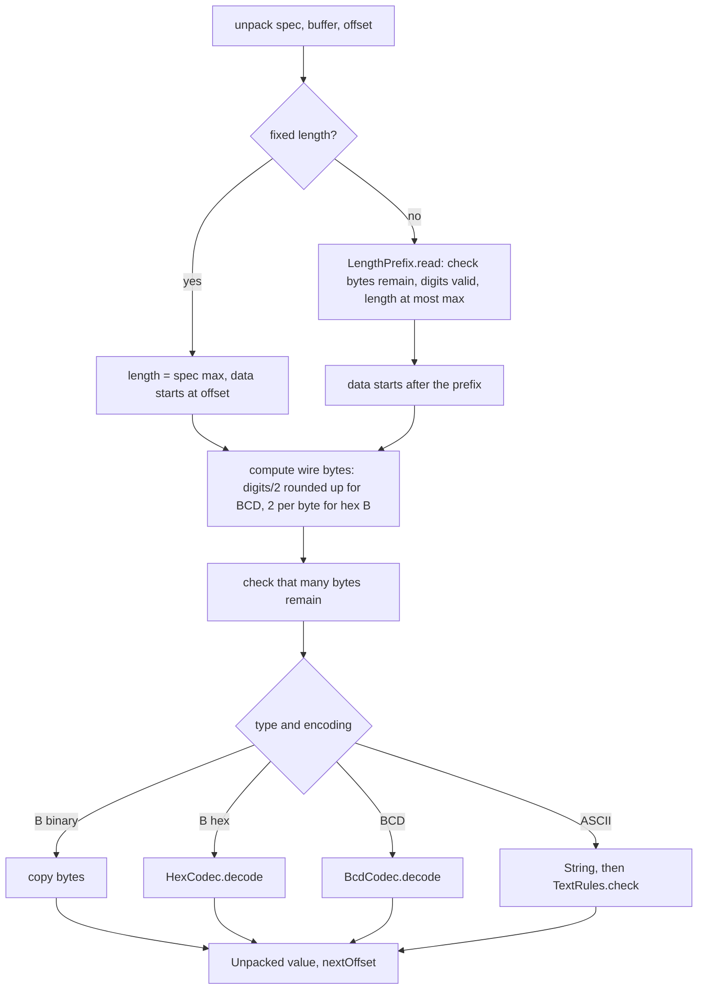

# Phase 1, step 2: field encodings (ASCII, BCD, binary) and length prefixes

Step 1 described a field: type, length, encoding. This step turns one field value into bytes and back. It is the first code in the project that produces ISO 8583 wire bytes.

## 1. Where this sits

```
 Terminal ──> Acquirer ──> Switch ──> Issuer          services (Phases 2-6)
                 \            |          /
                  \           |         /      every service uses the libraries below
   +----------------------------------------------------------------+
   |  iso8583-link   sign-on, echo, keep-alive      (step 9)         |
   |  iso8583-core   spec, codecs, bitmap, packer   (steps 1-7)      |
   |     step 1: spec model                                          |
   |     [*** step 2 ***]  package dev.paysim.iso8583.codec          |
   |  transport      TCP framing, Netty             (Phase 0, step 8)|
   |  common         Hex, Pan, Stan                 (step 0)         |
   +----------------------------------------------------------------+
```

Who builds on the field codecs:

| Later work | Uses | For what |
| --- | --- | --- |
| Phase 1 step 3 (bitmaps) | `Encoding`, the same conventions | The bitmap is another thing that is ASCII hex or raw bytes, chosen by the spec. |
| Phase 1 steps 4-5 (packer, unpacker) | `FieldCodec.pack`, `FieldCodec.unpack` | The packer calls `pack` for each present field in order, appending to one buffer. The unpacker calls `unpack` with the running offset, using `Unpacked.nextOffset()` to find the next field. |
| Phase 1 step 6 (errors, validation) | `IsoParseException`, `IsoPackException` | Field number and offset in every failure. |
| Phase 1 step 7 (message model) | `FieldValue` | Messages hold `FieldValue`s. |
| Phase 2 (issuer) | via the packer | Reads field 2, 4, 11 and others as text; reads field 52 as bytes and hands it to the HSM. |
| Phase 3 (switch) | via the packer | Reads a request in one dialect, writes it in another. This only works because values are kept apart from their encoding. |
| Phase 6 (HSM) | `FieldValue.Binary` | PIN block and MAC are binary values, never text. |

## 2. The domain concept

### 2.1 Why encodings differ

The digits `4111` can be sent as four bytes or as two:

```
ASCII:  34 31 31 31      four bytes, one per character; readable in any hex dump
BCD:    41 11            two bytes, one decimal digit per half-byte ("nibble")
```

Why do both exist? ISO 8583 is old. Early payment links ran at hundreds or a few thousand bits per second over leased lines, and every byte cost money. Packing two digits per byte halves the size of every numeric field. Mainframe hosts of that era also preferred packed decimal. Many such links are still running. Newer links and modern processors often choose ASCII because it is easy to read in traces and easy to debug, and bandwidth no longer matters. The result is that a payment system has to speak both, and which is which is a line in the interface specification.

Three encodings cover the cases here:

| Encoding | Used for | One byte holds |
| --- | --- | --- |
| ASCII | Text, readable | one character |
| BCD (binary-coded decimal) | Numeric fields, track 2, length prefixes | two decimal digits |
| Binary | Keys, PIN blocks, MACs, EMV chip data | any byte value |

Binary is the only honest representation of data that is not text. A PIN block is 8 bytes of ciphertext. Any of the 256 byte values can occur, including bytes that are not printable characters, so it must never pass through anything that assumes text. Some dialects nevertheless send binary fields as hex text (two ASCII characters per byte) so that the whole message is printable; this project's `PAYSIM_ASCII_87` does that. For type B fields, the `Encoding.ASCII` option means exactly this hex text.

EBCDIC, the mainframe character set, is also found on real links. This project does not implement it.

### 2.2 BCD in detail

BCD stores each digit 0-9 in four bits. The decimal string `1500` becomes the bytes `15 00`: the hex digits read like the decimal digits. That is the practical appeal: hex dump of a BCD field is the number.

Two details matter:

- **Odd digit counts.** A byte holds two digits, so an odd count leaves a spare nibble. For ordinary numeric fields this project puts a zero nibble on the **left**: the 15 digits `411111111111111` become `04 11 11 11 11 11 11 11`. For track 2 (below) the spare nibble goes on the right and holds `F`. Real interfaces differ on this (left or right, zero or `F`), which is one more reason the choice must be written in the spec.
- **Length counts digits, not bytes.** In a BCD LLVAR field, the prefix gives the number of digits. A 16-digit PAN has prefix `16`, not `08`, even though the data takes 8 bytes. A receiver that read the prefix as a byte count would be wrong.

### 2.3 Track 2 in BCD: the `D` separator and the `F` pad

Track 2 is the data on the magnetic stripe: the PAN, a separator, expiry (YYMM), a three-digit service code, then issuer discretionary data. On the stripe and in the ISO field the separator is shown as `=`, but `=` has no digit value. In BCD form it is the hex nibble `D`, which is why track 2 text is often written with `D` instead of `=`:

```
text:   4111111111111111=2512101
BCD:    41 11 11 11 11 11 11 11  D2 51 21 01
                                 ^ the D nibble is the separator
```

If the total count is odd, the last byte's spare nibble is padded with `F`, a value that can never be a digit or the separator, so a reader can tell padding from data. The track 2 field carries sentinel characters (start `;` and end `?`) on the physical card but not in the ISO field.

Three things are unusual about this, and each has a consequence in the code:

1. `=` and `D` both encode to nibble `D`. Decoding therefore always yields `=`: the codec cannot know which one you started with. A `D` in the input does not survive a round trip. The Javadoc of `BcdCodec` states this.
2. The pad nibble is `F`, and the decoder insists on it. A missing `F` is an error, because it signals a wrong length.
3. Track 2 is sensitive authentication data. Its content must never appear in logs or error messages.

### 2.4 Padding, and why it is kept when unpacking

A fixed field has an exact length. If a caller supplies a shorter value, the packer fills it out per the spec: numbers get zeros on the left (`1500` becomes `000000001500`), text gets spaces on the right (`T1` becomes `T1      `).

On unpack the padding is **kept**. The codec returns `000123` for field 11 and `T1      ` for field 41. It does not strip them. Reasons:

- What was on the wire is what you get back. When you compare a trace to a log, they agree. A codec that silently trimmed would hide the very differences you are hunting for.
- Whether the spaces are meaningful is a business question, not an encoding question. Some hosts want them preserved when echoing a field back (a response often must return field 41 exactly as received).
- The rule is simple: `unpack(pack(x))` is `x` after padding, never something different.

Stripping, if wanted, is the job of the message model's typed accessors, which come later.

### 2.5 Why error offsets are absolute

When a message from a real counterparty fails to parse in production, you do not have a debugger. You have a hex dump of the frame from a log or a packet capture, and an error message. The most useful message says which field failed and where in that dump. So:

```
field 2 at offset 26: non-digit at index 4 for type N
```

means "go to byte 26 of the frame". The offset is absolute within the buffer passed to `unpack`, not relative to the field. In section 3 you can see 26 come from 20 bytes before the field, a 2-byte prefix, and 4 bytes of data.

When a read runs off the end of the buffer, the error reports the offset where that read started.

### 2.6 Why errors and `toString` never show values

Exceptions and `toString` end up in logs. A field value may be a PAN (field 2), track data (35 or 45), a PIN block (52) or a MAC (64). So:

- `IsoParseException` and `IsoPackException` contain the field number, an offset or length, an index and a reason. Never a character from the data.
- `FieldValue.Text.toString()` prints `Text[16 chars]`; `Binary.toString()` prints `Binary[8 bytes]`.

The cost is that you cannot see the bad value from the exception alone. The offset lets you find it in the trace, which is held to a stricter standard (access-controlled, short retention, or masked).

A typical failure scenario: a service logs `Failed to parse request: field 2 value=4111111111111111` at ERROR level. Error logs are shipped, indexed and retained for a long time, often to a third-party platform, precisely because they matter. A malformed message from one terminal now spreads a full card number across every system that handles error logs, none of which was designed for card data. The rule is to design failure paths with the same care as success paths.

## 3. A concrete message, byte by byte

There is no full-message packer or bitmap yet; those arrive in steps 3 to 5. So this section shows the fields of the 0100 authorization request **one at a time**, each packed on its own. In a finished message these byte strings are concatenated after the MTI and bitmap, in field-number order.

Every dump below was produced by running `FieldCodec.pack` against the compiled classes and printing the result with `dev.paysim.common.Hex.dump`. The first dump uses the default dialect `Specs.PAYSIM_ASCII_87`.

### 3.1 ASCII dialect (`PAYSIM_ASCII_87`)

**Field 2, PAN `4111111111111111`: LLVAR, 18 bytes.**

```
0000  31 36 34 31 31 31 31 31  31 31 31 31 31 31 31 31   1641111111111111
0010  31 31                                              11
```

Bytes 0-1: `31 36` is the length prefix `16` as two ASCII digits. Bytes 2-17: the 16 digits, one byte each.

**Field 3, processing code `000000`: fixed, 6 bytes.** `30 30 30 30 30 30`. No prefix; the spec says 6.

**Field 4, amount `000000001500` (15.00): fixed, 12 bytes.**

```
0000  30 30 30 30 30 30 30 30  31 35 30 30              000000001500
```

If the caller passes just `1500`, the packer left-pads with zeros and produces the identical 12 bytes (checked by running it). Eight bytes of padding `30`, then `31 35 30 30` is "1500".

**Field 7, transmission date and time `1031143015` (MMDDhhmmss): fixed, 10 bytes.** `31 30 33 31 31 34 33 30 31 35`.

**Field 11, STAN `000123`: fixed, 6 bytes.** `30 30 30 31 32 33`.

**Field 22, POS entry mode `051`: fixed, 3 bytes.** `30 35 31`.

**Field 35, track 2 `4111111111111111=2512101`: LLVAR, 26 bytes.**

```
0000  32 34 34 31 31 31 31 31  31 31 31 31 31 31 31 31   2441111111111111
0010  31 31 3D 32 35 31 32 31  30 31                      11=2512101
```

`32 34` is the prefix `24` (24 characters follow). Then the 16 PAN digits, `3D` (the `=` separator, byte 18), and `2512101`. In ASCII the separator stays `=`.

**Field 41, terminal ID `TERM0001`: fixed, 8 bytes.** `54 45 52 4D 30 30 30 31`. With a shorter value, `T1`, the output is `54 31 20 20 20 20 20 20`: the two characters followed by six spaces (`20`), the right padding.

**Field 49, currency `840`: fixed, 3 bytes.** `38 34 30`.

**Field 52, PIN data, 8 bytes `01 23 45 67 89 AB CD EF`: fixed, 16 bytes.**

```
0000  30 31 32 33 34 35 36 37  38 39 41 42 43 44 45 46   0123456789ABCDEF
```

The 8 binary bytes are written as 16 uppercase hex characters. This is why the field is twice as long on the wire as in the spec (`maxLength=8` counts bytes).

### 3.2 ASCII against BCD, side by side

To see the difference, here are fields 2, 4, 35 and 52 packed with a second dialect built in code: numeric and track 2 fields as BCD, field 52 as raw binary:

```java
var bcd = MessageSpec.builder("paysim-bcd")
    .mtiEncoding(Encoding.BCD).bitmapEncoding(Encoding.BINARY)
    .field(2,  "PAN",      FieldType.N, LengthKind.LLVAR, 19, Encoding.BCD)
    .field(4,  "Amount",   FieldType.N, LengthKind.FIXED, 12, Encoding.BCD)
    .field(35, "Track 2",  FieldType.Z, LengthKind.LLVAR, 37, Encoding.BCD)
    .field(52, "PIN data", FieldType.B, LengthKind.FIXED, 8,  Encoding.BINARY)
    .build();
```

**Field 2, `4111111111111111`: 9 bytes (ASCII: 18).**

```
0000  16 41 11 11 11 11 11 11  11
```

`16` is one prefix byte: BCD, and the count is 16 digits. Then 8 data bytes; the hex reads as the digits.

**Field 2, a 15-digit PAN `411111111111111`: 9 bytes.**

```
0000  15 04 11 11 11 11 11 11  11
```

Prefix `15` (digits, not bytes). The data begins `04`: the extra zero nibble is on the left, and the 15 digits follow. The same 9 bytes as before, because 15 and 16 digits both need 8 bytes.

**Field 4, `000000001500`: 6 bytes (ASCII: 12).**

```
0000  00 00 00 00 15 00
```

**Field 35, track 2 `4111111111111111=2512101`: 13 bytes (ASCII: 26).**

```
0000  24 41 11 11 11 11 11 11  11 D2 51 21 01
```

`24` is the prefix (24 digits, counting the separator as one). `41 11 ... 11` is the PAN. `D2` is the separator nibble `D` followed by the first digit of the expiry; then `51 21 01`: `51`, `21`, `01` carry the rest of `2512101`.

**Field 35 with an odd count, `4111111111111111=251210` (23 characters): 13 bytes.**

```
0000  23 41 11 11 11 11 11 11  11 D2 51 21 0F
```

Prefix `23`. The last byte is `0F`: the final digit `0`, then the `F` pad nibble.

**Field 52 as raw binary, 8 bytes: 8 bytes (ASCII dialect: 16).**

```
0000  01 23 45 67 89 AB CD EF
```

Summary:

| Field | ASCII dialect | BCD / binary dialect |
| --- | --- | --- |
| 2 PAN (16 digits) | 18 bytes | 9 bytes |
| 4 Amount | 12 bytes | 6 bytes |
| 35 Track 2 (24 chars) | 26 bytes | 13 bytes |
| 52 PIN data | 16 bytes | 8 bytes |
| Total | 72 bytes | 36 bytes |

Same values, half the size. And a trace of the BCD dialect is a stream of bytes that make no sense as text, which is why people find it harder to read.

### 3.3 Reading bytes back, including padding

Unpacking `4111111111111111D2512101` that was packed as BCD track 2:

```
Unpacked[value=Text[24 chars], nextOffset=13]
value as text: 4111111111111111=2512101     (the D came back as =)
```

`nextOffset=13` is the offset of the byte after the field. A message unpacker starts the next field there.

Field 11 packed from `123` and unpacked: value `000123`, `nextOffset=6`. The padding stays.

### 3.4 A real error message

Take the bytes of field 2 with a bad character at the fifth digit: `16` followed by `4111X11111111111`. Suppose they begin at offset 20 of a frame (the 4-byte MTI plus a 16-hex-character primary bitmap in this dialect take exactly 20 bytes). Unpacking fails with:

```
field 2 at offset 26: non-digit at index 4 for type N
```

Check: 20 (where the field starts) + 2 (length prefix) + 4 (index within the data) = 26. The exception also exposes `field()` = 2 and `offset()` = 26. The message contains no digit of the PAN: it names the position and the rule, not the character.

Other real messages from the same code:

```
field 2 at offset 2: needs 16 bytes, only 3 left     (truncated buffer: prefix says 16)
field 2 at offset 0: length 25 exceeds max 19        (bad length prefix in a BCD field)
field 2 at offset 3: invalid BCD nibble at index 4 for type N
field 52 at offset 15: invalid hex digit at index 15
field 2: non-digit at index 4 for type N             (pack side: no offset, there is no buffer yet)
field 4: length 13 exceeds max 12
field 52: length 7 does not match fixed length 8
```

## 4. Design and flow

Class overview:



Pack, for one field:



Nothing is written to `out` until every check has passed, so the last step is the only side effect.

Unpack, for one field:



Key classes:

- `FieldValue`: a sealed interface with two cases, `Text` and `Binary`.
- `FieldCodec`: the only public entry point: `pack` and `unpack`.
- `Unpacked`: a value plus the absolute offset of the next byte.
- `LengthPrefix`: encodes and decodes the LLVAR/LLLVAR prefix (ASCII digits, or BCD).
- `BcdCodec`: packed decimal for types N and Z, including the track 2 separator and pad rules.
- `HexCodec`: type B as hex text.
- `TextRules`: the character check, shared by pack and unpack.
- `IsoPackException`, `IsoParseException`: the two failure types. Pack has no offset; parse always does.

Decisions and reasons:

- **`FieldValue` is sealed: `Text` or `Binary`.** Text types and binary are different things and the compiler can force handling both with a `switch`. Passing text to a type B field fails with `type B requires a Binary value, got Text`, so confusion is caught at the boundary.
- **`Binary` copies its array on the way in and out.** The record would otherwise hand out a mutable array that anyone could change, including a PIN block that has been logged or hashed. `equals` and `hashCode` use contents.
- **Values print as sizes only.** See section 2.6.
- **Length of a type B field is in bytes, whatever the encoding.** The LLVAR prefix of field 55 counts the chip data bytes, not the hex characters.
- **Pack is atomic.** All checks run before the first write to the output stream. A failed pack leaves the stream untouched, so a packer that catches the error can carry on without a half-written message.
- **Pack and unpack share `TextRules`.** The same function judges the characters in both directions, so the code never packs something that it would refuse to read back.
- **One exception to padding: XN.** `x+n` must be supplied whole, sign included (`C00000100`). Zero-padding on the left would push the sign out of the first position.
- **Space padding on a BCD field is rejected.** A space has no BCD form, so the combination fails clearly (`space padding cannot be encoded in BCD`) rather than writing garbage.
- **Right-spaces are exempt from the AN character check.** A fixed AN field padded with spaces would otherwise fail validation on its own padding when read back.
- **Errors say where, never what.** See sections 2.5 and 2.6.
- **The codecs are static and stateless.** No instances, no shared state; they can be called from any thread.
- **Only `FieldCodec`, `Unpacked` and the exceptions are public.** The helpers are package-private, so later steps can only go through the one entry point.

## 5. Try it yourself

On Windows, if Maven fails with PKIX or certificate errors:

```bash
export MAVEN_OPTS="-Djavax.net.ssl.trustStoreType=Windows-ROOT"
```

Run one test class (BCD) or all codec tests:

```bash
./mvnw -q -pl iso8583-core -am test -Dtest=BcdFieldCodecTest -Dsurefire.failIfNoSpecifiedTests=false
./mvnw -q -pl iso8583-core -am test -Dtest='*FieldCodec*Test' -Dsurefire.failIfNoSpecifiedTests=false
```

Build, then open jshell on the compiled classes (`;` is the Windows class path separator; use `:` elsewhere):

```bash
./mvnw -q -pl iso8583-core -am install -DskipTests
jshell --class-path "common/target/classes;iso8583-core/target/classes"
```

Paste this session (it was run as written):

```java
import dev.paysim.common.*;
import dev.paysim.iso8583.*;
import dev.paysim.iso8583.spec.*;
import dev.paysim.iso8583.codec.*;
import java.io.ByteArrayOutputStream;

byte[] pack(FieldSpec s, FieldValue v) { var o = new ByteArrayOutputStream(); FieldCodec.pack(s, v, o); return o.toByteArray(); }
void show(MessageSpec m, int f, FieldValue v) { var b = pack(m.field(f), v); System.out.println("F" + f + " " + m.field(f).name() + "  (" + b.length + " bytes)"); System.out.print(Hex.dump(b)); }

var A = Specs.PAYSIM_ASCII_87;
show(A, 2, FieldValue.text("4111111111111111"));
show(A, 4, FieldValue.text("1500"));
show(A, 11, FieldValue.text("000123"));
show(A, 35, FieldValue.text("4111111111111111=2512101"));
show(A, 41, FieldValue.text("T1"));
show(A, 52, FieldValue.binary(Hex.decode("0123456789ABCDEF")));

var B = MessageSpec.builder("paysim-bcd").mtiEncoding(Encoding.BCD).bitmapEncoding(Encoding.BINARY).field(2, "PAN", FieldType.N, LengthKind.LLVAR, 19, Encoding.BCD).field(4, "Amount", FieldType.N, LengthKind.FIXED, 12, Encoding.BCD).field(35, "Track 2", FieldType.Z, LengthKind.LLVAR, 37, Encoding.BCD).field(52, "PIN data", FieldType.B, LengthKind.FIXED, 8, Encoding.BINARY).build();
show(B, 2, FieldValue.text("4111111111111111"));
show(B, 4, FieldValue.text("000000001500"));
show(B, 35, FieldValue.text("4111111111111111=2512101"));
show(B, 52, FieldValue.binary(Hex.decode("0123456789ABCDEF")));

var packed = pack(B.field(35), FieldValue.text("4111111111111111D2512101"));
var u = FieldCodec.unpack(B.field(35), packed, 0);
System.out.println(u + " next=" + u.nextOffset() + " text=" + ((FieldValue.Text) u.value()).value());

byte[] frame = new byte[20 + 18];
System.arraycopy("164111X11111111111".getBytes(), 0, frame, 20, 18);
try { FieldCodec.unpack(A.field(2), frame, 20); } catch (IsoParseException e) { System.out.println(e.getMessage()); }
```

(The `frame` line simulates 20 bytes of MTI and bitmap in front of the field. The array is zero-filled there, which does not matter because `unpack` starts at offset 20.)

Quick experiments. Predict the result first, then run it:

1. In the BCD dialect, pack field 2 with a 19-digit PAN, then with 17 digits. What is the prefix byte and the total number of bytes in each, and where does the spare nibble go for the odd count?
2. Pack field 35 in the BCD dialect with `4111111111111111D2512101` and again with `4111111111111111=2512101`. Are the bytes the same? Then unpack the result and compare with what you put in.
3. Change the byte at offset 3 of a BCD field 2 buffer to `0xA1` (for example, `new byte[]{0x16,0x41,0x11,(byte)0xA1,0x11,0x11,0x11,0x11,0x11}`) and unpack. Which field and offset does the message report, and which nibble is at fault? What happens if you change the length prefix to `0x25` instead?
4. Pack field 52 with 7 bytes, then with 9. What does each error say?

## Key terms

- **ASCII encoding:** one byte per character; numbers are written as text digits.
- **BCD:** binary-coded decimal; two decimal digits per byte, one per nibble.
- **Nibble:** half a byte, four bits, written as one hex digit.
- **Binary field (type B):** raw bytes such as a PIN block, MAC or chip data; sent raw, or as hex text.
- **LLVAR / LLLVAR:** variable-length field with a two- or three-digit length prefix, in ASCII or BCD.
- **Padding:** the fill that brings a short fixed value up to its field length (zeros on the left for numbers, spaces on the right for text, `F` on the right for track 2 in BCD).
- **Track 2 separator:** `=` in text, nibble `D` in BCD.
- **Absolute offset:** the position of a byte counted from the start of the whole buffer, as it would appear in a hex dump of the frame.
- **Sealed type:** a Java type with a closed list of permitted subtypes, so the compiler can check that all of them are handled.
- **Atomic pack:** nothing is written unless the whole field is valid.

## Next step

Step 3: bitmaps (coming next). The bitmap says which of fields 2 to 128 are present, and is itself ASCII hex or raw bytes according to the spec.
