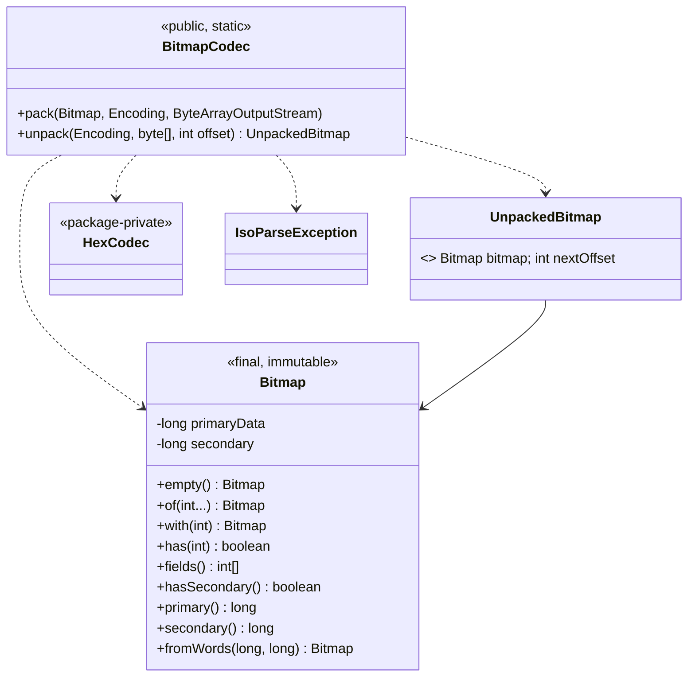
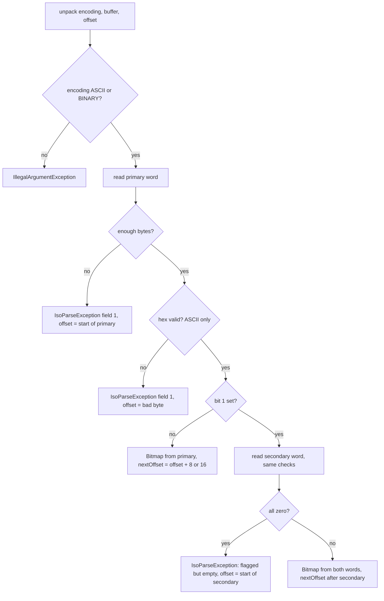

# Phase 1, step 3: the bitmap

Step 2 turned one field into bytes. A message has up to 128 possible fields, and almost every message leaves most of them out. This step builds the structure that says which fields are there: the bitmap.

## 1. Where this sits

```
 Terminal ──> Acquirer ──> Switch ──> Issuer          services (Phases 2-6)
                 \            |          /
                  \           |         /      every service uses the libraries below
   +----------------------------------------------------------------+
   |  iso8583-link   sign-on, echo, keep-alive      (step 9)         |
   |  iso8583-core   spec, codecs, bitmap, packer   (steps 1-7)      |
   |     step 1: spec model                                          |
   |     step 2: field codecs                                        |
   |     [*** step 3 ***]  Bitmap, BitmapCodec                       |
   |  transport      TCP framing, Netty             (Phase 0, step 8)|
   |  common         Hex, Pan, Stan                 (step 0)         |
   +----------------------------------------------------------------+
```

New classes: `dev.paysim.iso8583.Bitmap` (the set of present fields) and, in `dev.paysim.iso8583.codec`, `BitmapCodec` and the small record `UnpackedBitmap`.

Who builds on it:

| Later work | Uses | For what |
| --- | --- | --- |
| Phase 1 step 5 (packer) | `Bitmap`, `BitmapCodec.pack` | The packer collects the fields a message holds into a `Bitmap`, writes MTI, then the bitmap, then each field in ascending order. |
| Phase 1 step 5 (unpacker) | `BitmapCodec.unpack`, `UnpackedBitmap.nextOffset()` | Reads the bitmap first, then walks `bitmap.fields()` calling `FieldCodec.unpack` for each. The bitmap is the table of contents. |
| Phase 1 step 6 (errors) | Field 1 in `IsoParseException` | A bad bitmap is reported as field 1 with an absolute offset. |
| Phase 2 (issuer) | via the unpacker | Decides what to do from which fields are present: a 0100 without field 2 or 35 cannot be authorized. |
| Phase 3 (switch) | `Bitmap.has(...)` | Routing reads field 2 (BIN) and field 41 (terminal) after looking at the bitmap. For reversals (0400), field 90 (original data elements) sits above bit 64, so every reversal needs a secondary bitmap. |
| Phase 3 (network management) | field 70 | 0800 sign-on and echo messages carry field 70, which also forces a secondary bitmap. |

## 2. The domain concept

### 2.1 Why a bitmap?

Think about the alternatives for a message that may contain any of 128 fields:

- **Tags** (as in JSON, XML or EMV TLV): each value is preceded by its name or number. Flexible, but every field pays for its label.
- **A fixed layout** with every field always present: wasteful, since a typical authorization uses about 15 of 128.
- **A bitmap**: one bit per possible field, 1 if present. A 64-bit map costs 8 bytes however many fields follow.

ISO 8583 chose the bitmap. The reasons are the same as for BCD in step 2: the format dates from the 1980s, when links were slow and expensive. A field cost zero overhead bytes beyond its own length prefix. Position tells you what a field is, so no names travel on the wire. And a receiver can scan the 8 bytes quickly, deciding what it has to parse before it parses anything. Switches still exploit that: a message that lacks a required field can be rejected from the bitmap alone.

The cost is rigidity. Fields always appear in ascending order, and you can only parse a message if you know the spec, because nothing in the bytes says that field 41 is 8 characters long. That is why step 1 exists.

### 2.2 Primary and secondary bitmaps

The primary bitmap is 64 bits (8 bytes). The bits are numbered 1 to 64 **from the most significant bit of the first byte**:

```
byte 1          byte 2          ...   byte 8
bits 1 2 3 4 5 6 7 8   bits 9 ... 16        bits 57 ... 64
  ^ MSB (0x80)                                          ^ LSB (0x01) of last byte
```

Bit 1 is special. It does not stand for a data field; it says "a second 64-bit bitmap follows, covering fields 65 to 128". Bits 2 to 64 are fields 2 to 64. So the primary bitmap covers the data elements 2-64 and the secondary covers 65-128. That is how 128 fields fit.

In this project:

- `Bitmap.of(2, 3)` makes a bitmap with fields 2 and 3.
- Bit 1 is never set by the caller. `Bitmap.of(1)` throws. The class sets bit 1 itself when, and only when, any field in 65-128 is present.

### 2.3 Why 0800 messages almost always carry a secondary bitmap

Field 70 is "network management information code": the code that says whether an 0800 message is a sign-on (`001`), sign-off (`002`), an echo test (`301`), a key change and so on. Field 70 lives above 64, so any 0800 that has it needs a secondary bitmap. Typical network management messages are therefore 8 bytes bigger than the ordinary authorization, and the first byte of their bitmap has the high bit set, so it starts with a hex digit from `8` to `F`. That is a handy hint when reading a trace: a bitmap whose first digit is 8 or above means "secondary follows".

Other fields in the upper half you will meet: 90 (original data elements, used in reversals), 95 (replacement amounts) and 128 (a second MAC position).

### 2.4 Tertiary bitmaps, and why you will rarely see one

The 1987 edition of the standard uses field 65 as an indicator for a third bitmap (fields 129-192). Real networks, in my understanding, almost never use it: 128 fields were plenty for card payments, and later editions define more fields differently. This project does not implement a tertiary bitmap: field 65 is an ordinary data bit here. If a counterparty actually sent one, that would be a dialect extension for a later phase.

### 2.5 Hex text or raw bytes?

The primary bitmap is 8 bytes of binary data. Two ways to put it on the wire:

| Encoding | Size without / with secondary | Example for fields 7, 11, 70 |
| --- | --- | --- |
| BINARY | 8 / 16 bytes | `82 20 00 00 ...` |
| ASCII (hex text) | 16 / 32 bytes | `38 32 32 30 30 ...` which reads as `8220...` |

The binary form is compact; the ASCII form is readable, so a packet trace shows the bitmap as `8220000000000000`. Both exist on real links. As far as I know, binary bitmaps are common on card-network interfaces and legacy host links, and hex text on simpler or newer interfaces, but that is a statement about tendencies, not a rule: it is always a line in the interface specification. The `Encoding` in the spec chooses (`MessageSpec.bitmapEncoding()`, set in step 1), and `BitmapCodec` follows it. Only `ASCII` and `BINARY` are meaningful here; BCD is rejected.

### 2.6 A typical failure scenario: off by one in the bit numbering

*The following is a typical scenario, not a specific incident.*

A team writes a bitmap reader quickly. They number bits from 0, or they number from the least significant end, as programmers usually do for a number, and test with a message from a colleague's system. Messages with only low-numbered fields happen to look right (or the test message was symmetric). Then production traffic arrives with field 7 and field 11, bitmap byte `0x82`. The reader sees bits 2 and 8 instead of 1 and 7, thinks "no secondary bitmap; fields 2 and 8 are present", and begins to parse field 2 as an LLVAR PAN from bytes that are really the transmission date. Every field after that is garbage; some parse "successfully" with wrong values, and the authorization is declined, or worse, approved against the wrong data.

The defence is boring: write the bit positions down in a test with exact bytes. This step's tests pin field 2 to `0x40`, field 64 to the last bit of byte 8, field 65 to `0x80` in both bitmaps and field 128 to the last bit of byte 16.

A second variation: a peer sets bit 1 to say "secondary follows" and then sends a secondary of all zeros, usually because it always allocates the second half. Some hosts tolerate that. This codec rejects it, deliberately (section 4).

## 3. A concrete message, byte by byte

All bytes below were produced by running the real code in jshell on the compiled classes; nothing is computed by hand. The per-byte bit tables were printed by a small helper that unpacks each byte of `BitmapCodec.pack(..., BINARY)`.

### 3.1 The 0800 echo: fields 7, 11, 70

Field 7 is the transmission date and time, field 11 the STAN, field 70 the network management code. `Bitmap.of(7, 11, 70)` prints as `Bitmap[7, 11, 70]`.

BINARY encoding, 16 bytes: `82200000000000000400000000000000`.

| Byte | Hex | Bits (bit 1 on the left) | Fields |
| --- | --- | --- | --- |
| 1 | `82` | `1000 0010` | 1 (secondary follows), 7 |
| 2 | `20` | `0010 0000` | 11 |
| 3-8 | `00` | all zero | none |
| 9 | `04` | `0000 0100` | 70 (this is the secondary: bits 65-72, the sixth is 70) |
| 10-16 | `00` | all zero | none |

Bytes 1-8 are the primary bitmap, bytes 9-16 the secondary. Notice that bit 1 is set although no one asked for it: the codec derived it from field 70.

ASCII encoding, 32 bytes. The bitmap is the same 16 bytes written as hex text, so each byte becomes two characters:

```
0000  38 32 32 30 30 30 30 30  30 30 30 30 30 30 30 30  8220000000000000
0010  30 34 30 30 30 30 30 30  30 30 30 30 30 30 30 30  0400000000000000
```

`38 32` is the text "82", the hex of the first bitmap byte. Binary is half the size.

### 3.2 A typical 0100: fifteen fields

The authorization request from step 2 uses fields 2, 3, 4, 7, 11, 12, 13, 14, 22, 25, 35, 41, 42, 49 and 52. All are at or below 64, so there is no secondary bitmap and bit 1 stays clear.

`Bitmap.of(2, 3, 4, 7, 11, 12, 13, 14, 22, 25, 35, 41, 42, 49, 52)` packs to 8 bytes: `723C048020C09000`.

| Byte | Hex | Bits | Fields in this byte |
| --- | --- | --- | --- |
| 1 | `72` | `0111 0010` | 2, 3, 4, 7 |
| 2 | `3C` | `0011 1100` | 11, 12, 13, 14 |
| 3 | `04` | `0000 0100` | 22 |
| 4 | `80` | `1000 0000` | 25 |
| 5 | `20` | `0010 0000` | 35 |
| 6 | `C0` | `1100 0000` | 41, 42 |
| 7 | `90` | `1001 0000` | 49, 52 |
| 8 | `00` | `0000 0000` | none |

Reading `72` by hand: the high nibble `0111` means bit 1 clear, bits 2, 3 and 4 set; the low nibble `0010` means bits 5 and 6 clear, bit 7 set, bit 8 clear. So fields 2, 3, 4 and 7. Byte 2 covers bits 9-16: `0011 1100` sets the third to sixth positions, which are 11, 12, 13, 14.

In ASCII the same bitmap on the wire is the 16 characters `723C048020C09000`:

```
0000  37 32 33 43 30 34 38 30  32 30 43 30 39 30 30 30  723C048020C09000
```

A reversal (0400) adds field 90, which would add a secondary bitmap with bit 90 (the 26th bit of the secondary) set. `Bitmap.of(2, 3, 11, 90)` has primary `E020000000000000` and secondary `0000004000000000`: bit 1 appears in the primary's first byte (`E0` = `1110 0000`: bits 1, 2, 3).

### 3.3 Preview: MTI, bitmap and fields together

*Assembled by hand here; the packer arrives in step 5.* A complete 0800 echo request is MTI, then bitmap, then fields 7, 11, 70 in order. Each field's bytes below were produced by `FieldCodec.pack` with the `PAYSIM_ASCII_87` spec, and the bitmap by `BitmapCodec.pack(..., ASCII)`:

| Part | Bytes |
| --- | --- |
| MTI `0800` (ASCII) | `30 38 30 30` |
| Bitmap (ASCII, 32 chars) | the `8220...0400...` bytes shown above |
| Field 7 `1031143015` | `31 30 33 31 31 34 33 30 31 35` |
| Field 11 `000001` | `30 30 30 30 30 31` |
| Field 70 `301` | `33 30 31` |

Concatenated, 55 bytes (4 + 32 + 10 + 6 + 3):

```
0000  30 38 30 30 38 32 32 30  30 30 30 30 30 30 30 30  0800822000000000
0010  30 30 30 30 30 34 30 30  30 30 30 30 30 30 30 30  0000040000000000
0020  30 30 30 30 31 30 33 31  31 34 33 30 31 35 30 30  0000103114301500
0030  30 30 30 31 33 30 31                              0001301
```

Reading it: bytes 0-3 are the MTI. Bytes 4-35 are the bitmap (the text `8220000000000000` and `0400000000000000`). At offset 36 the fields start: field 7 (10 bytes), field 11 (6 bytes) and field 70 (3 bytes), with no separators between them. The receiver knows where each ends only because the spec says field 7 is 10 characters, field 11 is 6 and field 70 is 3. That is why the bitmap must come first.

### 3.4 A real error message

An ASCII bitmap whose first byte `82` announces a secondary, but the buffer ends 15 characters into it (offset 0):

```
field 1 at offset 16: truncated secondary bitmap, need 16 bytes, have 15
```

Field 1 is the convention for the bitmap. The offset is where the short secondary starts, so you can find it in a hex dump. The same input with the secondary present but all `0` gives:

```
field 1 at offset 16: secondary bitmap flagged but empty
```

And an invalid hex digit (`G` in `82200000000000G0`) reports the exact byte:

```
field 1 at offset 14: invalid hex digit at index 14
```

As elsewhere, the messages carry the field, offset, lengths and indexes, never the bytes themselves.

## 4. Design and flow



Unpack flow:



### Decisions, and why

**Two `long`s, not a `BitSet` or a boolean array.** A bitmap is exactly 128 bits, so two 64-bit words are enough, cheap to copy, trivially immutable and fast to compare. The primary stores only fields 2-64 internally, and `primary()` adds bit 1 on the way out. The class is a value object: `equals` and `hashCode` compare the two words, so `Bitmap.of(70, 3, 2)` equals `Bitmap.of(2, 3, 70)`. Mutating methods (`with`) return new instances, which makes a bitmap safe to share between threads, important once the unpacker hands messages to a switch's worker threads.

**Bit 1 is automatic.** If the caller could set bit 1 independently, two things could go wrong: bit 1 set with no field above 64 (a secondary of all zeros, a malformed message), or a field above 64 with bit 1 clear (the receiver would never read the secondary and the message would be parsed wrongly). Deriving the flag from the data makes both impossible to build. `Bitmap.of(1)` is therefore an error, and the message says why. `fromWords` is the one door for raw words; it ignores bit 1 of the primary for the same reason.

**Bit numbering follows the standard: bit 1 is the most significant bit.** In code, field `n` (2-64) is the mask `1L << (64 - n)`. The mapping is simple, but it is the single most error-prone line in the class, so tests pin the exact bytes.

**Errors are reported as field 1, with absolute offsets.** The bitmap is not a data element, but the standard calls the secondary bitmap "field 1", and one number keeps `IsoParseException(field, offset, reason)` uniform. Truncation reports the offset where the short word starts (primary or secondary); invalid hex reports the exact byte, reusing `HexCodec` from step 2, which accepts upper or lower case.

**Strict about an empty flagged secondary.** If bit 1 is set but the secondary has no bits, `unpack` rejects the message. The trade-off: some real hosts do send such bitmaps (they always allocate the secondary), and a lenient codec would accept them. But a lenient codec cannot be lossless: unpacking such a message and packing it again produces a shorter bitmap, so bytes differ from what arrived. That breaks the project's rule that unpack followed by pack gives back what was received (step 2, padding), and makes mismatches in traces hard to explain. If an interface later needs tolerance, it should be an explicit option on the dialect, not the default.

**Pack is atomic.** The bytes are built in a local array and written to the stream in one call, after the encoding has been checked. A rejected encoding writes nothing, like `FieldCodec.pack`.

**Only ASCII and BINARY.** A BCD bitmap makes no sense (it is not decimal data). `pack` and `unpack` throw `IllegalArgumentException` for anything else, since a wrong encoding is a programming error in the spec, not bad input from the network.

**What the bitmap does not do.** It does not know field lengths or types (that is the spec) and it does not hold values (that is the message model in step 7). It only answers "which fields?".

## 5. Try it yourself

On Windows, if Maven fails with PKIX or certificate errors:

```bash
export MAVEN_OPTS="-Djavax.net.ssl.trustStoreType=Windows-ROOT"
```

Run the new tests:

```bash
./mvnw -q -pl iso8583-core -am test -Dtest='Bitmap*Test' -Dsurefire.failIfNoSpecifiedTests=false
```

Build, then open jshell on the compiled classes (`;` is the Windows class path separator; use `:` elsewhere):

```bash
./mvnw -q -pl iso8583-core -am install -DskipTests
jshell --class-path "common/target/classes;iso8583-core/target/classes"
```

Paste this session (every line was run):

```java
import dev.paysim.common.*;
import dev.paysim.iso8583.*;
import dev.paysim.iso8583.spec.*;
import dev.paysim.iso8583.codec.*;
import java.io.ByteArrayOutputStream;
import java.nio.charset.StandardCharsets;

byte[] pack(Bitmap b, Encoding e) { var o = new ByteArrayOutputStream(); BitmapCodec.pack(b, e, o); return o.toByteArray(); }

var echo = Bitmap.of(7, 11, 70);
echo
echo.hasSecondary()
Long.toHexString(echo.primary())
Long.toHexString(echo.secondary())
Hex.encode(pack(echo, Encoding.BINARY))
System.out.print(Hex.dump(pack(echo, Encoding.ASCII)));

var auth = Bitmap.of(2, 3, 4, 7, 11, 12, 13, 14, 22, 25, 35, 41, 42, 49, 52);
Hex.encode(pack(auth, Encoding.BINARY))
auth.hasSecondary()
auth.with(90).hasSecondary()

var wire = "8220000000000000".getBytes(StandardCharsets.US_ASCII);
BitmapCodec.unpack(Encoding.ASCII, wire, 0)
```

The last line fails: bit 1 is set but the secondary is missing, so you see `field 1 at offset 16: truncated secondary bitmap, need 16 bytes, have 0`. Now give it a complete one:

```java
var full = "82200000000000000400000000000000".getBytes(StandardCharsets.US_ASCII);
var result = BitmapCodec.unpack(Encoding.ASCII, full, 0);
result.bitmap()
result.nextOffset()
Bitmap.of(1)
```

The last line throws `field 1 is the secondary bitmap flag and is set automatically`. Type `/exit` to leave jshell.

### Experiments (predict first, then run)

1. Take `auth` and add field 128 with `auth.with(128)`. What are `primary()` and `secondary()` in hex now? Which byte of the packed binary bitmap changes first, and how long is the result?
2. Take the 32-character `full` buffer and replace the secondary (characters 17-32) with sixteen `0`s. What does `unpack` report, and at which offset? Then go back to the original and change only the first character from `8` to `0`. What bitmap comes back, and what is `nextOffset()`?
3. Write the bitmap `723C048020C09000` in lower case and put it at offset 5 of a buffer that has 5 filler bytes in front. Is the result the same bitmap, and what is `nextOffset()`? Then replace the fourth hex digit with `G`: which offset is reported?
4. Compute by hand the BINARY bitmap for fields 2, 64, 65 and 128 on paper first, then check with `Hex.encode(pack(Bitmap.of(2, 64, 65, 128), Encoding.BINARY))`.

## Key terms

- **Bitmap:** a set of bits, one per possible data element, saying which are present in a message.
- **Primary bitmap:** the first 64 bits, covering bit 1 (secondary flag) and fields 2-64.
- **Secondary bitmap:** a second 64 bits, present only when bit 1 of the primary is set, covering fields 65-128.
- **Tertiary bitmap:** a third bitmap for fields 129-192 that the 1987 edition provides for through field 65; rare in practice, not implemented here.
- **Bit 1:** the most significant bit of the first byte; here it means "secondary bitmap follows", not a data field.
- **Most significant bit (MSB):** the leftmost bit of a byte, with value 128 (`0x80`).
- **Hex-ASCII bitmap:** the bitmap written as hex text, two characters per byte.
- **Binary bitmap:** the bitmap sent as raw bytes.
- **Field 70:** network management information code; carried by 0800 messages and the usual reason they have a secondary bitmap.
- **Field 90:** original data elements, used in reversals; also above bit 64.
- **Value object:** an immutable class compared by content, like `Bitmap`.

## Next step

[Step 4: MTI and the message model](phase-1-step-4.md)
