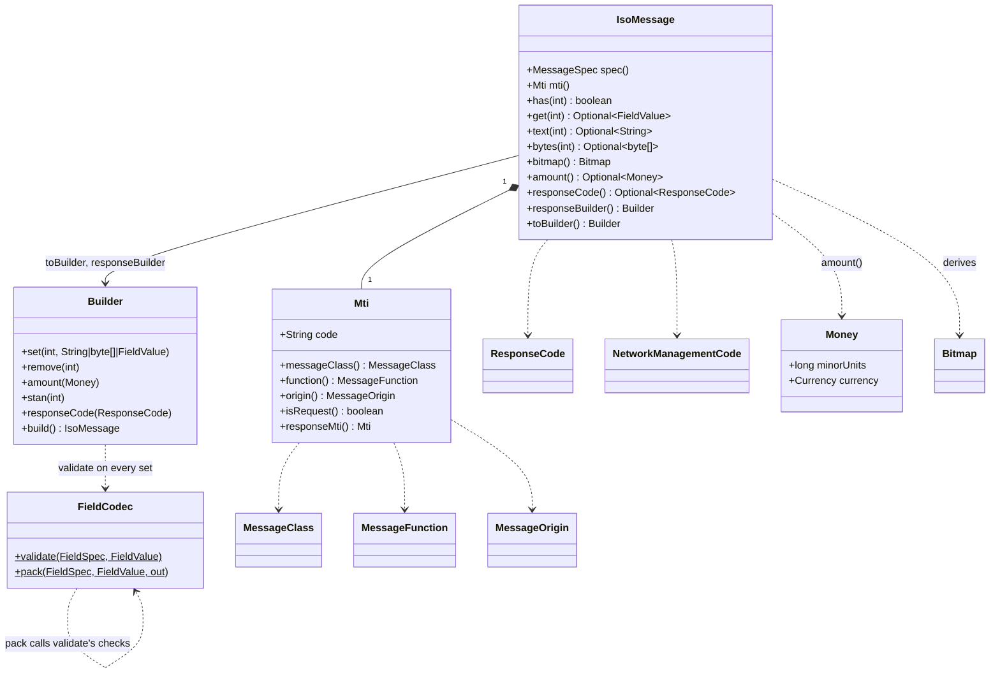
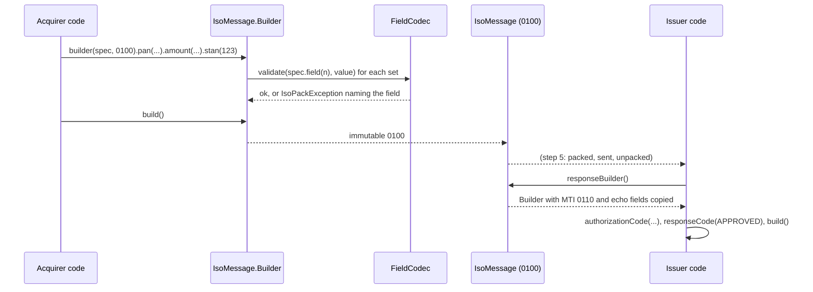

# Phase 1, step 4: MTI and the message model

Steps 1 to 3 gave us the pieces: a spec that says what each field looks like, codecs that turn one field into bytes, and a bitmap that says which fields are present. This step puts them together in memory. An `IsoMessage` is an MTI (what kind of message this is) plus the fields it holds, each one already checked against the spec. There is still no whole-message packing here; that is step 5.

## 1. Where this sits

```
 Terminal ──> Acquirer ──> Switch ──> Issuer          services (Phases 2-6)
                 \            |          /
                  \           |         /      every service uses the libraries below
   +----------------------------------------------------------------+
   |  iso8583-link   sign-on, echo, keep-alive      (step 9)         |
   |  iso8583-core   spec, codecs, bitmap, packer   (steps 1-7)      |
   |     step 1: spec model                                          |
   |     step 2: field codecs                                        |
   |     step 3: Bitmap, BitmapCodec                                 |
   |     [*** step 4 ***]  Mti, IsoMessage, ResponseCode, dates      |
   |  transport      TCP framing, Netty             (Phase 0, step 8)|
   |  common         Hex, Pan, Stan, [Money]        (step 0, step 4) |
   +----------------------------------------------------------------+
```

New in `common`: `Money`. New in `iso8583-core`, package `dev.paysim.iso8583`: `Mti` with the enums `MessageClass`, `MessageFunction` and `MessageOrigin`; `ResponseCode`; `NetworkManagementCode`; `IsoDateTimes`; `IsoMessage` with its `Builder`. One change to existing code: `FieldCodec.validate(spec, value)`, which `pack` now calls too.

Who builds on it:

| Later work | Uses | For what |
| --- | --- | --- |
| Phase 1 step 5 (packer) | `IsoMessage.fields()`, `bitmap()`, `get(n)`, `Mti.code()` | Writes MTI, bitmap, then each present field in ascending order. The unpacker fills a builder and returns an `IsoMessage`. |
| Phase 1 step 6 (printer) | `IsoMessage`, `Pan.mask` | A readable dump with PAN masked. `toString()` stays value-free; the printer is the one place that shows values, deliberately. |
| Phase 1 step 9 (sign-on, echo) | `NetworkManagementCode`, `responseBuilder()` | An 0800 with field 70 = 301 is answered by an 0810 that echoes 7, 11 and 70. |
| Phase 2 (issuer) | `amount()`, `pan()`, `ResponseCode`, `responseBuilder()` | Decides approve or decline and builds the 0110 with 38 and 39. |
| Phase 3 (switch) | `Mti.messageClass()`, `isRepeat()`, field 90 | Routes by MTI class; reversals (04xx) go to a different path than authorizations (01xx). |
| Phase 5 (clearing) | `Money`, advices (xx2x) | Settlement files are built from amounts in minor units plus currency. |

## 2. The domain concept

### 2.1 The MTI: four digits, four questions

The Message Type Indicator is the first thing on the wire. In the 1987 edition each digit answers one question:

```
   0     1     0     0
   |     |     |     +-- origin:   who sent it (0 acquirer, 2 issuer, 4 other; +1 = repeat)
   |     |     +-------- function: request, response, advice, notification, instruction
   |     +-------------- class:    authorization, financial, reversal, network management, ...
   +-------------------- version:  0 = ISO 8583:1987
```

| Digit | Meaning | Values |
| --- | --- | --- |
| 1 | Version | `0` = 1987. Later editions use 1 and 2; this project supports only 0. |
| 2 | Class | 1 authorization, 2 financial, 3 file action, 4 reversal, 5 reconciliation, 6 administrative, 7 fee collection, 8 network management |
| 3 | Function | 0 request, 1 request response, 2 advice, 3 advice response, 4 notification, 5 notification acknowledgement, 6 instruction, 7 instruction acknowledgement |
| 4 | Origin | 0 acquirer, 1 acquirer repeat, 2 issuer, 3 issuer repeat, 4 other, 5 other repeat |

Responses are always the request's function plus one (0 becomes 1, 2 becomes 3), which is why `0100` is answered by `0110` and `0420` by `0430`. Digits 8 and 9 in the function and origin positions are not defined here, and neither is class 9; `new Mti("0190")` throws.

A switch can route on the MTI before it reads a single field. That is the whole point of putting it first.

### 2.2 The life of a transaction

The simplest case: a cardholder buys something and the terminal asks for authorization.

```
 Terminal/Acquirer                    Switch                       Issuer
       |  0100 auth request  ------->   |   ---------------------->  |
       |                                |                            | checks funds, PIN, status
       |  0110 response (39=00) <-----  |   <----------------------  |
```

Things go wrong in the network more often than in the cardholder's account. The acquirer sends the 0100, the answer never arrives, and now nobody knows whether the issuer approved and put a hold on the funds. The usual remedy is a reversal:

```
 Acquirer                    Switch                       Issuer
    |  0100 ---------------> |  ----------------------->  |   (issuer approves, holds 15.00)
    |      ... timeout, 0110 lost ...                     |
    |  0400 reversal ------> |  ----------------------->  |   field 90 = which transaction
    |  0410 <--------------  |  <-----------------------  |   (issuer releases the hold)
```

The reversal names the original transaction in field 90 (original data elements). If the reversal itself times out, the acquirer sends it again with the repeat origin digit, 0401, so the receiver knows it may already have seen it. A repeat is answered like the original: `0401` gets `0410`, not a special response. In practice most acquirers send reversals as advices (0420) rather than requests: an advice cannot be refused, so the acquirer stores it and resends it (as 0421) until it receives an 0430 acknowledgement. That store-and-forward loop is what guarantees a timed-out authorization does not leave a hold on the cardholder's money. 0400 reversal requests exist but are less common; exact rules differ by network.

Advices tell rather than ask. An 0120 authorization advice says "this already happened", for example when a switch approved a transaction itself because the issuer was unreachable (stand-in processing) and now informs the issuer afterwards. The issuer cannot say no; it can only acknowledge with 0130.

### 2.3 Response codes: who decides, and what happens next

Field 39 is two characters chosen by whoever answers. The same declined purchase looks very different depending on the code:

| Code | Name here | Who decided | What the terminal shows | Retry? |
| --- | --- | --- | --- | --- |
| `00` | APPROVED | Issuer | Approved, print receipt | no need |
| `05` | DO_NOT_HONOR | Issuer | Declined (a generic "no", often risk rules) | no, try another card |
| `51` | INSUFFICIENT_FUNDS | Issuer | Declined, insufficient funds | not now |
| `55` | INCORRECT_PIN | Issuer | Wrong PIN, try again | yes, a limited number of times (then `75`) |
| `91` | ISSUER_UNAVAILABLE | Switch or network | "Try again later" | yes: nothing was decided |
| `96` | SYSTEM_MALFUNCTION | Whoever failed | Error | maybe, after a pause |

The difference between `05` and `91` matters. A decline (05) is an answer; hammering the same card with retries only creates more declines on the cardholder's record. `91` means the issuer was never consulted. An acquirer that treated them the same would either retry declines forever or give up on temporary outages. `ResponseCode.isApproved()` is true only for `00`. Unknown codes are normal (each network adds its own), so `fromCode` returns an `Optional` and `IsoMessage.responseCode()` gives empty for them, while `text(39)` keeps the raw value for logs.

### 2.4 Why money is `long` minor units plus a currency

Field 4 holds the amount as digits with no decimal point: 12 digits, the amount in the currency's smallest unit. `000000001500` is fifteen dollars in USD, fifteen hundred yen in JPY, and one and a half dinars in BHD. The number alone means nothing; field 49 carries the currency, and the number of decimals depends on it:

| Currency | Numeric code | Decimals | `1500` minor units is |
| --- | --- | --- | --- |
| USD | 840 | 2 | 15.00 USD |
| JPY | 392 | 0 | 1500 JPY |
| BHD | 048 | 3 | 1.500 BHD |

The classic failure, labelled as such:

> **Typical failure: the 14.99 receipt.** A system stores the amount as a `double`. The bill is computed as `19.99 * 0.75`, which gives 14.9925 or, with accumulated error, 14.989999999999998. A formatter truncates and prints 14.98, or rounds one way on the terminal and the other way at the issuer. The acquirer's total and the issuer's no longer agree by one cent, on thousands of transactions, and reconciliation fails every night. Binary floating point cannot hold 0.10 exactly (in jshell, `0.1 + 0.2` prints `0.30000000000000004`, as shown below), so no amount of care with rounding fully fixes it.

Whole numbers do not drift. `Money` is a `long` and an ISO 4217 `Currency`, and the formatting uses integer division, never a `double`.

### 2.5 Field 7 in GMT, fields 12 and 13 in local time

A message carries three timestamps and they are not redundant:

- **Field 7, transmission date and time** (`MMddHHmmss`): when the message was sent, in GMT by definition. Every party in the chain stamps the same clock, which is what lets a switch and an issuer in different countries order events and sort out timeouts.
- **Fields 12 and 13, local transaction time and date** (`HHmmss`, `MMdd`): what the wall clock at the terminal showed. This is what appears on the cardholder's receipt and statement.

A purchase at 10:30 in New York and the same instant in Tokyo have the same field 7 and different 12/13. Using local time for field 7 would make messages from Tokyo look half a day ahead of messages from New York, and a time-based duplicate check would reject them. None of the three has a year, so `IsoDateTimes` parses to `MonthDay` and `LocalTime`; around New Year, whoever consumes them must supply the year.

### 2.6 Echo fields: how a response finds its request

The terminal side usually has many requests in flight at once on one connection. When an 0110 comes back, which 0100 is it for? The protocol's answer is that the response repeats the identifying fields of the request:

- **11, STAN:** the six-digit trace number, unique per sender over a short window.
- **7, transmission date and time**, **37, RRN**, **41 terminal ID**, **42 merchant ID**, **32 acquiring institution**: together with the STAN, a key that is unique in practice.
- **2, 3, 4, 49, 12, 13:** the card, processing code, amount, currency and local time, so the receipt and the audit trail show the same facts on both sides.
- **70** for network management and **90** for reversals.

> **Typical failure: the response matched to the wrong request.** An authorization service builds its 0110 from scratch instead of copying the echo fields and forgets field 41. The acquirer's matcher keys on STAN plus terminal ID. With field 41 missing, the response matches nothing and times out, the acquirer reverses an approved purchase, and the customer sees a failed payment while the issuer briefly held the money. A second variant: the responder copies 11 but not 4, and the terminal prints a receipt without the amount.

`responseBuilder()` exists so responders do not rebuild this list by hand.

## 3. A concrete message

All output below comes from running the real classes in `jshell`, built with `./mvnw -q -pl iso8583-core -am install -DskipTests` and started with the class path `common/target/classes;iso8583-core/target/classes`. The spec is `Specs.PAYSIM_ASCII_87`. The clock is fixed at 2026-10-31T14:30:15Z with a Tokyo zone, to show that field 7 does not follow the clock's zone.

```
var clock = Clock.fixed(Instant.parse("2026-10-31T14:30:15Z"), ZoneId.of("Asia/Tokyo"));
var req = IsoMessage.builder(Specs.PAYSIM_ASCII_87, Mti.AUTH_REQUEST)
    .pan("4111111111111111").processingCode("000000")
    .amount(Money.of(1500, "USD")).transmissionDateTime(clock).stan(123)
    .localDateTime(LocalDateTime.of(2026, 10, 31, 10, 30, 15))
    .set(14, "2512").set(22, "051").set(25, "00").set(35, "4111111111111111=2512101")
    .terminalId("TERM0001").merchantId("MERCHANT0000001")
    .set(52, Hex.decode("0123456789ABCDEF")).build();
```

### 3.1 `toString()` shows field numbers, never values

```
IsoMessage[0100 fields=[2, 3, 4, 7, 11, 12, 13, 14, 22, 25, 35, 41, 42, 49, 52]]
```

Fields 2, 35 and 52 hold a card number, track data and a PIN block. A log line that accidentally printed the message must not leak them, so `toString()` has no way to. Field 49 appeared although we never set it: `amount(...)` sets 4 and 49 together.

### 3.2 The derived bitmap

```
Bitmap[2, 3, 4, 7, 11, 12, 13, 14, 22, 25, 35, 41, 42, 49, 52]
723C048020C09000
```

The bitmap comes from the fields present; nobody sets bits by hand. The first byte `72` is `0111 0010`: bit 1 is 0 (no secondary), bits 2, 3, 4 and 7 are set. The step 3 doc explains the rest of the bytes. The hex includes fields 35 and 52, which is why it differs from a bitmap for the same message without track and PIN data.

### 3.3 Each field's packed bytes

`FieldCodec.pack` with the ASCII spec, one field at a time. For variable fields the length prefix is part of the bytes.

```
  2  Primary account number       313634313131313131313131313131313131
  3  Processing code              303030303030
  4  Amount, transaction          303030303030303031353030
  7  Transmission date and time   31303331313433303135
 11  System trace audit number    303030313233
 12  Time, local transaction      313033303135
 13  Date, local transaction      31303331
 14  Date, expiration             32353132
 22  POS entry mode               303531
 25  POS condition code           3030
 35  Track 2 data                 3234343131313131313131313131313131313D32353132313031
 41  Card acceptor terminal ID    5445524D30303031
 42  Card acceptor ID code        4D45524348414E5430303030303031
 49  Currency code, transaction   383430
 52  PIN data                     30313233343536373839414243444546
```

Reading a few: field 2 is `3136` (the ASCII digits "16", the LLVAR prefix) followed by the sixteen digits of the PAN. Field 4 is `000000001500`: 1500 cents, zero-filled to 12 digits. Field 7 is `1031143015`, the UTC time, although the clock's zone was Tokyo; in Tokyo the local time would have been 23:30. Field 52 is a binary field, which this ASCII spec sends as hex text, so the 8 bytes `01 23 45 67 89 AB CD EF` take 16 characters. All of these bytes are produced here by `pack` and checked against nothing but the spec; the MTI and bitmap are not written yet. **Whole-message bytes (MTI, bitmap and fields in order) come in step 5.**

`req.amount().get()` gives back `15.00 USD`, built from fields 4 and 49.

### 3.4 The response: `responseBuilder()`

```
var resp = req.responseBuilder().authorizationCode("A1B2C3").responseCode(ResponseCode.APPROVED).build();
```

```
IsoMessage[0110 fields=[2, 3, 4, 7, 11, 12, 13, 38, 39, 41, 42, 49]]
0110 APPROVED approved=true
```

The MTI went from 0100 to 0110. Ten fields were copied from the request (2, 3, 4, 7, 11, 12, 13, 41, 42, 49) and the responder added 38 and 39. What was not copied: 14 (expiry), 22 (entry mode), 25 (condition code), 35 (track 2) and 52 (PIN block). Nothing about a response needs the track or the PIN, and carrying them back would only spread sensitive data further.

### 3.5 A network management pair

```
IsoMessage[0800 fields=[7, 11, 70]] Bitmap[7, 11, 70] 8220000000000000 0400000000000000
IsoMessage[0810 fields=[7, 11, 70]]
```

The echo test: field 7 timestamp, STAN 7, field 70 = 301. The primary bitmap starts with `8`, meaning a secondary bitmap follows, because field 70 is above 64; the secondary `0400000000000000` has the bit for field 70. The 0810 echoes all three fields; the responder would add field 39 where the network requires it.

### 3.6 Errors name the field and never the value

```
dev.paysim.iso8583.IsoPackException: field 3: non-digit at index 2 for type N
java.lang.IllegalStateException: MTI 0110 is already a response
```

The first one came from `set(3, "12A456")`: the error happens at the `set` call, not later at pack time, and the message holds the field number and the index, not the text. The second is `Mti.AUTH_RESPONSE.responseMti()`.

## 4. Design and flow

### 4.1 Classes



### 4.2 Request to response



### 4.3 Decisions and why

- **Validate when a value is set, not when it is packed.** A wrong PAN length should fail on the line that supplied it, in the code that knows where it came from. A pack-time error shows up later in a transport thread with no idea who set the value. `FieldCodec.validate` is the check, and `Builder.set` calls it.
- **One validation path.** `pack` now runs the same private check that `validate` runs, and then only encodes. If they were two copies of the rules, a change to one (say, a new padding rule) would let the builder accept what the packer rejects. The existing codec tests pass unchanged, and `FieldCodecValidateTest` asserts that `validate` and `pack` produce the same message and that `pack` writes nothing on failure.
- **The message keeps what was set, not what goes on the wire.** `terminalId("T1")` stores `T1`; the space padding to 8 characters is added when packing. A value that arrives by unpacking is padded (`T1      `), so the `terminalId()` accessor strips trailing spaces and works for both. `text(41)` returns the raw value either way.
- **Optional accessors.** A field absent from the message is a normal case (a 0110 has no PIN), not an error. `stan()` returns `OptionalInt` to avoid boxing. The one exception is field 4 without 49: an amount without a currency is a malformed message, so `amount()` throws `IllegalStateException` naming both fields instead of guessing.
- **`Money` in `common`.** The acquirer, issuer and clearing services need it without depending on ISO 8583. `toString()` uses integer division, and handles `Long.MIN_VALUE` and negatives such as `-0.50 USD`. The builder rejects negative amounts: field 4 has no sign. Reversals and refunds are separate message types, not negative amounts.
- **`toString()` never shows values.** Only field numbers. Even a debug log with the whole message cannot leak a PAN or PIN block. The masked pretty-printer is step 6.
- **Spec identity in `equals`.** Two messages are equal if they share the same `MessageSpec` object, the same MTI and the same field contents. A spec is built once and shared, so identity means "same dialect"; comparing specs by content would be slower and `MessageSpec` has no `equals`. A message in the ASCII dialect and one in a BCD dialect with the same field values are therefore different messages.
- **`responseBuilder()` copies a fixed list: 2, 3, 4, 7, 11, 12, 13, 32, 37, 41, 42, 49, 70, 90.** These are the matching keys (7, 11, 32, 37, 41, 42), the facts the receipt and audit trail must agree on (2, 3, 4, 12, 13, 49), and the references for network management (70) and reversals (90). Track, PIN, expiry and entry mode are left out on purpose. The responder adds 38 and 39. Different networks echo slightly different sets; this is the simulator's choice.
- **Repeats collapse in `responseMti()`.** `0101` is answered by `0110`, so the repeat flag is dropped, not mirrored.
- **STAN range.** `stan(int)` accepts 0 to 999999. The `Stan` generator in `common` never issues 0, but a builder that refused to represent a received `000000` would be stricter than the standard.
- **Enums are the closed set we understand.** A response code from a real network that is not in `ResponseCode` is not an error: `responseCode()` returns empty and the raw text stays available.

## 5. Try it yourself

Build once, then open jshell with the two class directories on the class path:

```
./mvnw -q -pl iso8583-core -am install -DskipTests
jshell --class-path "common/target/classes;iso8583-core/target/classes"
```

Run these lines. Every output shown was produced by running them; lines that print something are followed by their output.

```
import dev.paysim.common.*;
import dev.paysim.iso8583.*;
import dev.paysim.iso8583.spec.*;
import java.time.*;
var clock = Clock.fixed(Instant.parse("2026-10-31T14:30:15Z"), ZoneId.of("Asia/Tokyo"));
var echo = IsoMessage.builder(Specs.PAYSIM_ASCII_87, Mti.NETWORK_REQUEST).transmissionDateTime(clock).stan(7).networkManagementCode(NetworkManagementCode.ECHO_TEST).build();
System.out.println(String.format("%016X %016X", echo.bitmap().primary(), echo.bitmap().secondary()));
```

```
8220000000000000 0400000000000000
```

```
System.out.println(echo.transmissionDateTime());
Optional[TransmissionDateTime[date=--10-31, time=14:30:15]]
System.out.println(Mti.REVERSAL_ADVICE.responseMti());
0430
System.out.println(new Mti("0201").responseMti());
0210
System.out.println(Money.ofNumeric(-50, 840));
-0.50 USD
System.out.println(ResponseCode.fromCode("51"));
Optional[INSUFFICIENT_FUNDS]
System.out.println(ResponseCode.fromCode("99"));
Optional.empty
System.out.println(Money.of(1000, "USD").equals(Money.of(1000, "EUR")));
false
```

Errors:

```
var bad = IsoMessage.builder(Specs.PAYSIM_ASCII_87, Mti.AUTH_REQUEST).set(4, "000000001500").build();
try { bad.amount(); } catch (IllegalStateException e) { System.out.println(e.getMessage()); }
field 4 is present but field 49 (currency) is missing
try { IsoMessage.builder(Specs.PAYSIM_ASCII_87, Mti.AUTH_REQUEST).set(5, "1"); } catch (IllegalArgumentException e) { System.out.println(e.getMessage()); }
field 5 is not defined in spec paysim-ascii-87
```

Run the tests for this step:

```
./mvnw -q -pl iso8583-core -am test -Dtest=MtiTest -Dsurefire.failIfNoSpecifiedTests=false
./mvnw -q -pl iso8583-core -am test -Dtest=IsoMessageTest -Dsurefire.failIfNoSpecifiedTests=false
./mvnw -q -pl iso8583-core -am test -Dtest=FieldCodecValidateTest -Dsurefire.failIfNoSpecifiedTests=false
./mvnw -q -pl common test -Dtest=MoneyTest -Dsurefire.failIfNoSpecifiedTests=false
```

Others: `ResponseCodeTest`, `NetworkManagementCodeTest`, `IsoDateTimesTest`.

### Experiments (predict first, then run)

1. What does `new Mti("0421").responseMti()` return, and what does `new Mti("0430").isResponse()` say? Then predict whether `new Mti("0900")` and `new Mti("0108")` are accepted, and why or why not.
2. Build a 0100 with `.amount(Money.of(1500, "JPY"))`. What do fields 4 and 49 hold, and what does `amount()` print? Do the same for BHD. How many decimal places does each print?
3. Build a 0100 with fields 2, 3 and 41 and call `responseBuilder().build().fields()`. Which of the three come back? Then add field 52 and ask the same question. Finally, call `responseBuilder()` on the result of the first response: what happens?
4. Use a clock fixed at `2026-12-31T23:59:59Z` with the zone `Asia/Tokyo`. What is the field 7 string? Now take `LocalDateTime.of(2027, 1, 1, 8, 59, 59)` as the terminal's local time: what are its field 12 and 13 strings? The two describe the same instant. Why can a receiver not tell from the strings alone that they are the same instant, and what extra information would it need?

## Key terms

- **MTI (Message Type Indicator):** four digits at the start of a message giving version, class, function and origin.
- **Message class:** MTI digit 2; authorization (1), financial (2), reversal (4), network management (8) and others.
- **Message function:** MTI digit 3; request, response, advice, notification, instruction, and their answers.
- **Message origin:** MTI digit 4; acquirer, issuer or other, with a variant marking a repeat.
- **Repeat:** a retransmission of a message that got no answer; the receiver may already have seen the first one.
- **Authorization request (0100) and response (0110):** ask whether a purchase would be approved, and the answer.
- **Reversal (0400/0420):** undoes an earlier transaction, usually after a timeout; field 90 names the original.
- **Advice (xx2x):** tells the other side something that already happened, for example a stand-in approval.
- **Stand-in processing:** a switch or network approving or declining on the issuer's behalf when the issuer is unreachable.
- **Response code (field 39):** two characters chosen by the answering party; `00` approves.
- **Network management code (field 70):** what an 0800 asks for: sign-on 001, sign-off 002, echo test 301.
- **Minor units:** the smallest unit of a currency (cents, yen); amounts are stored as whole numbers of these.
- **ISO 4217:** the currency code standard; alpha codes like USD and numeric codes like 840.
- **Transmission date and time (field 7):** when the message was sent, in GMT.
- **Local transaction time and date (fields 12, 13):** the terminal's wall clock.
- **Echo fields:** fields a response copies from its request so the requester can match it.
- **STAN:** system trace audit number, field 11; unique per sender over a short window.
- **RRN:** retrieval reference number, field 37; identifies a transaction for later inquiries.
- **Immutable:** cannot change after construction; changes produce a new value (`toBuilder()`).

## Next step

[Step 5: packing and unpacking whole messages](phase-1-step-5.md)
