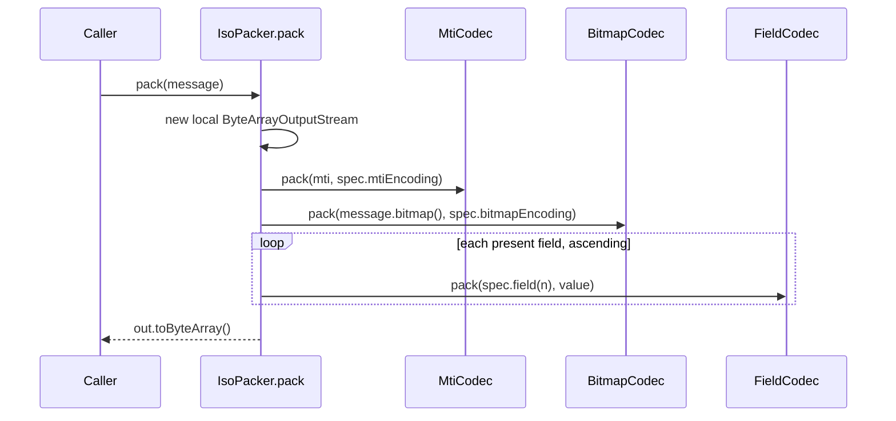
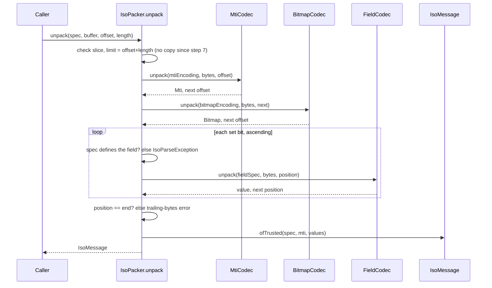

# Phase 1, step 5: the packer, whole messages to bytes and back

Steps 1 to 4 built the parts: a spec that describes every field, codecs for one field and for the bitmap, and an immutable `IsoMessage`. This step joins them. `IsoPacker.pack(message)` turns a message into the exact bytes that go on the wire, and `IsoPacker.unpack(spec, bytes)` turns bytes back into a message. It is the point where the Phase 0 echo, which we assembled by hand from string pieces, becomes something the library produces and checks.

## 1. Where this sits

```
 Terminal ──> Acquirer ──> Switch ──> Issuer          services (Phases 2-6)
                 \            |          /
                  \           |         /      every service uses the libraries below
   +----------------------------------------------------------------+
   |  iso8583-link   sign-on, echo, keep-alive      (step 9)         |
   |  iso8583-core   spec, codecs, bitmap, packer   (steps 1-7)      |
   |     step 1: spec model                                          |
   |     step 2: field codecs                                        |
   |     step 3: Bitmap, BitmapCodec                                 |
   |     step 4: Mti, IsoMessage                                     |
   |     [*** step 5 ***]  MtiCodec, IsoPacker  (pack / unpack)      |
   |  transport      TCP framing, Netty             (Phase 0, step 8)|
   |  common         Hex, Pan, Stan, Money                           |
   +----------------------------------------------------------------+
```

New in `iso8583-core`: `IsoPacker` in `dev.paysim.iso8583` (next to `IsoMessage`, see section 4 for why), and `MtiCodec` in `dev.paysim.iso8583.codec`. One non-public addition to `IsoMessage`: a package-private factory `ofTrusted` that only the packer uses. The public API of `IsoMessage` is unchanged.

It depends on all of steps 1 to 4: the spec says which fields exist and how they are encoded, `FieldCodec` and `BitmapCodec` do the per-part work, `IsoMessage` is the input and output.

Who builds on it:

| Later work | Uses | For what |
| --- | --- | --- |
| Phase 1 step 6 (printer) | `IsoPacker.unpack` | Prints a message you captured as bytes; the printer takes the unpacked `IsoMessage`. |
| Phase 1 step 7 (JMH) | `pack`, `unpack` | The benchmark measures exactly these two methods, which is why unpack avoids re-validating values (section 4). |
| Phase 1 steps 8 and 9 (network link) | `pack`, `unpack`, the slice overload | The link reads a length-prefixed frame from `transport` and hands the payload to `unpack`; replies go out through `pack`. |
| Phases 2 to 6 (all services) | the whole thing | Every service receives bytes, unpacks, decides, builds a response, packs. |

## 2. The domain concept

### 2.1 Why parsing is sequential

Look at the bitmap again. It says "fields 2, 3, 4, 7 are present". It does **not** say how many bytes each one takes. Where field 3 ends and field 4 begins is known only because the spec says field 3 is a fixed 6 digits. Variable fields carry a length prefix (field 2 starts with `16`, field 35 with `24`), but even then the receiver must know the prefix is two digits wide, not three.

So a parser walks the message left to right: read the MTI, read the bitmap, then for each set bit use that field's definition to find where it ends, and continue from there. There is no way to skip ahead or resynchronise. If the receiver believes field 11 is 8 digits when the sender sends 6, everything after field 11 is shifted by two bytes, and the next field the receiver reads is garbage.

This is the classic **spec mismatch** integration failure (a typical scenario, not one specific incident). Two parties both say "ISO 8583" and both have a document, but the documents differ in one field: a length, a padding rule, an encoding. The error does not appear where the mistake is. It appears several fields later, as "invalid digit" or "length exceeds max", and the engineer staring at the log is looking at the wrong field. Section 3.4 reproduces exactly this with real output.

That is why the error messages carry the field number and the absolute byte offset, and why they never carry values (a value in that spot may be a card number). With offset and field you can put the hex trace next to the spec and see where the two disagree.

### 2.2 What hosts do with a message they cannot parse

This varies by host, so treat the following as typical rather than universal. A host that cannot parse an inbound message usually cannot trust anything in it, including the STAN it would need to build a matching response. Common reactions are to drop the message silently (the sender sees a timeout), to answer with a format error (response code 30 is the usual "format error" code, where the host is able to build a response at all), or to close the connection. Repeated garbage often marks the link as unhealthy and may trigger operator alarms. For an acquirer this means a spec mismatch does not look like "one transaction declined"; it looks like "the link is flapping" or "every transaction times out".

### 2.3 Golden messages in certification

When an acquirer or issuer onboards onto a card network, there is usually a certification phase (details vary by network and are partly confidential). The party sends test messages and compares what comes back with a script of expected results. A recurring practice, and a good habit for any ISO 8583 library, is to keep **golden messages**: exact byte strings for known inputs, checked in as test data. If a refactor changes one byte of a golden message, a test fails before a network does. The tests in this step include three such messages and the echo from Phase 0.

### 2.4 ASCII versus compact on the wire

The same logical message can be written two ways:

- **ASCII** (this project's default, `paysim-ascii-87`): every digit is one byte holding the character, the bitmap is 16 hex characters, binary fields are hex text. Easy to read in a trace, about twice the size for numbers.
- **Compact**: the MTI as two BCD bytes, the bitmap as 8 raw bytes, numeric fields as packed decimal (two digits per byte), binary fields as raw bytes. Smaller and faster to parse, unreadable without a dump tool.

Many real networks still use compact encodings. The reasons are mostly history (the formats date from when links were slow and bytes cost money) and compatibility (a network cannot change its wire format without every member changing too). Section 3.3 packs the same 0100 both ways so you can see the size difference.

## 3. Byte by byte

Everything below is output from running the code with jshell (classpath `common/target/classes;iso8583-core/target/classes`, after `./mvnw -q -pl iso8583-core -am install -DskipTests`). Nothing was computed by hand.

### 3.1 The 0100 authorization request, 159 bytes

The message: PAN 4111111111111111, processing code 000000, USD 15.00 (field 4 = 1500, field 49 = 840), transmission time from a fixed clock at 2026-10-31T14:30:15Z, STAN 123, local time 10:30:15 and date 10-31, expiry 2512, entry mode 051, condition code 00, a track 2 string, terminal `TERM0001`, merchant `MERCHANT0000001`, and an 8-byte PIN block `0123456789ABCDEF`. That is fields 2, 3, 4, 7, 11, 12, 13, 14, 22, 25, 35, 41, 42, 49, 52.

```
0000  30 31 30 30 37 32 33 43  30 34 38 30 32 30 43 30  0100723C048020C0
0010  39 30 30 30 31 36 34 31  31 31 31 31 31 31 31 31  9000164111111111
0020  31 31 31 31 31 31 30 30  30 30 30 30 30 30 30 30  1111110000000000
0030  30 30 30 30 31 35 30 30  31 30 33 31 31 34 33 30  0000150010311430
0040  31 35 30 30 30 31 32 33  31 30 33 30 31 35 31 30  1500012310301510
0050  33 31 32 35 31 32 30 35  31 30 30 32 34 34 31 31  3125120510024411
0060  31 31 31 31 31 31 31 31  31 31 31 31 31 3D 32 35  1111111111111=25
0070  31 32 31 30 31 54 45 52  4D 30 30 30 31 4D 45 52  12101TERM0001MER
0080  43 48 41 4E 54 30 30 30  30 30 30 31 38 34 30 30  CHANT00000018400
0090  31 32 33 34 35 36 37 38  39 41 42 43 44 45 46     123456789ABCDEF
```

The same bytes, annotated. Offsets are decimal, and the order is the order of the bitmap bits.

| Offset | Length | Field | On the wire (as text) | Notes |
| --- | --- | --- | --- | --- |
| 0 | 4 | MTI | `0100` | ASCII MTI, 4 bytes |
| 4 | 16 | bitmap | `723C048020C09000` | hex text; 8 bytes of bits; 16 chars because ASCII |
| 20 | 18 | 2 PAN | `16` `4111111111111111` | LLVAR: 2-digit length, then 16 digits |
| 38 | 6 | 3 processing code | `000000` | fixed 6 |
| 44 | 12 | 4 amount | `000000001500` | minor units, left-padded with zeros |
| 56 | 10 | 7 transmission date/time | `1031143015` | MMddHHmmss, UTC |
| 66 | 6 | 11 STAN | `000123` | |
| 72 | 6 | 12 local time | `103015` | HHmmss |
| 78 | 4 | 13 local date | `1031` | MMdd |
| 82 | 4 | 14 expiry | `2512` | YYMM |
| 86 | 3 | 22 POS entry mode | `051` | |
| 89 | 2 | 25 POS condition code | `00` | |
| 91 | 26 | 35 track 2 | `24` + 24 chars | LLVAR; `=` is the separator |
| 117 | 8 | 41 terminal ID | `TERM0001` | |
| 125 | 15 | 42 merchant ID | `MERCHANT0000001` | |
| 140 | 3 | 49 currency | `840` | USD |
| 143 | 16 | 52 PIN data | `0123456789ABCDEF` | 8 bytes as 16 hex characters |

Total: 159 bytes. How the bitmap `723C048020C09000` falls out: write it as bits, `72` = `0111 0010` covers fields 1 to 8, so bits for 2, 3, 4 and 7 are set; `3C` = `0011 1100` covers 9 to 16, so 11, 12, 13, 14; `04` covers 17 to 24, so 22; `80` covers 25 to 32, so 25; `20` covers 33 to 40, so 35; `C0` covers 41 to 48, so 41 and 42; `90` covers 49 to 56, so 49 and 52; `00` covers 57 to 64. Bit 1 (the secondary bitmap flag) is clear because no field above 64 is present.

The 0110 response built with `responseBuilder()` plus field 38 `A1B2C3` and field 39 `00` is 116 bytes: `0110`, bitmap `7238000006C08000`, then the echoed fields followed by 38 and 39 (the full string is asserted in `IsoPackerGoldenTest`).

### 3.2 The 0800 echo, byte for byte equal to Phase 0

Phase 0's `EchoDemo` builds its message by hand: `"0800" + "8220000000000000" + "0400000000000000" + "1015042100" + "000001" + "301"`. The library builds the same message from typed calls:

```
0000  30 38 30 30 38 32 32 30  30 30 30 30 30 30 30 30  0800822000000000
0010  30 30 30 30 30 34 30 30  30 30 30 30 30 30 30 30  0000040000000000
0020  30 30 30 30 31 30 31 35  30 34 32 31 30 30 30 30  0000101504210000
0030  30 30 30 31 33 30 31                              0001301
```

55 bytes, and `IsoPackerGoldenTest.echoMatchesPhaseZeroHandBuiltMessage` asserts the packed bytes equal that exact string. The first bitmap word is `82200000...`: bit 1 (secondary bitmap present) plus bit 7 gives `0x82`, then bit 11 gives `0x20` in the second byte. The secondary bitmap `0400000000000000` carries field 70: it is the sixth bit of the first secondary byte (fields 65 to 72), so `0x04`. Field 70 is `301`, the echo test code.

### 3.3 The compact dialect, side by side

The test dialect `paysim-ascii-87-compact` has the same fields but BCD MTI, binary bitmap, BCD for numeric and track 2 fields and raw bytes for binary fields. Text fields (41, 42) stay ASCII. The same 0100:

```
0000  01 00 72 3C 04 80 20 C0  90 00 16 41 11 11 11 11  ..r<.. ....A....
0010  11 11 11 00 00 00 00 00  00 00 15 00 10 31 14 30  .............1.0
0020  15 00 01 23 10 30 15 10  31 25 12 00 51 00 24 41  ...#.0..1%..Q.$A
0030  11 11 11 11 11 11 11 D2  51 21 01 54 45 52 4D 30  ........Q!.TERM0
0040  30 30 31 4D 45 52 43 48  41 4E 54 30 30 30 30 30  001MERCHANT00000
0050  30 31 08 40 01 23 45 67  89 AB CD EF              01.@.#Eg....
```

| | ASCII | Compact |
| --- | --- | --- |
| MTI `0100` | 4 bytes (`30 31 30 30`) | 2 bytes (`01 00`) |
| bitmap | 16 bytes (hex text) | 8 bytes (`72 3C 04 80 20 C0 90 00`) |
| 2 PAN (16 digits) | 18 bytes | 9 bytes (`16`, then 8 packed bytes) |
| 22 entry mode `051` | 3 bytes | 2 bytes (`00 51`, odd count gets a zero nibble on the left) |
| 35 track 2 (24 chars) | 26 bytes | 13 bytes; the `=` separator is nibble `D` (see `D2 51 21 01`) |
| 52 PIN data | 16 bytes (hex text) | 8 bytes raw |
| **Whole 0100** | **159 bytes** | **92 bytes** |
| **Whole 0800 echo** | **55 bytes** | **28 bytes** |

The compact 0800 echo is `08 00`, `82 20 00 00 00 00 00 00`, `04 00 00 00 00 00 00 00`, `10 15 04 21 00`, `00 00 01`, `03 01`. About 42 percent less for the 0100 and about 49 percent less for the echo. The ASCII form wins on readability: the first dump can be read straight off the hex dump's right-hand column; the second needs the spec open next to it.

### 3.4 One real unpack error: the spec mismatch

Take the 159-byte ASCII 0100 above, and unpack it with a spec that differs in one place: the receiver believes field 11 (STAN) is 8 digits, not 6. This is the shape of a typical integration mistake: an off-by-two in one field definition. The real output:

```
field 35 at offset 93: length 41 exceeds max 37
```

Nothing is wrong at field 11. Field 11 simply swallowed two extra bytes, which pushed every following field two bytes to the right. Fields 12, 13, 14, 22 and 25 are fixed-length numeric fields, and the shifted bytes happened to be digits, so they parsed without complaint. The first place where the shifted bytes hit a rule was field 35: its LLVAR length prefix was read from the wrong position and came out as 41, more than the 37 the spec allows. The error points at field 35, offset 93; the real cause is field 11, 25 bytes earlier in the message with five other fields in between. In the real message field 35 starts at offset 91, so the offset in the error being 93 is itself the two-byte shift made visible.

Two related real outputs from the same message:

```
field 14 at offset 82: present in bitmap but not defined in spec peer-no-field-14
field 35 at offset 93: needs 24 bytes, only 7 left
```

The first is a spec that leaves out field 14 altogether: the bitmap names it, the spec does not define it, and since the packer cannot know its length it stops there. The second is the same message cut off at 100 bytes, as a TCP read that stopped early would produce: the field is named, along with how many bytes it needed and how many were left.

## 4. Design and flow

### 4.1 Pack



### 4.2 Unpack



### 4.3 Decisions and why

**A static utility, no instances.** Packing needs no state: the spec travels with the message. A static class can be called from any thread, has nothing to configure, and is trivial to benchmark.

**Pack is atomic.** The bytes are built in a local buffer and returned at the end. If a field fails, the caller never sees half a message. (Values were already validated when set on the builder, so a failure here means a spec and message that disagree.)

**`IsoPacker` lives in `dev.paysim.iso8583`, not in `codec`.** Unpack must build an `IsoMessage` without running every value through the builder again. The values came out of `FieldCodec.unpack`, which already checked length and characters, and revalidating them would roughly double the work that step 7 wants to measure. The way to do that without opening a hole in `IsoMessage`'s public API is a package-private factory, `IsoMessage.ofTrusted(spec, mti, values)`. Java package-private access only works within the same package, so the packer sits there. The cost: `MtiCodec` is public so the packer can reach it. The factory is documented as trusted-input only; it takes ownership of the array and nobody else may touch it.

**Trailing bytes are an error.** If bytes remain after the last field named in the bitmap, `unpack` throws instead of ignoring them. Silent leftovers hide spec mismatches (a field that exists on the wire but not in the bitmap you were told about) and would break byte-stability. The error reports the last field parsed, or 1 if there were no fields, and the offset of the first extra byte.

**Field 0 is the MTI, field 1 the bitmap, in errors.** Real fields start at 2 (field 1 is the secondary bitmap flag). That left 0 free for the MTI, so every parse failure has a field number, and a log line like `field 0 at offset 12` is immediately readable.

**Unpack reports a field the spec lacks.** The bitmap announces a field; the spec has no definition. Without a definition there is no length, so parsing cannot continue. The error names that field and the offset where its data would start.

**Slices keep absolute offsets.** `unpack(spec, buffer, offset, length)` is for a network link that reads a frame into the middle of a larger buffer. Errors point into `buffer`, not into the slice, so a hex trace of the whole buffer lines up. The field codecs bounds-check against the array length, so a slice that ends before the array does is copied up to its end first. That is the one allocation the slice overload costs; the whole-buffer overload skips it. (Replaced in [step 7](phase-1-step-7.md): the codecs now take an exclusive `limit`, so the slice overload no longer copies.)

**The key property is byte-stability, not object equality.** `pack(unpack(bytes))` equals `bytes` for every message the library accepts. Object equality after a round trip holds only when fixed fields were set at full length: `unpack` returns the padded wire value (by design since step 2), so a message built with a short `"0"` for a six-digit field comes back as `"000000"`. The bytes are the same either way. `IsoPackerGoldenTest` checks both facts.

**Compact dialect tradeoffs inherited from earlier steps.** A BCD track 2 comes back with `=` even if the sender used `D`; the sweep test uses `=` so it stays stable. An invalid BCD nibble is a parse error with the byte offset.

### 4.4 What the tests cover

- `IsoPackerGoldenTest` (9 tests): the Phase 0 echo, the 0100, the 0110, the compact 0100 and 0800 as exact hex; unpack then pack reproduces every golden; the equality-vs-bytes distinction; slice parsing.
- `IsoPackerSweepTest` (9 tests): every field of `paysim-ascii-87` at maximum length, once per MTI, in both dialects, for pack, unpack, equality and byte-stability; each field alone; the empty message; the trusted factory against builder-made messages.
- `IsoPackerErrorTest` (14 tests): exact field and absolute offset for each failure, using a buffer with filler bytes in front of the message and behind it, plus a check that no error message contains any 4 digits of the PAN.
- `MtiCodecTest` (8 tests): ASCII and BCD wire forms and the field 0 errors.

## 5. Try it yourself

Build once so the class directories exist:

```
cd /f/Claude_projects/payment-processor
./mvnw -q -pl iso8583-core -am install -DskipTests
jshell --class-path "common/target/classes;iso8583-core/target/classes"
```

Then, in jshell. This is the exact sequence I ran:

```
import dev.paysim.common.*;
import dev.paysim.iso8583.*;
import dev.paysim.iso8583.spec.*;
IsoMessage echo = IsoMessage.builder(Specs.PAYSIM_ASCII_87, Mti.NETWORK_REQUEST).set(7, "1015042100").stan(1).networkManagementCode(NetworkManagementCode.ECHO_TEST).build();
byte[] wire = IsoPacker.pack(echo);
new String(wire)
IsoMessage back = IsoPacker.unpack(Specs.PAYSIM_ASCII_87, wire);
back.networkManagementCode()
back.equals(echo)
System.out.print(Hex.dump(wire));
```

Expect the string `0800822000000000000004000000000000001015042100000001301`, `Optional[ECHO_TEST]` and `true`.

Run one test class:

```
./mvnw -q -pl iso8583-core -am test -Dtest=IsoPackerGoldenTest -Dsurefire.failIfNoSpecifiedTests=false
./mvnw -q -pl iso8583-core -am test -Dtest=IsoPackerErrorTest -Dsurefire.failIfNoSpecifiedTests=false
```

### Predict the output

Try to answer each before running it.

1. Flip one bit in the bitmap. Continuing the session above:
   ```
   byte[] flipped = wire.clone();
   flipped[5] = (byte) '1';
   IsoPacker.unpack(Specs.PAYSIM_ASCII_87, flipped)
   ```
   `'2'` becomes `'1'` in the first bitmap word. Which bits change, which field does the error name, and why that offset? (Hint: what does bit 1 now announce?)

2. Append two bytes to the echo and unpack the result: `IsoPacker.unpack(Specs.PAYSIM_ASCII_87, java.util.Arrays.copyOf(wire, wire.length + 2))`. Which field and offset appear in the message, and why that field and not another?

3. Pack the same echo with a compact spec (BCD MTI, binary bitmap, BCD numerics) and then unpack those bytes with `Specs.PAYSIM_ASCII_87`. At which field does it fail, and at which offset? Then reverse it: ASCII bytes with the compact spec.

## Key terms

- **Pack / unpack:** turn a message into wire bytes / wire bytes into a message.
- **Spec mismatch:** two parties' definitions of a message differ; the parse error usually appears fields after the real mistake.
- **Golden message:** an exact byte string for a known input, kept as test data to catch any change in output.
- **Compact encoding:** BCD and binary instead of ASCII text, so the same message takes fewer bytes.
- **Byte-stability:** `pack(unpack(bytes))` gives back `bytes`; the property the packer guarantees.
- **Atomic pack:** pack either returns the full message or throws, never half of one.
- **Trusted construction:** building an `IsoMessage` from values already validated by the codec, skipping the builder's checks; non-public.
- **Trailing bytes:** bytes after the last field named in the bitmap; treated as an error.
- **Field 0 / field 1 (in errors):** the convention for naming the MTI and the bitmap.
- **Slice:** a part of a larger buffer, given as offset and length; error offsets stay absolute.

## Next step

[Step 6: a masked pretty-printer](phase-1-step-6.md)
