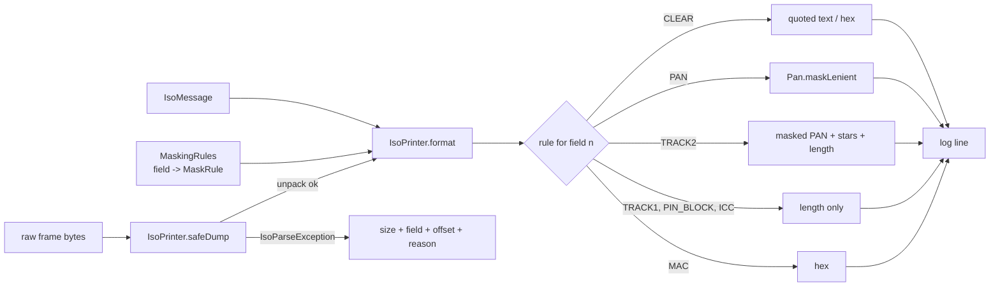

# Phase 1, step 6: a masked pretty-printer for logs and debugging

Step 5 gave us `IsoPacker`: messages to bytes and back. The moment you can parse a message, someone wants to print it. A developer wants to see what arrived, an operator wants to see why a transaction failed, a support engineer wants to paste something into a ticket. Printing is also the place where card data most often escapes. This step builds a printer that is **safe by construction**: every field goes through a masking rule, and a frame that cannot be parsed is described by size and reason, never by content.

New code: `Pan.maskLenient` in `common`; `MaskRule`, `MaskingRules` and `IsoPrinter` in `iso8583-core`.

## 1. Where this sits

```
 Terminal ──> Acquirer ──> Switch ──> Issuer          services (Phases 2-6)
                 \            |          /
                  \           |         /      every service uses the libraries below
   +----------------------------------------------------------------+
   |  iso8583-link   sign-on, echo, keep-alive      (step 9)         |
   |  iso8583-core   spec, codecs, bitmap, packer   (steps 1-7)      |
   |     step 1-5: spec, codecs, bitmap, Mti, IsoMessage, IsoPacker  |
   |     [*** step 6 ***]  MaskRule, MaskingRules, IsoPrinter        |
   |  transport      TCP framing, Netty             (Phase 0, step 8)|
   |  common         Hex, Pan (+ maskLenient), Stan, Money           |
   +----------------------------------------------------------------+
```

The printer sits beside the packer, not in the data path: nothing in a transaction depends on it. It is the thing every other component calls when it wants to say something about a message.

Who builds on it:

| Later work | Uses | For what |
| --- | --- | --- |
| Phase 1 step 9 (link logging) | `IsoPrinter.format`, `safeDump` | The link logs each message it sends and receives at DEBUG, through the printer. |
| Phase 1 step 8 (Netty transport) | the same rule, applied to bytes | The transport logs only frame lengths, never bytes (section 2.6). |
| Phase 3 (switch) | `format` | Tracing one transaction across acquirer-side and issuer-side legs. |
| Phase 6 (HSM) | `MaskRule.PIN_BLOCK` | PIN blocks travel to and from the HSM simulator; they must be as invisible in its logs as in the switch's. |
| Phase 7 (observability) | the whole idea | Log aggregation and traces centralise logs, which makes a leak in one line visible to everyone with dashboard access. |

## 2. The domain concept

This section is background, not legal advice. The Payment Card Industry Data Security Standard (PCI DSS) changes between versions and its requirement numbers move, so read the current version and your assessor's guidance before relying on any of it.

### 2.1 Displaying versus storing

PCI DSS treats a card number differently depending on what you do with it:

| Technique | What it does | Reversible? | Typical use |
| --- | --- | --- | --- |
| **Masking** | Hides part of the value **when displayed**: `411111******1111` | The stored value is still complete; masking is a view | Screens, logs, receipts, reports |
| **Truncation** | **Removes** part of the value permanently: keep first 6 and last 4, drop the rest | No | Storage where you only need to recognise the card |
| **Tokenisation** | Replaces the PAN with a random surrogate; a vault maps it back | Only through the vault | Merchants who keep "card on file" |
| **Encryption** | Scrambles the full value with a key | Yes, with the key | Storage and transit of the full PAN |

The standard's display rule, as commonly summarised, is that when a PAN is shown, at most the first six and last four digits may be visible (newer versions allow more subtle variants depending on the BIN length; check the version you are held to). This project's rule in `CLAUDE.md` is the conservative reading: first 6 plus last 4, everywhere.

Masking is not storage protection. A log file that says `411111******1111` is fine to show; a log file with the full number, encrypted at rest, is still a PCI-scoped store of card data with all the key management that implies. So the printer never produces the full number in the first place.

### 2.2 Sensitive authentication data

Separate from the PAN is a category usually called **sensitive authentication data**: full track data (magnetic stripe contents), the card verification code (CVV2/CVC2, and the equivalents carried in track data), and PIN data including the encrypted **PIN block**. The rule that matters most for engineers: these must **not be stored after authorization**, not even encrypted. A merchant or acquirer needs them to get an authorization; once the response is back, they must be gone.

Consequence for logging: a log line is a store. If a DEBUG line contains field 35 or field 52, and that line is written to disk, you have stored sensitive authentication data. "It was only a debug log" is not a defence a typical assessor accepts, and the data lives on in backups, shipped log archives and search indexes.

That is why the printer hides track 1, the PIN block and ICC data entirely, shows track 2 only with its PAN masked and its tail replaced by stars, and shows only the length of the rest.

### 2.3 Why logs are the usual leak

Almost nobody designs a system to store PANs in logs. It happens indirectly:

- **Debug logging left on.** Someone raises a log level during an incident and forgets to lower it, or ships a build whose default level is too verbose.
- **Exception traces.** An exception message that interpolates the offending value ("invalid PAN 4111...") ends up in an error tracker. Section 4 explains why the exceptions in this codebase carry only a length, an index and a reason.
- **`toString()` on a data class.** An auto-generated `toString` prints every field. That is why `IsoMessage.toString` lists field numbers only and `FieldValue.toString` lists sizes only.
- **APM and tracing tools.** Instrumentation that captures method arguments or HTTP/TCP payloads copies card data into a third-party system.
- **Support tickets and chat.** A developer pastes a hex dump into a ticket to ask "what is wrong with this field?". The ticket system was never assessed for card data.

A typical leak scenario (illustrative, not a specific incident): an issuer integration starts timing out in production. An engineer enables `DEBUG` on the network layer, which logs every frame as a hex dump, to see the traffic. The problem is found, but the level stays on for two weeks. The logs, which are shipped to a central search index with broad read access and a 90-day retention, now contain thousands of full PANs and track 2 values. Nobody stole anything, but the company now has to treat the logging pipeline as in scope for the card-data audit, and may have to purge the index.

The defence is to make "log the message" safe, so that turning on DEBUG is not a risky decision.

### 2.4 Why EMV field 55 is dangerous to show

Field 55 carries chip data from an EMV card, as a list of **TLV** (tag, length, value) items. Which tags appear depends on the transaction and the scheme, but the chip's data set can include:

- tag `5A`: the application PAN;
- tag `57`: the **track 2 equivalent data**, which contains the PAN, expiry and discretionary data;
- cryptograms, the application transaction counter, terminal verification results and more.

Because it is a blob, you cannot tell from the outside whether a given message includes the PAN. And you cannot safely print a prefix: if the chip puts `5A` first, a truncated hex prefix contains the first digits of the PAN, and if it puts it somewhere else, a different truncation leaks it. The roadmap said "truncate field 55"; this step deliberately overrides that. The printer shows the length and nothing else. (If you need to see the individual tags, a future EMV parser would decode the TLV and apply rules per tag, which is a different step.)

### 2.5 Why a MAC is fine to show

Fields 64 and 128 carry a **message authentication code**: a keyed checksum of the message, computed with a key the printer does not have. Seeing it reveals nothing about the card or the key (it is a fixed-size output of a keyed one-way function), and it is useful during MAC failures: you can compare what the sender computed with what the receiver computed. So the default rule shows it as uppercase hex. The rule is data, so a deployment that disagrees changes one line.

### 2.6 A forward note about the existing echo server

Phase 0's `EchoServer` logs raw frame hex at `FINER`. That is acceptable for a demo that echoes hand-built messages and is only reached when someone turns on a very verbose level, but it is exactly the pattern from section 2.3. Step 8's Netty transport will log **only lengths** at the transport layer, because the transport sees bytes and does not know what is in them; message-level logging happens above it, through this printer. We do not change `transport` in this step.

## 3. A concrete message, from real output

Everything below was produced by running the code in `jshell` (the session is in section 5).

### 3.1 The 0100, raw and printed

The raw frame, as `Hex.dump` shows it. This is what leaks if you log the bytes:

```
0000  30 31 30 30 37 32 33 43  30 34 38 30 32 30 43 30  0100723C048020C0
0010  39 30 30 30 31 36 34 31  31 31 31 31 31 31 31 31  9000164111111111
0020  31 31 31 31 31 31 30 30  30 30 30 30 30 30 30 30  1111110000000000
0030  30 30 30 30 31 35 30 30  31 30 33 31 31 34 33 30  0000150010311430
0040  31 35 30 30 30 31 32 33  31 30 33 30 31 35 31 30  1500012310301510
0050  33 31 32 35 31 32 30 35  31 30 30 32 34 34 31 31  3125120510024411
0060  31 31 31 31 31 31 31 31  31 31 31 31 31 3D 32 35  1111111111111=25
0070  31 32 31 30 31 54 45 52  4D 30 30 30 31 4D 45 52  12101TERM0001MER
0080  43 48 41 4E 54 30 30 30  30 30 30 31 38 34 30 30  CHANT00000018400
0090  31 32 33 34 35 36 37 38  39 41 42 43 44 45 46     123456789ABCDEF
```

Read the right-hand column: the PAN `4111111111111111` is in the clear at offset 0x16 (split across lines in the dump, but trivially readable), the track 2 at 0x5D with its `=2512101` tail, and the PIN block as the hex text `0123456789ABCDEF` at the end. Anyone with the log has all three.

The same message through `IsoPrinter.format(message)`:

```
MTI    0100  AUTHORIZATION REQUEST from ACQUIRER
BITMAP 723C048020C09000
[002]  Primary account number ............... 411111******1111
[003]  Processing code ...................... "000000"
[004]  Amount, transaction .................. "000000001500"
[007]  Transmission date and time ........... "1031143015"
[011]  System trace audit number ............ "000123"
[012]  Time, local transaction .............. "103015"
[013]  Date, local transaction .............. "1031"
[014]  Date, expiration ..................... "2512"
[022]  POS entry mode ....................... "051"
[025]  POS condition code ................... "00"
[035]  Track 2 data ......................... 411111******1111=******* (24 chars)
[041]  Card acceptor terminal ID ............ "TERM0001"
[042]  Card acceptor ID code ................ "MERCHANT0000001"
[049]  Currency code, transaction ........... "840"
[052]  PIN data ............................. [8 bytes, PIN block hidden]
```

Notes on the layout:

- `BITMAP 723C048020C09000` is the primary bitmap, the same 16 hex characters you can see at offset 4 of the raw dump (`37 32 33 43 ...`, which is the ASCII text `723C...`). No secondary bitmap, so no second word.
- Field names come from the spec, so the printer shows whatever dialect it was given.
- Text values are quoted so you can see their exact extent, including padding spaces: `"TERM0001"` is eight characters. A field printed as `"T1      "` tells you the padding is there; printed bare you would not know.
- Field 14 (expiry) is shown. It is not on the sensitive list by default, and a deployment that wants it hidden adds one rule (section 4).
- Track 2 keeps the masked PAN, then one star per remaining character, then the length. The length is useful when diagnosing a "wrong length" error and reveals nothing.
- The PIN block shows only its size. 8 bytes is the size of a standard PIN block, so the length confirms the field is plausible.

### 3.2 The 0800 echo, with a secondary bitmap

```
MTI    0800  NETWORK MANAGEMENT REQUEST from ACQUIRER
BITMAP 8220000000000000 0400000000000000
[007]  Transmission date and time ........... "1015042100"
[011]  System trace audit number ............ "000001"
[070]  Network management information code .. "301"
```

Field 70 lives in the second half of the bitmap, so the first word starts with `8` (bit 1 set: "a secondary bitmap follows") and the printer shows both words. The longest field name in the default spec ("Network management information code", 35 characters) sets the width of the label column: names are padded with dots to 38 characters, which leaves it at least two dots.

### 3.3 The 0110 response

```
MTI    0110  AUTHORIZATION REQUEST RESPONSE from ACQUIRER
BITMAP 7238000006C08000
[002]  Primary account number ............... 411111******1111
[003]  Processing code ...................... "000000"
[004]  Amount, transaction .................. "000000001500"
[007]  Transmission date and time ........... "1031143015"
[011]  System trace audit number ............ "000123"
[012]  Time, local transaction .............. "103015"
[013]  Date, local transaction .............. "1031"
[038]  Authorization ID response ............ "A1B2C3"
[039]  Response code ........................ "00"
[041]  Card acceptor terminal ID ............ "TERM0001"
[042]  Card acceptor ID code ................ "MERCHANT0000001"
[049]  Currency code, transaction ........... "840"
```

"from ACQUIRER" on a response looks wrong. It is faithful to the MTI: the fourth digit names the party that **originated the transaction**, and a response carries the request's digit (`responseMti` drops only the repeat flag). The printer reports what the MTI says rather than guessing who actually sent it. A repeat prints as `from ACQUIRER (repeat)`.

### 3.4 What `safeDump` prints for a bad frame

The 0100 frame truncated to 30 bytes, which cuts field 2 short:

```
unparseable frame: 30 bytes; field 2 at offset 22: needs 16 bytes, only 8 left
```

A 5-byte fragment:

```
unparseable frame: 5 bytes; field 1 at offset 4: truncated primary bitmap, need 16 bytes, have 1
```

Size, field, offset, reason. No bytes, no hex, even though 8 of the 16 PAN digits were inside those 30 bytes. With the offset and the spec you can find the problem in the capture on a machine that is allowed to hold captures; the log line does not need to.

## 4. Design and flow



Key classes:

- `MaskRule` (enum): CLEAR, PAN, TRACK2, TRACK1, PIN_BLOCK, ICC, MAC.
- `MaskingRules` (immutable): a map from field number to rule, default CLEAR. `ISO87_DEFAULT` marks 2, 35, 45, 52, 55, 64 and 128. `with(field, rule)` returns a new instance.
- `IsoPrinter`: `format(message)`, `format(message, rules)` and `safeDump(spec, frame)`.
- `Pan.maskLenient` in `common`.

### Decisions and why

**Rules are data, keyed by field number.** The printer contains no `if (field == 2)`. A dialect that puts a card number in field 48 is handled by `rules.with(48, MaskRule.PAN)`. A stricter deployment hides the expiry the same way. Keying by field number, not by value shape, matters: a value that "looks like a PAN" test would miss a malformed PAN, which is exactly what you most want hidden.

**Lenient masking never throws in a logging path.** `Pan.mask` throws on bad input, correct for business code. In a logger it would turn a diagnostic line into an exception, at the moment something is already wrong, and the exception could hide the original failure. `maskLenient` returns the normal mask for a valid PAN and `[16 chars]` for anything else, even a PAN with one typo. A near-miss PAN is still likely a PAN, so it reveals no character. The test `malformedPanInAnAnsFieldIsReducedToItsLength` pushes `4111x11111111111` through a spec where field 2 accepts any printable text.

**ICC data is hidden, not truncated.** Section 2.4. A prefix cannot be proved safe for a blob of unknown structure.

**The PIN block and track 1 show only a length.** Track 1 carries the cardholder name, so masking its PAN part would still leak a name. An encrypted PIN block is still sensitive authentication data.

**`safeDump` never falls back to hex.** The tempting implementation is "try to parse; if that fails, dump the bytes so at least we see something". That is precisely the leak from section 2.3, delivered when the system is least understood. On a parse failure it reports the size and the exception message (`IsoParseException` messages carry field, offset and reason, never content, by design from step 5). An unexpected exception type is reported by class name only, because its message is not known to be free of content. `Hex.dump` of a frame remains available for tests with hand-built messages.

**`toString` stays minimal.** `IsoMessage.toString` still prints field numbers only. Making it call the printer would be convenient and would put a multi-line masked rendering into every accidental `log.info("got " + message)`; but "convenient" is how formatting choices leak into code that was never reviewed for it. The printer is an explicit call.

**One line per field, fixed layout.** Tests compare whole strings, so a change to the layout is a conscious test update, not drift.

### What this does not do

- It does not make an arbitrary logger safe: if code logs `message.pan()` directly, the printer is bypassed. The remaining defence is code review, tests like the leak tests here, and (later) log scanning.
- It does not decode field contents (TLV in field 55, sub-fields in 48 or 126).
- It does not decide log levels; see step 9.

## 5. Try it yourself

Build and install the libraries once so jshell can see the classes:

```
./mvnw -q -pl iso8583-core -am install -DskipTests
```

Then, from the repository root (use `;` as the class-path separator on Windows, `:` on Linux and macOS):

```
jshell --class-path "common/target/classes;iso8583-core/target/classes"
```

Paste these lines one block at a time:

```java
import dev.paysim.common.*;
import dev.paysim.iso8583.*;
import dev.paysim.iso8583.spec.*;
import java.time.*;
import java.util.*;
var spec = Specs.PAYSIM_ASCII_87;
var m = IsoMessage.builder(spec, Mti.AUTH_REQUEST).pan("4111111111111111").processingCode("000000").amount(Money.of(1500,"USD")).transmissionDateTime(Clock.fixed(Instant.parse("2026-10-31T14:30:15Z"), ZoneId.of("UTC"))).stan(123).localDateTime(LocalDateTime.parse("2026-10-31T10:30:15")).set(14,"2512").set(22,"051").set(25,"00").set(35,"4111111111111111=2512101").terminalId("TERM0001").merchantId("MERCHANT0000001").set(52,new byte[]{1,0x23,0x45,0x67,(byte)0x89,(byte)0xAB,(byte)0xCD,(byte)0xEF}).build();
System.out.println(IsoPrinter.format(m));
```

The raw bytes, then the safe version of a damaged frame:

```java
var frame = IsoPacker.pack(m);
System.out.println(Hex.dump(frame));
System.out.println(IsoPrinter.safeDump(spec, Arrays.copyOf(frame, 30)));
System.out.println(m);
```

Lenient masking, chip data, and a custom rule:

```java
System.out.println(Pan.maskLenient("4111x11111111111") + " " + Pan.maskLenient(null));
var icc = IsoMessage.builder(spec, Mti.AUTH_REQUEST).stan(1).set(55, Hex.decode("5A0841111111111111115F2403251231")).build();
System.out.println(IsoPrinter.format(icc));
var strict = MaskingRules.ISO87_DEFAULT.with(14, MaskRule.PAN);
System.out.println(IsoPrinter.format(m, strict));
```

Run just this step's tests:

```
./mvnw -q -pl common test -Dtest=PanTest
./mvnw -q -pl iso8583-core -am test -Dtest=IsoPrinterTest -Dsurefire.failIfNoSpecifiedTests=false
./mvnw -q -pl iso8583-core -am test -Dtest=MaskingRulesTest -Dsurefire.failIfNoSpecifiedTests=false
```

Predict the output before you run it (no answers here):

1. `IsoPrinter.safeDump(spec, Arrays.copyOf(frame, 21))`. Which field and which offset does the error name, and why is it different from the 30-byte case?
2. Take `m` and replace the track 2 with `4111111111111111D2512101`, then format it. Does the separator character in the output change? What does `Pan.maskLenient("4111111111111111D")` print and why?
3. Build a message with field 64 set to eight bytes, print it with the default rules, then with `.with(64, MaskRule.CLEAR)`. What changes? Now try `.with(64, MaskRule.PIN_BLOCK)`. Which rule would you want on field 64 in production, and what is the argument for the other?

## Key terms

- **PAN masking:** showing only the first 6 and last 4 digits of a card number; a display technique, not storage protection.
- **Truncation:** permanently removing part of a stored value.
- **Tokenisation:** replacing a PAN with a surrogate that only a vault can map back.
- **Sensitive authentication data:** full track data, card verification codes and PIN data; must not be stored after authorization, even encrypted.
- **PIN block:** the encrypted, formatted PIN as carried in field 52; still sensitive authentication data.
- **Track 1 / track 2:** the two data tracks of a magnetic stripe; track 1 includes the cardholder name, track 2 the PAN, expiry and service code.
- **EMV field 55 / TLV:** chip data as a list of tag-length-value items; tags `5A` (PAN) and `57` (track 2 equivalent) may be inside.
- **MAC:** message authentication code, a keyed checksum for integrity; not secret.
- **Lenient masking:** masking that cannot throw, safe to call in a logging path.
- **safe dump:** logging a frame as a parsed, masked message or as size plus failure reason, never as raw bytes.
- **Originator digit:** the fourth MTI digit; names who started the transaction and stays the same in the response.

## Next step

Step 7: benchmarking the packer with JMH (coming next)
