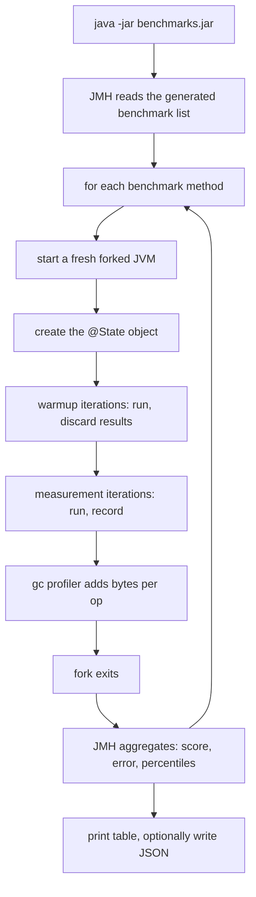

# Phase 1, step 7: measuring the packer with JMH

Steps 4 to 6 gave us a message model, a packer and a printer. They are correct (hundreds of tests say so), but nobody has asked how fast they are. This step does not change any of them. It adds a `benchmarks` module that **measures** them with JMH, the benchmarking harness from the OpenJDK project, and records the numbers so later phases have a baseline. The most useful result is not a speed record; it is a list of where the bytes and nanoseconds go.

New code: the `benchmarks` module (`Messages`, `PackerBenchmark`, `SliceBenchmark`, `PrinterBenchmark`, a smoke test). New doc: [`docs/benchmarks/phase-1.md`](../benchmarks/phase-1.md) with the raw results.

## 1. Where this sits

```
 Terminal ──> Acquirer ──> Switch ──> Issuer          services (Phases 2-6)
                 \            |          /
                  \           |         /      every service uses the libraries below
   +----------------------------------------------------------------+
   |  iso8583-link   sign-on, echo, keep-alive      (step 9)         |
   |  iso8583-core   spec, codecs, bitmap, packer   (steps 1-6)      |
   |  transport      TCP framing, Netty             (Phase 0, step 8)|
   |  common         Hex, Pan, Stan, Money                           |
   +----------------------------------------------------------------+
   |  [*** step 7 ***]  benchmarks  (depends on iso8583-core;        |
   |                    nothing depends on it)                       |
   +----------------------------------------------------------------+
```

The module hangs off the side of the stack. It reads `iso8583-core` and nothing reads it, so it can never slow down or break a service.

| Later work | Uses | For what |
| --- | --- | --- |
| Phase 1 step 8 (Netty transport) | the same harness | Measure frame decode cost and how it compares with the parse cost seen here. |
| Phase 3 (switch) | the numbers as a budget | The switch parses and re-packs every message on its hot path (acquirer side in, issuer side out, and back). The cost per hop here times the hops is the floor for the switch's own latency. |
| Phase 4 (terminal sim, load generator) | allocation per op | A load generator that sends thousands of messages a second will mostly measure its own garbage collector if it allocates like `pack` does. |
| Phase 7 (observability, latency SLOs) | method and baseline | A latency target such as "p99 under 50 ms inside the switch" only means something if you know what the parser alone costs. |

## 2. The domain concept

### 2.1 Why latency matters in a card network

An authorization is a request that someone is standing in front of: a person at a till, a customer on a checkout page, a car at a fuel pump. The request crosses several parties, and each one takes a slice of a time budget.

```
 terminal -> acquirer -> network switch -> issuer (decide) -> switch -> acquirer -> terminal
```

Typical figures (illustrative; schemes and acquirers publish their own and they differ by region and product):

- End to end, an authorization usually completes in well under a couple of seconds; one to three seconds is a common order of magnitude for what a customer will tolerate before they wonder if it failed.
- The terminal or acquirer sets a **timeout**, often in the range of a few seconds up to about thirty for some configurations. The switch and issuer have shorter internal timeouts so they can answer before the party upstream gives up.
- The issuer's own decision (balance, fraud score, limits) usually takes the largest share. A switch in the middle is expected to add little, tens of milliseconds or less, because it is on the path of every transaction.

Why a timeout matters beyond annoyance: if the acquirer gives up and the issuer later approves, the cardholder's available balance is reduced for a purchase the merchant believes did not happen. The fix is a **reversal** (a 04xx message, which the project's `Mti` already models) sent for the timed-out request. Every timeout therefore produces extra traffic and a reconciliation problem. A slow hop makes timeouts more likely, which makes more reversals, which adds load to the slow hop.

### 2.2 Throughput and peaks

Volume is not flat. Networks are sized for peaks: shopping holidays, paydays, events, a large retailer's sale hour. A busy national switch can see thousands of transactions per second at peak, and a global network more than that (hedged: published figures vary and change). The relevant point for a learner is the shape: capacity has to cover the peak with headroom, not the average, and a system that is fine at 100 messages per second can fall over at 2,000 because garbage collection pauses start to line up with the traffic.

### 2.3 Why parsing is on every hop

ISO 8583 is a binary format with a bitmap, so a party cannot route or decide without decoding it. The acquirer packs a message from its internal model; the switch unpacks it to read the BIN (to pick the issuer), possibly changes fields, and packs it again for the issuer link; the issuer unpacks it, and the response retraces the path. One purchase means roughly four to eight pack or unpack operations along the way, plus logging. Multiply by thousands per second and "just a parser" becomes a measurable share of CPU and, more importantly, of allocation.

### 2.4 Benchmarking concepts

Measuring a few microseconds of Java code correctly is harder than it looks. The concepts below are why we use JMH rather than a loop around `System.nanoTime()`.

**JIT warmup.** The JVM starts by interpreting bytecode, then compiles hot methods to machine code, then recompiles them with more aggressive optimisation as it learns how they are used. Early iterations are slower, sometimes by 10x or more. A benchmark must discard a **warmup** period and measure only steady state. (It also means a fresh JVM, such as a short-lived tool or a cold service right after deployment, runs slower than any steady-state number in this repo.)

**Dead-code elimination.** The JIT removes work whose result is never used. A loop that calls `IsoPacker.pack(msg)` and throws the array away may be compiled to nothing, and you will "measure" 0.3 ns per call. JMH defends against this: a `@Benchmark` method's return value is passed to a **Blackhole** that the JIT cannot see through, so the work must really happen. If you need several results, hand them to a `Blackhole` parameter explicitly.

**Constant folding.** If the input is a `static final` constant, the JIT can compute the result at compile time. That is why the benchmark inputs are ordinary non-final instance fields in a `@State` object.

**Forks.** The JIT's profile is shaped by what ran before in the same JVM: if the JVM has seen an earlier benchmark use a call site in another way, the compiled code for this one is affected. JMH runs each benchmark in a fresh **forked** JVM so one benchmark cannot contaminate another.

**Throughput versus average time.** Two views of the same thing. *Throughput* counts operations per unit of time (higher is better). *Average time* is time per operation (lower is better). They are reciprocals when one thread runs and nothing varies; with several threads or uneven work, they diverge. Report both so a reader can pick the one that matches their question: capacity planning wants throughput, latency budgets want time per operation.

**Allocation per operation and GC pressure.** Time per operation hides a cost that arrives later: every object allocated has to be garbage-collected. The `gc` profiler reports `gc.alloc.rate.norm`, the bytes allocated per operation. In the JVM the allocation itself is cheap, but a high rate fills the young generation faster, which triggers collections more often. At low rates this is invisible; at high rates it shows up as latency spikes that no single method's timing explains. Bytes per op is also the most stable number: it barely varies between runs, unlike nanoseconds.

**Why a naive `System.nanoTime()` loop lies.** It measures the interpreter during warmup, then compiled code, with no separation. It lets the JIT delete unused results. It lets the JIT hoist constant inputs. It runs everything in one JVM so earlier loops change later ones. It reports one number with no error estimate. Each of those can move the result by a factor of two or more, and none is visible in the output.

## 3. The numbers

All figures below come from one run on an Intel Core i5-10400F desktop (6 cores, Windows 10, Java 21.0.5, G1). They are **relative** measurements from one machine; the full table with machine details, JMH settings and errors is in [`docs/benchmarks/phase-1.md`](../benchmarks/phase-1.md).

| Benchmark | ns/op | ops/ms | alloc bytes/op |
| --- | ---: | ---: | ---: |
| `packAscii0100` | 2,112 | 475 | 6,096 |
| `unpackAscii0100` | 1,068 | 982 | 4,616 |
| `packCompact0100` | 2,237 | 447 | 6,024 |
| `unpackCompact0100` | 1,226 | 756 | 3,480 |
| `packAscii0800` | 478 | 2,120 | 1,600 |
| `unpackAscii0800` | 502 | 2,106 | 1,888 |
| `roundTripAscii0100` | 3,202 | 308 | 11,072 |
| `unpackSliceAtStart` (copies ~160 B) | 1,027 | 956 | 5,152 |
| `unpackSliceFlushWithEnd` (no copy) | 1,057 | 973 | 4,616 |
| `unpackSliceNearEnd` (copies ~64 KiB) | 7,127 | 140 | 70,528 |
| `formatAscii0100` (printer) | 9,624 | 106 | 18,504 |
| `unpackAndFormatAscii0100` | 10,759 | 92 | 22,472 |

The error margins in the full table are 5% to 20% for several rows, so read the ratios, not the last digit.

### 3.1 What one 0100 costs

The sample 0100 (PAN, processing code, amount, STAN, dates, card expiry, POS entry mode, track 2, terminal and merchant ids, PIN block) is 159 bytes on the wire in the ASCII dialect and 92 bytes in the compact dialect. On this machine:

- Parsing it takes about **1.1 microseconds** and allocates about **4.6 KB**: about 29 bytes of garbage per byte of input. The `FieldValue[129]` array alone is roughly half a kilobyte; the rest is one value object and one string or byte array per field.
- Packing it takes about **2.1 microseconds** and allocates about **6.1 KB**. It is slower than parsing because the output grows inside a `ByteArrayOutputStream` that starts at 256 bytes and doubles, and `toByteArray()` copies the result once more.
- One hop that parses and re-packs (the switch forwarding a request) is therefore about 3 microseconds of CPU, or three thousandths of a millisecond. Against a 2-second end-to-end budget that is negligible; the parser is not what will make the switch slow. What deserves attention is the roughly 11 KB of garbage per hop, which at thousands of messages per second becomes tens of megabytes of garbage per second.

### 3.2 ASCII versus compact

The compact dialect is 42% smaller on the wire (92 versus 159 bytes) and allocates about 25% less when unpacking (3,480 versus 4,616 B/op), but is not faster: unpack is about 15% slower and pack about 6% slower (the latter within error). BCD decoding does arithmetic per digit pair; ASCII decoding just copies and builds strings. So the compact format's value is bandwidth and (a little) garbage, not CPU. That matches how real networks evolved: bandwidth was the scarce resource when binary formats were chosen.

### 3.3 The slice benchmark and the step 5 note

Step 5 documented that `IsoPacker.unpack(spec, buffer, offset, length)` copies `buffer` up to the slice's end when the slice ends before the buffer does, so that field codecs cannot read beyond the slice. The benchmark quantifies it using a 64 KiB buffer:

| Slice position in the 64 KiB buffer | Copy made | ns/op | bytes/op |
| --- | --- | ---: | ---: |
| at the start | about 160 bytes | 1,027 | 5,152 |
| ends exactly at the buffer's end | none (whole-buffer shortcut) | 1,057 | 4,616 |
| ends one byte before the buffer's end | about 64 KiB | 7,127 | 70,528 |

So the copy is free in the common cases of "frame at the start of a small buffer" or "frame flush with the end", and costs about 6 microseconds and 66 KB per message in the worst case. A link that reads frames into one large reusable buffer and passes offsets would hit that worst case on most frames. The reading at the time: a known, bounded cost the step 5 design accepted for safety and absolute error offsets. Once it had a number, it was cheap to remove, as the next subsection shows.

#### The fix

The measurement made the fix obvious, so it was done right after, in its own change. `FieldCodec`, `BitmapCodec` and `MtiCodec` gained a 4-argument `unpack(..., offset, limit)` that treats `limit` as the exclusive end and uses it in every bounds check (the old 3-argument methods delegate with `limit = buffer.length`). `IsoPacker.unpack(spec, buffer, offset, length)` now passes `offset + length` as the limit and no longer copies. Error offsets are still absolute positions in `buffer`, and bytes past the slice are never read, even when they would have completed a truncated field (new tests `IsoPackerSliceTest` and `LimitedReadTest` pin that).

| Benchmark | Before ns/op | After ns/op | Before B/op | After B/op |
| --- | ---: | ---: | ---: | ---: |
| `unpackSliceAtStart` | 1,027 | 992 | 5,152 | 4,976 |
| `unpackSliceFlushWithEnd` | 1,057 | 1,046 | 4,616 | 4,616 |
| `unpackSliceNearEnd` | 7,127 | 1,029 | 70,528 | 4,616 |
| `PackerBenchmark.unpackAscii0100` (no regression) | 1,068 | 1,022 | 4,616 | 4,616 |

Why thread a limit rather than copy: the copy existed only so that code checking `buffer.length` would stop at the slice end. Passing the end as a number gives the same guarantee for free, and the cost no longer depends on where the frame sits in the buffer. Lesson: measure, then fix, then re-measure. The baseline made the problem concrete, and the second run confirms the fix helped and that the normal path did not get slower. (The "measuring step does not change what it measures" decision below still holds: the fix is a separate change after the baseline.)

### 3.4 What logging costs

`IsoPrinter.format` takes about 9.6 microseconds and allocates 18.5 KB, roughly nine times the time of parsing the same message. Formatting every message on a hot path at DEBUG level would multiply the per-message CPU by about ten and the garbage by about five. The step 6 printer is safe to turn on; this shows why you still do it conditionally (`if (log.isDebugEnabled())`), and why production keeps it off.

### 3.5 A benchmark bug worth keeping

The first version of `SliceBenchmark` compared "slice at the start" with "slice at the end of the buffer", expecting the end case to show the big copy. The numbers were the same (about 1.03 microseconds each). That did not match the step 5 note, so the benchmark, not the packer, was suspect. Reading `unpack` showed why: "ends exactly at the buffer's end" takes the shortcut `end == buffer.length ? buffer : Arrays.copyOf(buffer, end)`, so the case that was supposed to be the worst was the only free one. The fix was to measure three positions, including "one byte short of the end". Lesson: when a benchmark contradicts what you believe, find out which of the two is wrong before believing either. A benchmark measures what you wrote, not what you meant.

## 4. Design and flow

### 4.1 How JMH runs a benchmark



The benchmark classes are ordinary Java with annotations. At compile time the JMH annotation processor (`jmh-generator-annprocess`) generates a harness class for every `@Benchmark` method: a timing loop with the Blackhole plumbing and the fork protocol. That generated code is what runs, not your method called naively in a loop.

### 4.2 Module layout

```
benchmarks/
  pom.xml                       jmh-core, annotation processor, shade plugin
  src/main/java/dev/paysim/benchmarks/
    Messages.java               fixtures: sample 0100, 0800 echo, ASCII and compact specs
    PackerBenchmark.java        pack/unpack x ASCII/compact, 0100/0800, round trip
    SliceBenchmark.java         slice overload at three positions in a 64 KiB buffer
    PrinterBenchmark.java       format; unpack + format
  src/test/java/.../BenchmarksSmokeTest.java   calls each benchmark method once
```

### 4.3 Decisions and why

**The module compiles in every build; benchmarks only run on demand.** If the module were opt-in (a profile), it would stop compiling the first time someone renamed a method in `iso8583-core`, and nobody would notice until they wanted a number. Putting it in the root `<modules>` means `./mvnw verify` breaks immediately when the API moves. Running is a separate, deliberate act (about 3 minutes), because benchmarks need a quiet machine and long runs.

**A shaded jar.** JMH forks child JVMs and needs the full classpath, including the generated classes and the `META-INF/BenchmarkList` file. The standard approach is to build one self-contained `benchmarks.jar` with the Maven Shade plugin and `org.openjdk.jmh.Main` as its entry point. That also gives us JMH's command line for free: select by regex, change iterations, add profilers, write JSON. The shade configuration uses `ServicesResourceTransformer` (merges service files) and strips signature files from dependencies (otherwise the merged jar fails with a security error).

**Fixtures live in main code, not test code.** The tests have `PackerSupport` to build the sample messages, but test classes are not on the benchmarks module's classpath and the shaded jar contains only main code. So `Messages` repeats the sample message and the compact-spec builder. Sharing through a `test-jar` was possible but adds a build dependency between modules for about 60 lines. The smoke test pins the fixtures to the known wire sizes (159 and 92 bytes) so the copy cannot drift from the original unnoticed.

**A smoke test.** The benchmarks never run in `verify`, so a bug in a benchmark (for example benchmarking the wrong message, as in section 3.5) would be invisible. The test calls every benchmark method once and asserts the result is correct (sizes, round trips, masked PAN in the printed form). It does not measure anything.

**Inputs are non-final fields of a `@State` class.** So the JIT cannot treat them as compile-time constants. Each benchmark returns its result so JMH's generated code feeds it to a Blackhole.

**The measuring step does not change what it measures.** No `iso8583-core` code was touched. The numbers show where optimisation might pay off (pack's buffer growth, the slice copy, per-field strings) but this step records a baseline; changing code in the same commit would make before and after impossible to compare.

**Annotation processing is disabled for test compilation only.** The JMH processor is configured on the module's compiler plugin. Without further configuration it also runs when compiling the test class and, finding no JMH annotations, warns "No processor claimed any of these annotations", which `-Werror` turns into a failure. Test compilation is set to `proc=none`. No lint option is suppressed anywhere.

## 5. Try it yourself

Set the TLS option first if downloads fail on this machine:

```
export MAVEN_OPTS="-Djavax.net.ssl.trustStoreType=Windows-ROOT"
```

Build the jar (the first run downloads JMH):

```
./mvnw -q -pl benchmarks -am package -DskipTests
```

List what exists:

```
java -jar benchmarks/target/benchmarks.jar -l
```

Run everything with the allocation profiler (about 3 to 4 minutes; close heavy programs first, and do not touch the machine while it runs):

```
java -jar benchmarks/target/benchmarks.jar -prof gc -rf json -rff /tmp/jmh.json
```

Run one benchmark fast (regex on the name; 2 warmup and 3 measurement iterations, 1 fork). The result is noisier, which is the point of the first experiment below:

```
java -jar benchmarks/target/benchmarks.jar PackerBenchmark.unpackAscii0100 -wi 2 -i 3 -f 1 -prof gc
```

Useful options: `-wi` warmup iterations, `-i` measurement iterations, `-f` forks, `-bm avgt` or `-bm thrpt` to run one mode only, `-tu us` to report microseconds, `-h` for everything.

Verify that the fixtures still work without running any benchmark:

```
./mvnw -q -pl benchmarks -am test -Dtest=BenchmarksSmokeTest -Dsurefire.failIfNoSpecifiedTests=false
```

### Predict-then-measure experiments

Write your prediction down before running each one: a number or a ratio, and a one-sentence reason. Then measure and, where you were wrong, work out why.

1. **Quiet versus noisy.** Run the single-benchmark command above three times in a row, then run it again while something heavy is running (a build, a video). How much do ns/op and the error column move? How much does `gc.alloc.rate.norm` move? Which of the two numbers would you trust to compare two versions of the code taken on different days?
2. **Remove the return.** In `PackerBenchmark`, change `unpackAscii0100` to return `void` and drop the `return`. Predict whether the score goes up, down or stays; by how much; and why. (Hint: think about what the JIT can prove about a result that nobody reads, and about what JMH's generated code does with a return value.) Restore the method afterwards.
3. **ASCII versus compact, per field.** Using the table, compute ns per field and bytes per field for unpack in each dialect for the 0100 (count its fields in the spec first). Which field types would you predict are most expensive in each dialect? Change `PackerBenchmark` to unpack a message that has only field 4 (amount) and field 11 (STAN) in each dialect and see whether your per-field guess holds.
4. **Add a field.** Add field 37 (retrieval reference number) to the sample 0100 in `Messages`. Predict the change in unpack allocation in bytes per op before you run it. Account for: the value object, the string, any array the codec creates. Then measure. (The smoke test's length assertions will tell you the new wire size; update them deliberately, not blindly.)

## Key terms

- **JMH:** the Java Microbenchmark Harness from OpenJDK; generates the timing loops and handles warmup, forks and result statistics.
- **Warmup:** iterations run and discarded so the JIT has compiled the code before measurement begins.
- **JIT (just-in-time compiler):** the JVM component that turns hot bytecode into optimised machine code at run time.
- **Fork:** a fresh JVM for each benchmark so earlier code does not shape the compiled code of later ones.
- **Blackhole:** JMH's sink for results; stops the JIT from deleting work whose output is unused.
- **Dead-code elimination:** the JIT removing computations whose results are never used.
- **Constant folding:** the JIT computing a result at compile time because the inputs are constants.
- **Throughput / average time:** operations per unit time (higher is better) versus time per operation (lower is better).
- **gc.alloc.rate.norm:** bytes allocated per benchmark operation, from JMH's `gc` profiler.
- **GC pressure:** how fast code creates garbage and so how often the collector must run.
- **Shaded (uber) jar:** one jar containing the module and all its dependencies, so JMH's forks have a complete classpath.
- **Reversal:** a 04xx message that undoes a request the sender could not confirm, typically after a timeout.
- **Hot path:** code that runs for every transaction; small costs here are multiplied by volume.
- **Slice (overload):** unpacking from an offset and length inside a larger buffer; bounded by an exclusive limit, no copy (it used to copy before the fix described in section 3.3).

## Next step

Step 8: Netty transport (coming next)
