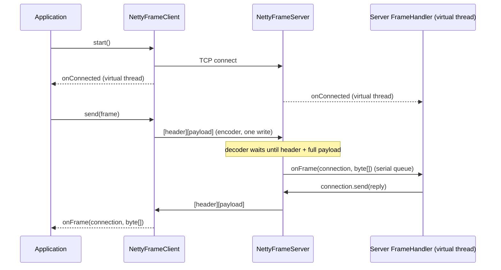
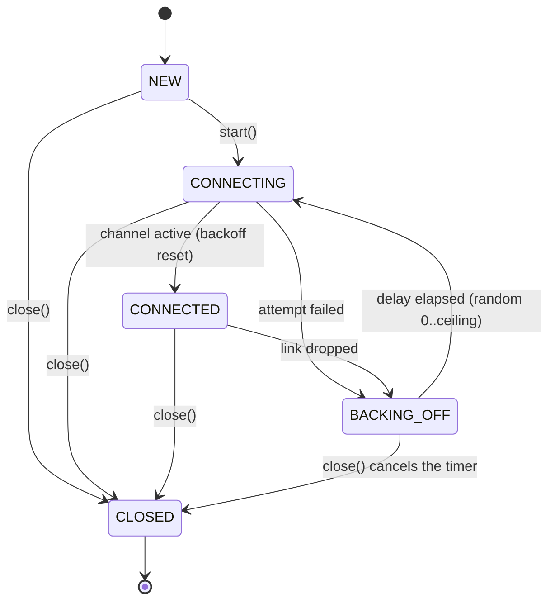

# Phase 1, step 8: Netty transport

Phase 0 gave us a blocking echo server and client: one virtual thread per connection, `DataInputStream.readFully`, and a `FrameCodec` that knows the length-header rules. It works, and it was the right way to learn framing. This step rebuilds the same idea on **Netty**, the event-driven network library that jPOS-style hosts, gateways and most JVM payment infrastructure sit on, and adds what a real card link needs and Phase 0 never had: a client that **reconnects by itself**, **idle detection**, and a clear rule about **which thread runs your code**.

Nothing here knows about ISO 8583. The transport moves `byte[]` frames; step 9 puts sign-on, echo and keep-alive messages on top of it.

New code (all in `transport`, package `dev.paysim.transport.netty`): `LengthHeaderFrameDecoder`, `LengthHeaderFrameEncoder`, `Backoff`, `FrameHandler`, `ConnectionListener`, `IdleKind`, `FrameConnection`, `NettyFrameServer`, `NettyFrameClient`, `NotConnectedException`, plus the internal `FrameChannelHandler` and `SerialExecutor`, and `NettyEchoDemo`. Small changes to Phase 0 code: `LengthHeader.encode/decode` are now public, and `EchoServer` no longer logs payload bytes.

## 1. Where this sits

```
 Terminal ──> Acquirer ──> Switch ──> Issuer          services (Phases 2-6)
                 \            |          /
                  \           |         /      every service uses the libraries below
   +----------------------------------------------------------------+
   |  iso8583-link   sign-on, echo, keep-alive      (step 9)         |
   |  iso8583-core   spec, codecs, bitmap, packer   (steps 1-7)      |
   | [*** transport  TCP framing, Netty             (Phase 0, step 8) ***]
   |  common         Hex, Pan, Stan, Money                           |
   +----------------------------------------------------------------+
```

`transport` does not depend on `iso8583-core`, and never will: it hands you bytes. That is what lets the same library carry ISO 8583 today and anything else later.

| Later work | Uses | For what |
| --- | --- | --- |
| Step 9 (`iso8583-link`) | `NettyFrameClient`, `NettyFrameServer`, `onIdle` | Sign-on (0800/301), echo test, and keep-alive messages sent when `onIdle(WRITER)` fires. |
| Phase 2 (issuer) | `NettyFrameServer` | The issuer service hosts a server; Spring only configures it and starts it. |
| Phase 3 (switch, acquirer) | both, plus client pools | The acquirer keeps several `NettyFrameClient`s to the switch; the switch holds client links to issuers and a server for acquirers. Matching replies to requests by STAN lives there, on top of `send`. |
| Phase 3 (timeouts, reversals) | the `send` failure contract | A frame that could not be sent is reported at once; one that was sent but never answered becomes a timeout and a reversal. |
| Phase 7 (observability) | listener callbacks | Connection up/down and framing-error counters. |

## 2. The domain concept

### 2.1 Why card network links are long-lived TCP connections

A web API usually opens a connection, sends a request, reads the response, and may close. Card networks do not work like that. Between an acquirer and a network (or a network and an issuer) there is a small number of **persistent links**, opened once and kept up for days.

Reasons (typical for ISO 8583 hosts, with details varying by network):

- **Volume and latency.** Connection set-up (TCP handshake, often TLS or a VPN tunnel on top) costs round trips. At thousands of authorizations a second, doing that per message is wasteful and adds delay to a customer who is standing at a till.
- **Many messages in flight on one link.** The sender does not wait for the reply to message 1 before sending message 2. Requests go out back to back and replies come back **in any order**, matched to their requests by fields such as the STAN (system trace audit number) and RRN. One link can therefore carry hundreds of concurrent authorizations. (The matching itself is Phase 3; the transport's job is only to carry frames both ways at any time.)
- **Sessions and sign-on.** Many networks require each link to be "signed on" with a network management message (0800 with code 001 in the classic scheme; 301 is the echo test used in our Phase 0 demo) before business messages are accepted, and signed off or re-signed on after trouble. The link has a **state**, which is why the transport exposes `onConnected`/`onDisconnected` and does not treat each message independently.
- **Keep-alive.** If nothing flows for a while (quiet night, low-volume issuer), either side sends an echo test (0800/301) so both sides know the link is alive. A link that has been silent for too long, with no echo answered, is treated as dead. The transport supports this with idle events; the messages themselves are step 9.
- **Dual links and primary/backup.** A serious connection has more than one path: two links to the same processor, or a primary and a backup site. Traffic is spread across them or fails over from one to the other. A single `NettyFrameClient` is one such link; Phase 3 manages several.

### 2.2 When the link drops in the middle of a transaction

This is the failure that shapes the design. Suppose an acquirer sent an authorization request (0100) and the connection dies before the response arrives. The acquirer does not know whether the issuer saw the request. Three possibilities: the request never left, it arrived and the response was lost, or it arrived and the issuer is still deciding.

The only safe answer is to treat the transaction as **timed out** and send a **reversal** (a 04xx message) once a link is available again, so that an approval the customer never saw does not hold their funds. That is Phase 3. For the transport, it means two honest rules:

1. `send` tells you immediately whether the frame was handed to a live connection. If the link is down it fails **at once** with `NotConnectedException`. It does not hold the message in a hidden queue, because a message that sits in a queue for 20 seconds and is then sent as the link comes back is a message the upper layer has already timed out and reversed. Silent queueing turns a clean failure into a duplicate. (Real systems do queue, but at a layer that knows about timeouts and STANs, not in the byte pipe.)
2. The reconnect loop runs by itself, so the link is back as soon as the other side is.

### 2.3 Why reconnect needs backoff and jitter

Typical scenario (illustrative, not a report of a specific outage): an issuer's host restarts. Two hundred acquirer-side connections lose their link at the same second. If each one retries every 100 ms, the host is hit with two hundred connection attempts per 100 ms exactly when it is starting up, cold caches, still loading keys. Many attempts fail or time out, which makes the clients retry, and the recovering host is held down by its own clients. This is the **thundering herd**.

Two standard fixes, both in `Backoff`:

- **Exponential backoff**: the wait ceiling doubles after each failure (100 ms, 200 ms, 400 ms ... up to 30 s). A host that is down for a minute is tried a few times, not six hundred.
- **Full jitter**: the actual wait is a random value between zero and the ceiling, `random(0, min(max, initial * 2^attempt))`. Without randomness all clients that started failing together would still retry together at 100, 300, 700 ms. With it they spread out over the whole window. (This is the "full jitter" variant popularised by an AWS architecture article; other variants add a fixed minimum.)

After a successful connect the counter is reset, so a later outage starts again with short waits.

### 2.4 Why idle detection exists

TCP does not tell you the other side is gone unless a packet gets through. Two real cases:

- **Half-open connections.** The peer machine crashes or loses power, or a cable is cut. No FIN or RST ever arrives. Your side believes the link is up and happily writes into a socket that nobody reads. Only a timeout on **silence** reveals it.
- **NAT and firewall timeouts.** Between many acquirers and their networks sit firewalls and NAT devices that drop the mapping for a connection that has been silent for some minutes (the value varies by device, from minutes to hours). The next packet then vanishes or is answered with a reset. Traffic every so often (keep-alive) keeps the mapping alive and tests the path at the same time.

`IdleStateHandler` raises an event when nothing was **read** for N ms (the other side went quiet: a signal to send an echo test, then to give up if there is no answer) or nothing was **written** for N ms (we have been quiet: send a keep-alive before the firewall forgets us). We expose these as `onIdle(connection, READER | WRITER)`. What to do about them is policy for step 9.

### 2.5 The Netty model, compared with Phase 0

Phase 0 (blocking): one virtual thread per connection sits in `read()`. The thread itself is the state of the connection: "I am halfway through reading a 55-byte payload" is a local variable and a position in the code. Simple to read. It scales well with virtual threads, but you cannot easily express "tell me if this connection has been silent for 30 seconds" or "reconnect with backoff" without extra threads and timers.

Netty (event-driven) flips this:

- A small fixed set of **event-loop threads** (a few per CPU core) each own many channels. A loop runs forever: wait for the operating system to say "these sockets have bytes / are writable / have a timer due", then call the right handler for each.
- Each channel has a **pipeline**: an ordered list of **handlers**. Inbound bytes flow from the socket through the handlers in order; outbound writes flow back the other way. Ours: `IdleStateHandler` (optional), our decoder, our encoder, then `FrameChannelHandler`.
- Bytes live in a **`ByteBuf`**, Netty's buffer type, usually **pooled** (reused) and **reference counted**: someone must release it, or memory leaks; touch it after release, and you read someone else's data. Our decoder copies each frame into a plain `byte[]` and hands that on, so no application code ever sees a `ByteBuf`.
- State that Phase 0 kept in a thread's stack ("halfway through a payload") now has to be kept in the **decoder**: it looks at the bytes it has, and if the frame is not complete it returns without consuming anything and waits for the next read.

**The one rule you must not break: never block the event loop.** One loop thread serves many connections. If a handler on that thread sleeps, waits for a database, or does a long computation, every other connection on the loop stalls with it, and so do timers (idle detection, reconnect). A single slow issuer lookup could freeze acquirer links that have nothing to do with it.

**How virtual threads fit.** Our hand-off: the event loop does only I/O and framing. As soon as a whole frame is decoded, `FrameChannelHandler` puts "run `onFrame` for this connection" on the **connection's serial queue**, which runs on a **virtual thread**. Your handler can then block (JDBC, Redis, waiting for a reply) in plain code, as in Phase 0, and the loop is untouched. This gives the event loop's efficiency for the network and the virtual thread's simplicity for the business code. The cost is one hand-off per frame, a few microseconds.

## 3. A frame's journey, with real bytes

Message: the Phase 0 echo test, ISO 8583 `0800`, 55 ASCII bytes:

```
0800 8220000000000000 0400000000000000 1015042100 000001 301
```

All bytes below came from running the code (a throwaway program using `EmbeddedChannel` and a real server/client pair; see section 5 to reproduce).

Header bytes for 55 payload bytes:

| Style | Header (hex) | Meaning |
| --- | --- | --- |
| `BINARY_2` | `0037` | two bytes, big-endian: 0x0037 = 55 |
| `ASCII_4` | `30303535` | four ASCII characters `0`,`0`,`5`,`5` |

### 3.1 The journey (BINARY_2)

```
 peer sends 57 bytes; TCP delivers them in two reads
   read 1 (22 bytes): 0037 3038303038323230303030303030303030303030
   read 2 (35 bytes): 3034303030303030303030303030303031303135303432313030303030303031333031

 ┌─────────────── Netty event-loop thread ──────────────────┐
 │ socket ─> [IdleStateHandler] ─> LengthHeaderFrameDecoder │
 │                                   read 1: header says 55, have 20 payload bytes
 │                                           -> consume nothing, wait
 │                                   read 2: 55 of 55 present
 │                                           -> copy to byte[55], emit
 │                                  ─> FrameChannelHandler.channelRead
 │                                           -> serial.execute(onFrame task)   (returns at once)
 └──────────────────────────────────────────────────────────┘
                                         │ hand-off
 ┌─────────────── virtual thread (per-connection serial queue) ──┐
 │ handler.onFrame(connection, frame)      <- your code, may block
 │   connection.send(frame)                -> channel.writeAndFlush(byte[55])
 └────────────────────────────────────────────────────────────────┘
                                         │ (Netty runs the write on the event loop)
 ┌─────────────── Netty event-loop thread ──────────────────┐
 │ LengthHeaderFrameEncoder: 0037 + 55 bytes -> one ByteBuf │
 │ ─> socket: 57 bytes, one write                            │
 └──────────────────────────────────────────────────────────┘
```

Encoder output, from running code (hex, 57 bytes):

```
0037 3038303038323230303030303030303030303030 3034303030303030303030303030303031303135303432313030303030303031333031
```

For `ASCII_4` the same payload is cut after 24 bytes (4 header + 20 payload), and the encoded output starts `30303535 3038303038...`; the decoder behaves identically: 0 frames after read 1, 1 frame (55 bytes, equal to the payload) after read 2. The test `FrameCodecNettyTest` pins this for both styles, including one byte at a time, and asserts that the encoder output equals the Phase 0 `FrameCodec.write` output byte for byte.

### 3.2 A real log line

At `FINER` the transport logs one line per frame, length and peer only:

```
FINER: Frame of 55 bytes from /127.0.0.1:57983
FINE: Connected: /127.0.0.1:57983
FINE: Disconnected: /127.0.0.1:57983
```

The payload never appears. A real 0100 carries a PAN in field 2, and "it is only a debug log" is how card numbers end up in log archives that nobody classified as cardholder data. Phase 0's `EchoServer` used to log `Hex.dump(frame)` at `FINER`; it now logs `From <peer>: 55 byte frame`, with a comment saying why. Even the stream error messages use only lengths and (for a bad ASCII header) the single offending byte.

### 3.3 A Windows quirk the tests ran into

When 50 clients connect to a localhost server in the same instant, Windows occasionally fails one of them with `SocketException: Invalid argument: setsockopt`. It is a burst-connect quirk of the Windows loopback stack, not a Netty bug: in a reproduction over 150 rounds, the Phase 0 blocking `EchoServer` hit it far more often than `NettyFrameServer`, and a bigger accept backlog did not help. The tests (`NettyServerClientTest`, and Phase 0's `EchoServerTest` since step 10) therefore open their connections one after another and then run the traffic concurrently, which still proves concurrent serving. Real terminals do not all connect in the same microsecond, but a recovering network can come close, which is one more reason clients use jittered backoff.

## 4. Design and flow

### 4.1 Client to server, one request and reply



### 4.2 Client life cycle



### 4.3 Decisions and why

**One decoder for both header styles, reusing `LengthHeader`.** `LengthHeaderFrameDecoder` asks `header.decode(...)` for the length, so ASCII-vs-binary is not duplicated and cannot drift from the blocking `FrameCodec`. To allow that, `LengthHeader.encode` and `decode` became `public`. The test that compares encoder bytes to `FrameCodec.write` guards the agreement.

**The oversize check happens on the header, before buffering.** A hostile or corrupt peer that sends `0xFFFF` and then drips bytes would otherwise make us hold 64 KB per connection while we wait. We reject as soon as the length is known. After any framing error the decoder discards everything that follows, because the stream is out of sync, and the connection is closed.

**Exact-size `byte[]` leaves the pipeline.** Pooled buffers are fast but dangerous to share: a forgotten `release()` leaks, a late use reads recycled memory. One copy of 55 bytes costs almost nothing and removes a whole bug class from every future handler.

**Mid-frame close is reported, not swallowed.** `decodeLast` runs when the channel closes; leftover bytes mean the peer vanished inside a message, so we raise a `FramingException` ("connection closed mid-frame (14 of 54 bytes)"). A clean close between frames is not an error.

**Per-connection serial dispatch on virtual threads.** The tension: frames of one connection must be handled **in order** (a sign-on must be processed before the traffic that follows it), but different connections must not wait for each other. A plain virtual-thread-per-frame executor would run frames of one connection concurrently and lose order. `SerialExecutor` (one per connection) keeps a queue; the first task submitted while idle starts a drain loop on a virtual thread, later tasks join the queue, and when it empties the loop ends and the thread is released. Listener callbacks use the same queue, so `onConnected` precedes the first frame and `onDisconnected` follows the last. Two things to know: the queue is unbounded (flow control belongs to the layer above), and a handler exception is logged and the queue carries on.

**`send` fails fast and never queues.** See 2.2. The returned `CompletableFuture<Void>` completes when the bytes are written, or fails with `NotConnectedException`, `ClosedChannelException`, or `FramingException` (payload above the maximum).

**Full-jitter backoff, pure and testable.** `Backoff.delay(attempt)` depends only on the attempt and an injectable `RandomGenerator`, so tests can fix a seed and assert bounds. `next()`/`reset()` add the counter. Overflow is guarded: `initial * 2^attempt` is never computed if it would exceed the maximum.

**TCP_NODELAY and SO_KEEPALIVE on.** Payment messages are small and latency-sensitive; Nagle's algorithm (waiting to batch small writes) would add delay. `SO_KEEPALIVE` is only a backstop (operating-system default intervals are hours); application-level keep-alive via idle events is the real mechanism.

**Logging.** Lengths and peers only, as in 3.2.

## 5. Try it yourself

Run the tests for this step:

```
./mvnw -q -pl transport -am test -Dtest='FrameCodecNettyTest,BackoffTest,SerialExecutorTest,NettyServerClientTest,NettyReconnectTest' -Dsurefire.failIfNoSpecifiedTests=false
```

Run the Netty echo demo (the `exec-maven-plugin` in `transport/pom.xml` is fixed to the Phase 0 `EchoDemo`, so use `java` directly):

```
./mvnw -q -pl transport -am install -DskipTests
./mvnw -q -pl transport dependency:build-classpath -Dmdep.outputFile=target/cp.txt
java -cp "transport/target/classes;common/target/classes;$(cat transport/target/cp.txt)" dev.paysim.transport.netty.NettyEchoDemo ASCII_4
```

(On Linux or macOS use `:` instead of `;` in the classpath.)

Or paste this into `jshell` started with that classpath (`jshell --class-path "..."`) to see decoding in action without any sockets:

```java
import io.netty.buffer.Unpooled;
import io.netty.channel.embedded.EmbeddedChannel;
import dev.paysim.transport.LengthHeader;
import dev.paysim.transport.netty.*;
var ch = new EmbeddedChannel(new LengthHeaderFrameDecoder(LengthHeader.ASCII_4, 9999));
ch.writeInbound(Unpooled.wrappedBuffer("0005he".getBytes()));   // header + 2 of 5 bytes
ch.inboundMessages().size()                                      // 0: still waiting
ch.writeInbound(Unpooled.wrappedBuffer("llo0002ok".getBytes())); // rest of frame 1, plus all of frame 2
ch.inboundMessages().size()                                      // 2
```

Predict, then try (no answers given):

1. In `NettyServerClientTest.slowHandlerOnOneConnectionDoesNotDelayAnother`, the handler sleeps 500 ms. What would happen to connection B's echo if the handler ran on the Netty event loop instead of the executor? To try it, temporarily change `FrameChannelHandler.channelRead` to call `handler.onFrame(c, frame)` directly instead of `serial.execute(...)`, and rerun the test. How many event-loop threads does the server have, and how does that change the answer on a machine with more cores?
2. Set `readerIdle(Duration.ofMillis(100))` on the server in a small program, connect a client and send nothing. How often does `onIdle(READER)` fire, and what happens if the client sends a frame every 50 ms?
3. Start the `NettyFrameClient` against a port with no server and turn on `FINE` logging for `dev.paysim` (as in the throwaway program: `Logger.getLogger("dev.paysim").setLevel(Level.FINE)`, and also set the console handler level to `ALL`). Read the "Reconnecting in N ms" lines. Does the sequence look like doubling? Why is it not exactly doubling? Then start a server on that port and stop it again; what are the first delays after the drop?

## Key terms

- **Event loop**: a thread that waits for I/O events and runs handlers for many channels. Must never block.
- **Channel / pipeline / handler**: Netty's connection, the ordered chain of processing steps on it, and one step in the chain.
- **ByteBuf**: Netty's reference-counted, often pooled, byte buffer. We convert to `byte[]` at the edge of the pipeline.
- **Length-prefixed framing**: each message is preceded by its length so a stream can be cut into messages (Phase 0, lesson 0).
- **Sign-on / echo test / keep-alive**: network management messages that establish a link's session and prove it is alive (step 9).
- **In flight**: sent but not yet answered. Many can be outstanding on one link, matched by STAN/RRN (Phase 3).
- **Half-open connection**: one side is gone but never said so; only silence reveals it.
- **Idle detection**: events raised when a connection has been quiet for a set time (reader idle or writer idle).
- **Exponential backoff**: wait times that grow geometrically after each failure, up to a cap.
- **Full jitter**: choose the actual wait uniformly at random between zero and the ceiling, to avoid synchronised retries.
- **Thundering herd**: many clients acting at the same moment, overwhelming something that is trying to recover.
- **Fail fast**: report an error immediately instead of hiding it in a queue.
- **Serial executor**: runs tasks one at a time in submission order on top of a shared pool.

Next step: [Step 9: the ISO 8583 link (sign-on, echo, matching)](phase-1-step-9.md)
