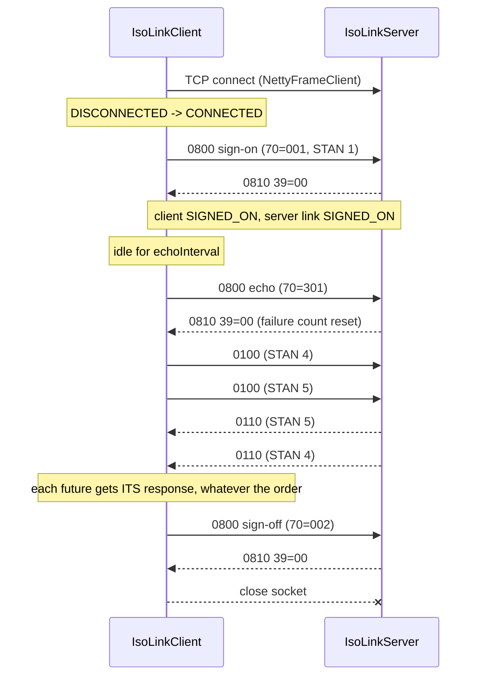
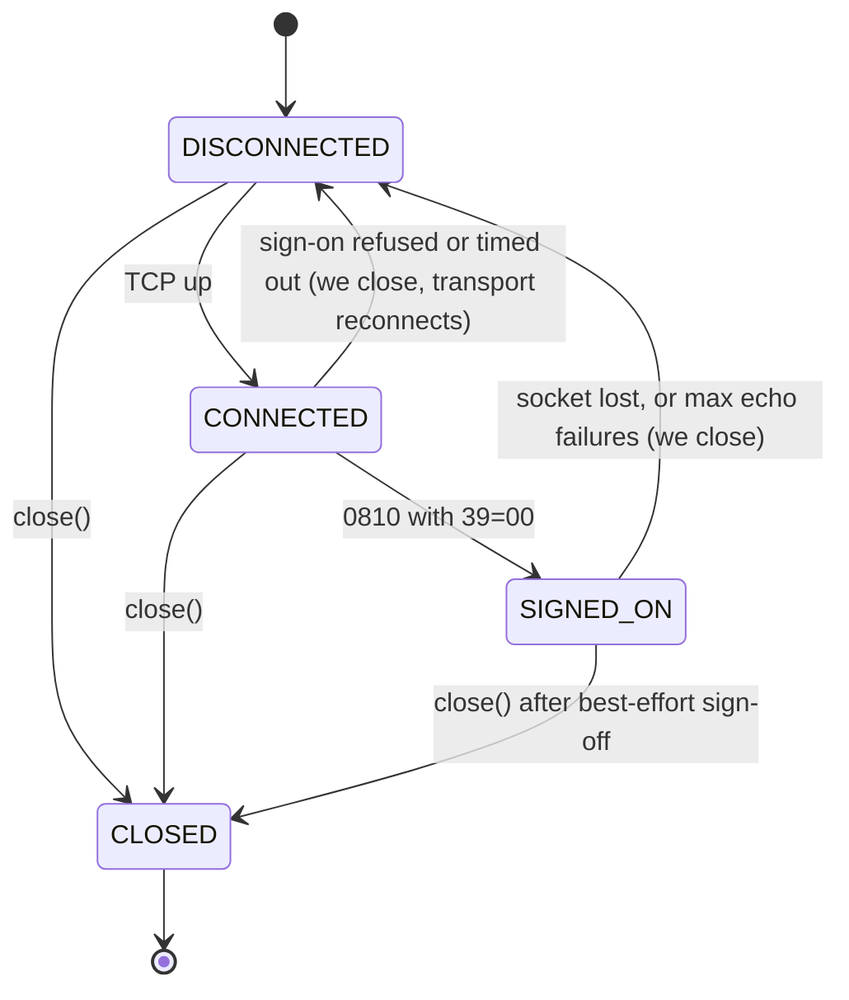

# Phase 1, step 9: the ISO 8583 link (sign-on, echo, matching)

Step 8 gave us a connection that carries `byte[]` frames, reconnects by itself and reports silence. It knows nothing about card messages. Step 7 and before gave us `IsoMessage`, a packer and a printer. They know nothing about sockets. This step is where the two meet: the new module **`iso8583-link`** turns "a TCP connection that carries frames" into "an ISO 8583 **link**": something that is signed on, kept alive, and able to carry many requests at once and give every caller the response that belongs to *its* request.

New code (module `iso8583-link`, package `dev.paysim.link`): `MatchKey`, `PendingRequests`, `LinkState`, `LinkListener`, `IsoRequestHandler`, `IsoLinkClient`, `IsoLinkServer`, `LinkNotReadyException`, `LinkDroppedException`, and the internal `LinkSupport`. Tests: `MatchKeyTest`, `PendingRequestsTest`, `IsoLinkIntegrationTest`. A demo (`LinkDemo`, run through `LinkDemoTest`) produced the captures below. No change to `common`, `iso8583-core` or `transport`.

## 1. Where this sits

```
 Terminal ──> Acquirer ──> Switch ──> Issuer          services (Phases 2-6)
                 \            |          /
                  \           |         /      every service uses the libraries below
   +----------------------------------------------------------------+
   | [*** iso8583-link  sign-on, echo, matching     (step 9) ***]    |
   |  iso8583-core   spec, codecs, bitmap, packer   (steps 1-7)      |
   |  transport      TCP framing, Netty             (Phase 0, step 8)|
   |  common         Hex, Pan, Stan, Money                           |
   +----------------------------------------------------------------+
```

`iso8583-link` is the only library that depends on both `iso8583-core` and `transport`. Everything above it can say "send this `IsoMessage` and give me the response" and never think about frames, sign-on or echo again.

| Later work | Uses | For what |
| --- | --- | --- |
| Phase 2 (issuer) | `IsoLinkServer` + an `IsoRequestHandler` | The issuer is a link server whose handler is the authorization logic (card lookup, balance check, response code). Spring starts it and configures the port. |
| Phase 3 (switch) | `IsoLinkServer` towards acquirers, `IsoLinkClient`s towards issuers | The switch receives a 0100 on one link, forwards it on another and relays the answer. A `TimeoutException` or `LinkDroppedException` from `request` is what triggers a reversal. |
| Phase 3 (acquirer) | `IsoLinkClient` | The acquirer keeps links to the switch; `request()` is its way to ask for an authorization. |
| Phase 4 (terminal sim) | `IsoLinkClient` | The simulated terminal talks to the acquirer through the same client class. |
| Phase 7 (observability) | `LinkListener` | State changes, unmatched responses and unparseable frames become metrics. |

## 2. The domain concept

### 2.1 A link has a life cycle, not just a socket

On a web API, "connected" means you can send a request. On a card network link it does not. Between an acquirer and a network (or a network and an issuer) the two ends agree on a small set of **network management** messages, class `08xx` (we use MTI 0800 for the request and 0810 for the response, with field 70 saying which kind):

| Field 70 | Name | Meaning |
| --- | --- | --- |
| `001` | Sign-on | "I am here and ready. Start accepting my traffic." |
| `002` | Sign-off | "I am leaving in an orderly way. Stop sending me traffic." |
| `301` | Echo test | "Are you alive?" |

These three are the classic scheme and are what this project implements. Real networks add more, and the details are network-specific: some use a **key exchange** (code `161` in several schemes) to rotate the keys that protect PINs and MACs, and a **cutover** (code `201`) around the end-of-day settlement boundary. Treat the list as "common examples", not as a standard to quote; every network's interface specification says which codes it uses and what happens on each. We will meet key exchange again in Phase 6 (HSM).

Why sign on at all, when TCP already says "connected"? Because the receiving host often has to do something at that moment: attach the connection to a configured partner, check that the partner is allowed, reset sequence state, make sure only one live connection exists per partner, or tell its own operators that the partner is up. Until that happens it has no reason to believe the traffic is meant for it. So a business message that arrives on a connection that has not signed on is, to many hosts, an error. Some answer with a decline code, some drop the message, some drop the whole connection. Our simulator answers **39=91** ("issuer or switch inoperative") and logs it. That is a simulator choice, made because an answer is easier to learn from and to test than silence.

Sign-off exists so the far side can tell "partner left on purpose" from "partner crashed". The first is routine and needs no alarm; the second might need an operator or a reversal run.

### 2.2 Why echo tests exist when TCP is "connected"

Step 8 explained half-open connections and NAT timeouts: TCP only learns the peer is gone when a packet fails to get through, and a quiet link sends no packets. The network-management answer is the **echo test**: after some silence, send 0800/301; if 0810 comes back, the path and the far-side *application* are alive.

The second half matters. A TCP-level keep-alive only proves the far side's operating system answers. A host process that is hung (deadlocked, out of memory, stuck in a long garbage-collection pause) keeps its socket open and its kernel happily acknowledges bytes. Only an application-level echo, which the application has to read and answer, proves the application is running. That is why we send a 0800, not a TCP probe, and why `IsoLinkServer` has a test hook `answerEchoes(false)`: it simulates exactly this "socket alive, process dead" case.

The policy in this step: after `echoInterval` of silence (in either direction) the client sends an echo. A missing or non-`00` answer counts as a failure; `maxEchoFailures` failures in a row (default 2) drop the link. Dropping it makes `NettyFrameClient` reconnect with backoff (step 8), and the sign-on runs again. One lost echo does not kill a link (packets get lost); two in a row do.

### 2.3 Many requests on one link: matching

Step 8 said a link carries hundreds of requests in flight and replies come back in any order. The question we postponed: how does the sender know which reply belongs to which request?

ISO 8583 has no "correlation id" field. By convention the responder **echoes** certain fields from the request, and the requester matches on them. The usual suspects:

- **Field 11, STAN** (system trace audit number): a six-digit number the sender increments for each message. It is *unique per sender*, not unique across the network, and it wraps after 999999.
- **Field 7, transmission date and time**: when the sender sent it.
- **Field 32, acquiring institution ID** and **field 41, terminal ID**: who is asking.
- **Field 37, RRN** is also common, but it is a business identifier, not a link-level one, so we leave it out here.

Our `MatchKey` is `(message class, 11, 7, 32, 41)`. The message class keeps a 0810 from matching a 0100 that happens to carry the same STAN. A missing field becomes `""`, so network-management messages (which carry no 32 or 41) match on class, STAN and time.

**Why STAN uniqueness per sender matters.** The key only works if no two requests in flight share it. Two things must therefore be true on the sending side: one counter per sender (`IsoLinkClient.stan()` exposes the link's counter so application requests and the link's own sign-on and echo messages draw from the same source), and the counter must not wrap onto a request that is still outstanding. With a 6-digit STAN and, say, 1,000 messages a second, it wraps every 16 minutes; a 10-second timeout is far below that, so wrap-around collisions need a request stuck for a quarter of an hour. `PendingRequests.register` still refuses a duplicate key in flight (`IllegalStateException`, "duplicate STAN in flight"), because silently overwriting an entry would hand one caller another caller's response.

### 2.4 What a timeout does and does not tell you

If no response arrives in time, the sender knows exactly one thing: it did not receive a response. It does *not* know whether the issuer saw the request, approved it, declined it, or never got it. The authorization may have been given and the cardholder's available balance reduced, while the terminal prints "declined".

So a timeout is not a decline. It is an **unknown outcome**, and the only safe follow-up is a reversal (a 04xx message, Phase 3) so that an approval the customer never saw does not hold their money. For the link library this means two things: `PendingRequests` removes the entry on timeout (the caller is told "unknown" now, and memory does not grow), and a response that arrives afterwards is **not** silently dropped; it is reported to `LinkListener.onUnmatchedResponse`, because it tells the operator the issuer *did* answer, just too late.

A typical failure pattern (illustrative, not a report of a specific incident): a switch matches responses by STAN alone. An issuer slows down; a request times out, the switch sends a reversal and moves on. Minutes later, with the STAN counter wrapped or the issuer restarted and re-numbering, a late response for the old request arrives carrying the same six digits as a *new, unrelated* request in flight. The switch matches it and completes the wrong transaction: one customer is told "approved" on another customer's response. Matching on message class, time, institution and terminal as well makes this collision much less likely, but it does not remove the underlying rule: an answer that matches nothing should be counted and looked at, not forced onto the nearest request.

## 3. A real session, captured from running code

All output below was produced by `LinkDemo`, which starts an `IsoLinkServer` and an `IsoLinkClient` on localhost with FINE logging on (section 5 shows how to rerun it). Timestamps are milliseconds since the demo started; your numbers will differ. Field 2 is masked by `IsoPrinter` (first 6, last 4); the library never logs hex of a live message. The demo's echo interval is 400 ms so that the idle echoes fit into a short run.

### 3.1 The sign-on frame, byte by byte

Built by the demo with a fixed clock (2026-03-14 10:15:42 UTC), STAN 1, field 70 = `001`:

```
payload: 55 bytes, header: 0037
0000  30 38 30 30 38 32 32 30  30 30 30 30 30 30 30 30  0800822000000000
0010  30 30 30 30 30 34 30 30  30 30 30 30 30 30 30 30  0000040000000000
0020  30 30 30 30 30 33 31 34  31 30 31 35 34 32 30 30  0000031410154200
0030  30 30 30 31 30 30 31                              0001001
```

On the wire (`BINARY_2` header): `0037` followed by those 55 bytes, 57 bytes in all. With `ASCII_4` the header would be the four characters `0055`, hex `30303535`. Reading the payload as text:

```
0800                MTI: network management request, from the acquirer side
8220000000000000    primary bitmap: fields 1 (secondary present), 7, 11
0400000000000000    secondary bitmap: field 70
0314101542          field 7:  03-14 10:15:42  (MMDDhhmmss, UTC)
000001              field 11: STAN 1
001                 field 70: network management code, sign-on
```

This is the same 55-byte shape as the Phase 0 echo test in step 8: only the code in field 70 and the STAN differ.

### 3.2 The session, as logged

Each message is logged four times (client sends, server receives, server sends, client receives). Below, the message body is shown once and the timestamps of its four log lines are listed; bodies are copied unchanged from the run.

```
  338 ms  state   DISCONNECTED -> CONNECTED               (client: TCP is up)

  356 ms  client  send  \
  397 ms  server  recv   } MTI 0800  NETWORK MANAGEMENT REQUEST from ACQUIRER
                         } BITMAP 8220000000000000 0400000000000000
                         } [007] Transmission date and time ........... "1101153109"
                         } [011] System trace audit number ............ "000001"
                         } [070] Network management information code .. "001"
  403 ms  server  send  \
  404 ms  client  recv   } MTI 0810  NETWORK MANAGEMENT REQUEST RESPONSE from ACQUIRER
                         } BITMAP 8220000002000000 0400000000000000
                         } [007] ... "1101153109"
                         } [011] ... "000001"
                         } [039] Response code ........................ "00"
                         } [070] ... "001"
  409 ms  state   CONNECTED -> SIGNED_ON                  (client: the 00 answer arrived)
```

The client has been quiet for about 400 ms, so the transport reports idle and the client sends an echo (STAN 2). Same shapes, field 70 = `301`:

```
  790 ms  client  send  0800 ... [011] "000002"  [070] "301"
  791 ms  server  recv  0800 ... [011] "000002"  [070] "301"
  791 ms  server  send  0810 ... [011] "000002"  [039] "00"  [070] "301"
  792 ms  client  recv  0810 ... [011] "000002"  [039] "00"  [070] "301"
 1191 ms  client  send  0800 ... [011] "000003"  [070] "301"     (a second echo, 400 ms later)
 1193 ms  client  recv  0810 ... [011] "000003"  [039] "00"  [070] "301"
```

Then the application's request (STAN 4, drawn from the same counter), and its response:

```
 1315 ms  client  send  \
 1316 ms  server  recv   } MTI 0100  AUTHORIZATION REQUEST from ACQUIRER
                         } BITMAP 7220000100808000
                         } [002] Primary account number ............... 411111******1111
                         } [003] Processing code ...................... "000000"
                         } [004] Amount, transaction .................. "000000002599"
                         } [007] Transmission date and time ........... "1101153109"
                         } [011] System trace audit number ............ "000004"
                         } [032] Acquiring institution ID ............. "123456"
                         } [041] Card acceptor terminal ID ............ "TERM0001"
                         } [049] Currency code, transaction ........... "840"
 1318 ms  server  send  \
 1319 ms  client  recv   } MTI 0110  AUTHORIZATION REQUEST RESPONSE from ACQUIRER
                         } BITMAP 7220000106808000
                         } (the same fields as the request, plus)
                         } [038] Authorization ID response ............ "A1B2C3"
                         } [039] Response code ........................ "00"
```

Compare the two bitmaps: `7220000100808000` and `7220000106808000` differ in one hex digit, because the response adds fields 38 and 39. And notice that the response carries the request's fields 2, 3, 4, 7, 11, 32, 41 and 49 back unchanged. That echo is what `responseBuilder()` does, and it is the whole reason `MatchKey` works.

Finally the client is closed. It signs off (STAN 5, field 70 = `002`), gets 0810/00, and closes the socket:

```
 1320 ms  client  send  0800 ... [011] "000005"  [070] "002"
 1321 ms  server  recv  0800 ... [011] "000005"  [070] "002"
 1321 ms  server  send  0810 ... [011] "000005"  [039] "00"  [070] "002"
 1322 ms  state   SIGNED_ON -> CLOSED
```

## 4. Design and flow

### 4.1 The session as a sequence



### 4.2 The client link's states



Requests are accepted only in `SIGNED_ON`. The server keeps a similar, simpler state per connection: `CONNECTED` after accept, `SIGNED_ON` after 0800/001, back to `CONNECTED` after 0800/002, and `DISCONNECTED` when the socket closes.

### 4.3 Who calls whom

```
 caller thread                client                         transport (step 8)
 -------------                ------                         ------------------
 request(0100) ------------>  SIGNED_ON? else LinkNotReady
                              PendingRequests.register(key, timeout)  --> future
                              pack, FrameConnection.send ----------------> bytes out

                                                   (serial queue of the connection, virtual thread)
                              onFrame <------------------------------------ bytes in
                              unpack
                                0810 / 0110 -> PendingRequests.complete -> caller's future completes
                                08xx request -> answer 0810/00 inline
                                other request -> own virtual thread -> IsoRequestHandler -> send response
```

### 4.4 The deadlock this design avoids

Step 8 made a promise: callbacks run on a per-connection **serial** queue, one at a time, so blocking in a callback is allowed and delays only that connection's later frames. Read that sentence again with sign-on in mind. The natural code is:

```
onConnected(connection):
    send 0800 sign-on
    response = waitForResponse()        // blocks this callback
    if response is 00: state = SIGNED_ON
```

The response is a *frame*. Frames of this connection are delivered by the same serial queue. That queue is currently executing `onConnected`, which is waiting for the response, which is sitting behind `onConnected` in the queue. Nothing can make progress until the wait times out. Result: every sign-on takes the full timeout and then fails, even with a perfectly healthy peer. The same trap exists for echo tests (waiting inside `onIdle`) and for a request handler that calls back over the same link.

The fix used throughout this module: **callbacks start an exchange and attach a continuation; they never wait for it.**

- Sign-on: `onConnected` registers the request in `PendingRequests` (getting a `CompletableFuture`), sends the frame, attaches `whenComplete(...)` and *returns*. The queue is free. The answer arrives as the next frame, is matched, and completes the future, and the continuation moves the state to `SIGNED_ON` (or closes the connection on a refusal or a timeout).
- Echo: the same pattern, started from `onIdle`.
- Requests the far side sends us: run on their own virtual thread (`IsoRequestHandler` may block). This is also what makes concurrency real: if the server handler ran on the serial queue, 100 requests with sleeping handlers would be answered strictly in order, one at a time, and the echo test would wait behind them.
- The one place that does wait is `IsoLinkClient.close()` (the best-effort sign-off, at most one second). It runs on the *caller's* thread, not inside a callback, so the answer can be delivered. The Javadoc says: do not call `close()` from a callback.

If this were wrong, every sign-on in the suite would sit out the sign-on timeout (5 s by default) before failing, and no test could reach `SIGNED_ON`; the whole suite runs in about five seconds.

### 4.5 Decisions and why

| Decision | Why |
| --- | --- |
| `MatchKey` = class + 11 + 7 + 32 + 41 | STAN alone collides across wrap-around and across senders; these are the fields a responder echoes (`responseBuilder()` copies them). Missing fields count as `""` so sign-on and echo, which have no 32 or 41, still match. |
| `request()` fails fast with `LinkNotReadyException` unless `SIGNED_ON` | Same argument as `send` in step 8: no hidden queue. A message queued for 20 seconds and sent when the link returns has already been timed out and reversed upstream. |
| Timeout completes with `TimeoutException` and removes the entry; late response goes to `onUnmatchedResponse` | The caller must learn "unknown outcome" at a bounded time. The late answer is information (the issuer did answer), so it is counted, not hidden. |
| A link drop fails pending requests with `LinkDroppedException`, not `LinkNotReadyException` | Different meaning: "not ready" means nothing was sent; "dropped" means it may have been sent and the outcome is unknown (a reversal candidate). Callers can tell them apart by type. |
| Echo failures drop the link | A link that cannot prove it is alive is worse than a reconnect: the reconnect is cheap (step 8) and re-runs sign-on, which resets the far side's view of us. |
| Echo is sent on reader idle or writer idle, but only one at a time | Both idle events fire on a quiet link; without the in-flight guard each interval would send two echoes. |
| Business request before sign-on gets 39=91 | Simulator choice; an explicit answer is easier to test and learn from than a drop. The Javadoc records that real hosts differ. |
| Handler exception gives 39=96 (system malfunction) and logs only the exception class | The caller always gets an answer rather than a timeout, and an exception message can contain card data. |
| Handler returning `null` sends nothing | Lets a handler model an issuer that "never answers", which is how Phase 3 tests timeouts and reversals. |
| Sign-off is best effort (1 s) | `close()` must not hang on a dead peer; a missed sign-off just looks like a dropped socket to the far side. |
| `PendingRequests` completes timeouts on a fresh virtual thread | A caller's `thenApply` chain must never run on, or block, the shared timer thread. |
| Logging only through `IsoPrinter`, at FINE, via suppliers | Masked output, and the ~10 microsecond formatting cost is only paid when FINE is on. Unparseable frames log size and reason only, never bytes. |

## 5. Try it yourself

Run the new tests:

```
./mvnw -q -pl iso8583-link -am test
./mvnw -q -pl iso8583-link -am test -Dtest=PendingRequestsTest -Dsurefire.failIfNoSpecifiedTests=false
./mvnw -q -pl iso8583-link -am test -Dtest=IsoLinkIntegrationTest -Dsurefire.failIfNoSpecifiedTests=false
```

Print a whole session like the one in section 3 (the demo test is off unless you pass the property):

```
./mvnw -q -pl iso8583-link -am test -Dtest=LinkDemoTest -Dlink.demo=true -Dsurefire.failIfNoSpecifiedTests=false
```

A jshell-style snippet (put `iso8583-link` and its dependencies on the classpath, for example from an IDE scratch file or a test method):

```java
var spec = dev.paysim.iso8583.spec.Specs.PAYSIM_ASCII_87;
var header = dev.paysim.transport.LengthHeader.BINARY_2;
IsoRequestHandler approve = req -> req.responseBuilder()
        .authorizationCode("A1B2C3").responseCode(dev.paysim.iso8583.ResponseCode.APPROVED).build();

try (var server = IsoLinkServer.builder(header, spec, approve).build()) {
    server.start();
    try (var client = IsoLinkClient.builder("localhost", server.port(), header, spec).build().start()) {
        client.awaitState(LinkState.SIGNED_ON, java.time.Duration.ofSeconds(5));
        var request = dev.paysim.iso8583.IsoMessage.builder(spec, dev.paysim.iso8583.Mti.AUTH_REQUEST)
                .pan("4111111111111111").processingCode("000000")
                .amount(dev.paysim.common.Money.of(2599, "USD"))
                .transmissionDateTime(java.time.Clock.systemUTC())
                .stan(client.stan().next()).build();
        System.out.println(client.request(request).get().responseCode());   // Optional[APPROVED]
    }
}
```

Predict, then try (no answers given):

1. In `unansweredEchoesDropTheLinkAndItSignsOnAgain` the client uses `echoInterval(100 ms)`, `echoTimeout(100 ms)` and `maxEchoFailures(2)`. Roughly how long after `answerEchoes(false)` is the link dropped? Change `maxEchoFailures` to 1 and to 5 and measure with timestamps in the `Events` listener. Which two settings dominate the time, and which one would you lower to detect a dead peer faster without making a single lost packet fatal?
2. Temporarily change `MatchKey.of` to use only the STAN (`""` for the other three fields). Then write a test that sends two requests with the same STAN but different terminal IDs (41) at the same moment, once with the key as it is and once with your change. What does `register` do in each case? Now imagine the second request is from a different terminal at a different store: which version would you rather run against a real network, and what do you still need to guarantee about STANs?
3. In `IsoLinkServer.business`, replace `handlerExecutor.execute(...)` by running the handler directly on the connection's callback. Rerun `hundredConcurrentRequestsEachGetTheirOwnResponse`. How long does it take now, is the completion order still scrambled, and what happens to an echo test that arrives while a handler sleeps? Which step-8 sentence about the serial queue explains it?

## Key terms

- **Link**: a long-lived connection between two ISO 8583 parties that has a session life cycle (connected, signed on, signed off), not just a socket.
- **Network management message**: class `08xx`; 0800 requests and 0810 responses, with field 70 giving the purpose.
- **Sign-on (001) / sign-off (002)**: tell the far side "I am ready for traffic" or "I am leaving in an orderly way".
- **Echo test (301)**: an application-level "are you alive?" that proves the far-side process, not only its operating system, is running.
- **Key exchange / cutover (e.g. 161 / 201, network-specific)**: other network management codes some networks use to rotate keys or mark the settlement-day boundary. Not implemented here.
- **Half-open link**: one side is gone but never said so; only silence or a failed echo reveals it.
- **STAN (field 11)**: system trace audit number, six digits, unique per sender, wraps at 999999.
- **Multiplexing**: many requests in flight on one connection, answered in any order.
- **Match key**: the set of echoed fields used to pair a response with its request (here class, 11, 7, 32, 41).
- **In flight**: sent and not yet answered.
- **Late / unmatched response**: an answer that arrives after its request timed out, or that matches no request at all.
- **Unknown outcome**: what a timeout means; the request may have been processed. The reason reversals exist (Phase 3).
- **Fail fast**: report "not ready" immediately instead of queueing the request.
- **Serial queue deadlock**: waiting, inside a callback, for a message that only that same callback queue can deliver.
- **Continuation (`whenComplete`)**: code attached to a future that runs when it completes, so nobody has to block waiting for it.

Next step: Step 10: Phase 1 wrap-up — lesson, exercises and LinkedIn post (coming next)
